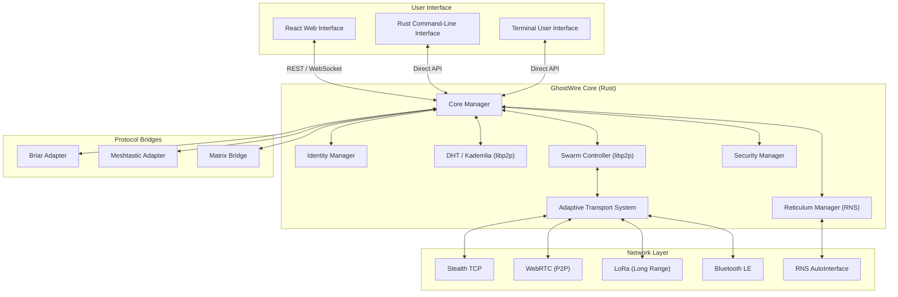

<div align="center">

### 🌐 **[Visit the GhostWire Website →](https://www.ghostwire.cc/)**


# GhostWire

**An open protocol for resilient peer-to-peer communication.**

[](ghostwire/CHANGELOG.md)
[](LICENSE)
[](COMMERCIAL_LICENSE.md)


[](docs/FIRST_PING.md)
[](https://codeberg.org/PHANTOMOJO/GhostWire-secure-mesh-communication)

</div>

---

## What Is GhostWire?

GhostWire is a **decentralized networking protocol** — not an app. It provides the cryptographic, routing, and transport layers that developers can build communication tools on top of.

The reference implementation is written in **Rust** and includes a working mesh node with encrypted messaging, hybrid (X25519 + ML-KEM-768) cryptography in code, and delay-tolerant networking. Post-quantum interoperability and formal audit are pending.

**Built for:** Disaster responders, rural communities, privacy advocates, researchers, and anyone who needs communication that works regardless of the odds.

---

## Protocol Stack

```
┌─────────────────────────────────────────────────────────────┐
│  APPLICATION:  Messaging │ Knowledge Ark │ Ghost Channels   │
├─────────────────────────────────────────────────────────────┤
│  API:          REST (Axum) │ WebSocket │ CLI │ TUI          │
├─────────────────────────────────────────────────────────────┤
│  SERVICES:     BlockStore │ Mailbox │ Social │ Sphinx       │
├─────────────────────────────────────────────────────────────┤
│  AI ROUTING:   LightGBM → Gemma 4 → GNN → PRoPHET          │
├─────────────────────────────────────────────────────────────┤
│  CRYPTO:       XChaCha20-Poly1305 │ X25519 │ ML-KEM-768     │
├─────────────────────────────────────────────────────────────┤
│  TRANSPORTS:   StealthTCP │ WebRTC │ BLE │ LoRa │ obfs4     │
│                │ Reticulum (RNS) │                          │
├─────────────────────────────────────────────────────────────┤
│  MESH:         libp2p GossipSub │ Kademlia DHT │ DTN        │
│                │ RNS AutoInterface │ RNS Announces           │
└─────────────────────────────────────────────────────────────┘
```

**Full specification:** [`docs/spec/PROTOCOL.md`](docs/spec/PROTOCOL.md)

---

## Key Capabilities

| Capability | Description |
|------------|-------------|
| **🛡️ Encrypted P2P** | XChaCha20-Poly1305 E2E encryption with X25519 key exchange and forward secrecy ratchet |
| **🌐 Serverless Mesh** | Pure P2P via libp2p — no central point of failure, no cloud dependency |
| **🤖 AI Routing** | 4-layer ML stack (LightGBM → Gemma 4 → GNN → PRoPHET) for optimal path selection |
| **📡 Delay-Tolerant** | PRoPHET epidemic routing — messages survive network partitions via store-carry-forward |
| **🔒 Post-Quantum** | ML-KEM-768 (Kyber-768) hybrid key exchange — defends against harvest-now-decrypt-later |
| **🎭 Anonymous Routing** | Sphinx onion routing (same protocol as Nym and Lightning Network) with SURBs |
| **📶 Multi-Transport** | TCP, WebRTC, Bluetooth LE, LoRa, QUIC — auto-failover based on conditions |
| **🛡️ Censorship Resistance** | 4 pluggable transport modes (WebSocket, Shadowsocks, TLS, obfs4) with traffic armor |
| **🚨 Coercion Resistance** | Duress PIN, panic wipe, dead man's switch — protection against physical coercion |
| **🧠 Web of Trust** | TOFU key pinning with signed attestations and computed trust scores |
| **📚 Knowledge Ark** | Decentralized knowledge commons — share code, docs, datasets across the mesh |
| **🔗 Protocol Bridges** | Adapter framework exists for Matrix, Meshtastic, Briar, Reticulum — Briar bridge uses demo keys; not production-tested |

---

## Quick Start

### Build & Run

```bash
git clone https://codeberg.org/PHANTOMOJO/GhostWire-secure-mesh-communication.git
cd GhostWire-secure-mesh-communication/ghostwire
cargo run --release
```

The node starts on `http://127.0.0.1:8080`. Mesh networking activates with `--mesh-port`.

### Interactive TUI

```bash
cargo run --release -- tui
```

Terminal interface with dashboard, peer list, message history, and compose — all in one screen.

| Key | Action |
|-----|--------|
| `Tab` | Switch tabs |
| `i` | Compose message |
| `q` | Quit |

**Full installation guide:** [docs/INSTALL.md](docs/INSTALL.md)

---

## Build on GhostWire

GhostWire is a **protocol**, not just an application. You can build on it in three ways:

### 1. Use the Rust Library

```toml
[dependencies]
ghostwire = { git = "https://codeberg.org/PHANTOMOJO/GhostWire-secure-mesh-communication.git" }
```

### 2. Use the REST API

Start a GhostWire node, then interact via HTTP/WebSocket from any language.

### 3. Implement the Protocol

Follow the specifications in [`docs/spec/`](docs/spec/) to build your own implementation in any language.

**Developer guide:** [docs/build/OVERVIEW.md](docs/build/OVERVIEW.md)

---

## Published Crates

| Crate | Description | Status |
|-------|-------------|--------|
| [**sphinx-rs**](ghostwire-libs/crates/sphinx-rs/) | Sphinx onion routing with SURBs | ✅ Published — crates.io |
| [**gw-reliability**](gw-reliability/) | Ack tracking, retry queues, TTL-based delivery | ✅ Standalone crate — cargo test passes |
| [**gw-routing**](gw-routing/) | Peer table, peer health, Skademlia DHT | ✅ Standalone crate — cargo test passes |
| gw-pipe | Mesh transport: TCP/Noise/Yamux + libp2p protocols | 📄 Source in newest/ — not yet standalone crate |
| gw-vault | Cryptographic key storage and management | 📄 Source in newest/ — not yet standalone crate |
| gw-identity | Typed crypto identities and username resolution | 📄 Source in newest/ — not yet standalone crate |
| gw-trust | Reputation scoring and certificate revocation | 📄 Source in newest/ — not yet standalone crate |
| gw-discovery | Peer discovery via mDNS, DHT, and bootstrap nodes | 📄 Source in newest/ — not yet standalone crate |
| gw-quic | QUIC transport layer | 📄 Source in newest/ — not yet standalone crate |
| gw-msg | Message framing, wire protocol, DTN bundles | 📄 Source in newest/ — not yet standalone crate |
| ghostwire-dtn | Delay-tolerant networking (PRoPHET) | 🔄 In progress |
| hlc-rs | Hybrid Logical Clocks | 🔄 In progress |
| trust-store | Web of Trust + TOFU key management | 🔄 In progress |

---

## 🆚 GhostWire vs Other Protocols

| Feature | GhostWire | libp2p | Matrix | Nostr | I2P |
|---------|:---------:|:------:|:------:|:-----:|:---:|
| **P2P mesh networking** | ✅ | ✅ | ❌ | ❌ | ✅ |
| **Built-in encryption** | ✅ | ✅ | ✅ | ✅ | ✅ |
| **Anonymous routing** | ✅ | ❌ | ❌ | ❌ | ✅ |
| **Delay-tolerant networking** | ✅ | ❌ | ❌ | ❌ | ❌ |
| **AI-powered routing** | ✅ | ❌ | ❌ | ❌ | ❌ |
| **Post-quantum crypto** | ✅ | ❌ | ❌ | ❌ | ❌ |
| **Multi-transport** | ✅ | ✅ | ❌ | ❌ | ✅ |
| **Censorship resistance** | ✅ | ❌ | ❌ | ❌ | ✅ |
| **Coercion resistance** | ✅ | ❌ | ❌ | ❌ | ❌ |

GhostWire is most similar to **libp2p** (modular P2P stack) and **I2P** (anonymous network layer), with unique additions in AI routing, delay-tolerant networking, and post-quantum cryptography.

---

## 🏗️ Architecture



**Deep dive:** [docs/ARCHITECTURE.md](docs/ARCHITECTURE.md)

---

## 📚 Documentation

| Guide | Description |
|-------|-------------|
| **[📋 Protocol Spec](docs/spec/PROTOCOL.md)** | Formal protocol specification (like NIPs / Matrix Spec) |
| **[🏗️ Architecture](docs/ARCHITECTURE.md)** | System internals and design decisions |
| **[🛠️ Installation](docs/INSTALL.md)** | Detailed setup for various platforms |
| **[🔒 Security](docs/SECURITY.md)** | Security model and vulnerability disclosure |
| **[📡 First Ping](docs/FIRST_PING.md)** | First cross-machine mesh communication record |
| **[🤖 AI Integration](ghostwire/GEMMA4_INTEGRATION.md)** | Gemma 4 and AI routing setup |
| **[🔧 Build Instructions](ghostwire/BUILD_INSTRUCTIONS.md)** | Compilation and development guide |
| **[🏗️ Build on GhostWire](docs/build/OVERVIEW.md)** | How to build applications on the protocol |
| **[📜 Governance](docs/GOVERNANCE.md)** | Protocol evolution process (GIPs) |
| **[📋 Wiki](https://codeberg.org/PHANTOMOJO/GhostWire-secure-mesh-communication/wiki)** | Full project knowledge base |

---

## 🏆 Competition

<details>
<summary>GCD4F 2026 Submission</summary>

GhostWire is submitted to the **Global Competition on Design for Futures (GCD4F) 2026**, organized by Beijing Normal University and UNESCO IITE.

| Detail | Information |
|--------|-------------|
| **Track** | Higher Education — AI for Society |
| **Team** | Team GhostWire |
| **Institution** | Open University of Kenya |
| **Theme** | AI for Society |
| **SDG Alignment** | SDG 9 (Infrastructure), SDG 11 (Communities), SDG 17 (Partnerships) |
| **Submission** | 2026 | Track: Higher Education — AI for Society |

</details>

---

## 🤝 Contributing

We welcome contributors across all layers of the protocol:

### Get Started
1. **Fork** the repository
2. **Create** a feature branch (`git checkout -b feature/amazing-feature`)
3. **Make** your changes
4. **Test** thoroughly
5. **Submit** a pull request

### Ways to Contribute
- 🦀 **Rust** — libp2p networking, transport layers, crypto, AI routing
- 🐍 **Python** — ML model training, data pipelines, GNN optimization
- 🌐 **TypeScript/React** — Web UI, dashboard, visualization
- 📖 **Documentation** — Protocol specs, guides, translations
- 🧪 **Testing** — Write tests, report issues, penetration testing
- 🔒 **Security** — Cryptographic analysis, threat modeling, audits
- 🌉 **Bridges** — Matrix, Meshtastic, Briar, Reticulum adapters

**Guidelines:** [CONTRIBUTING.md](CONTRIBUTING.md) | [Code of Conduct](CODE_OF_CONDUCT.md)

---

## Citation

If referencing GhostWire in academic work:

> Muriithi, M.I. (2026). GhostWire: An Open Protocol for Resilient Peer-to-Peer Communication. https://codeberg.org/PHANTOMOJO/GhostWire-secure-mesh-communication

Milestone reference: First verified cross-machine mesh communication — April 5, 2026 (v0.2.0).

---

## 📜 Licensing

**GhostWire is dual-licensed:**

| License | Use Case | Cost |
|---------|----------|------|
| **🆓 AGPL-3.0-or-later** | Personal, Research, Education, Open Source | Free |
| **🏢 Commercial License** | Proprietary Products, SaaS, Closed-Source | Contact for pricing |

**Library crates** (sphinx-rs, ghostwire-dtn, etc.) are licensed under **MIT + Apache-2.0** for permissive use.

### Which License Do I Need?

| Your Use Case | License |
|---------------|---------|
| Personal projects | ✅ AGPL-3.0 (free) |
| University research | ✅ AGPL-3.0 (free) |
| Open source projects | ✅ AGPL-3.0 (free) |
| Using library crates | ✅ MIT + Apache-2.0 (free) |
| Proprietary products | 🏢 Commercial |
| SaaS without source disclosure | 🏢 Commercial |

**Commercial inquiries:** licensing@ghostwire.cc

**Full terms:** [LICENSE](LICENSE) | [COMMERCIAL_LICENSE.md](COMMERCIAL_LICENSE.md) | [LICENSE_EXPLANATION.md](LICENSE_EXPLANATION.md)

---

## 👥 Team

**GhostWire** — Nairobi, Kenya

| Name | Role |
|------|------|
| **Michael Irungu Muriithi** | Protocol architecture, cryptography, implementation |

---

## 📞 Community & Support

### Get Help
- 📖 **Documentation:** [docs/](docs/)
- 💬 **Discussions:** [Codeberg Discussions](https://codeberg.org/PHANTOMOJO/GhostWire-secure-mesh-communication/discussions)
- 🐛 **Bug Reports:** [Codeberg Issues](https://codeberg.org/PHANTOMOJO/GhostWire-secure-mesh-communication/issues)
- 📧 **Contact:** contact@ghostwire.cc

### Stay Updated
- ⭐ **Star this repo** to get release notifications
- 🔔 **Watch** for major updates

### Security
- 🔒 **Security documentation:** [ghostwire/SECURITY.md](ghostwire/SECURITY.md) — authoritative for the protocol crate, supported pre-1.0 releases, and private-reporting process
- 🚨 **Report a vulnerability privately first:** use [GitHub private vulnerability reporting](https://github.com/Phantomojo/GhostWire-secure-mesh-communication/security/advisories) or security@ghostwire.cc, including description, reproduction, impact, version, and a PoC when available.
- ⚠️ **Important:** GhostWire is pre-1.0, has had no external security review, and every security claim is design intent. The supported-version line is the current rescue lineage only. Do not use it for production security decisions without your own review.

This README keeps that same posture plainly, because hidden optimistic language makes public claims weaker.

---

## 🏆 Roadmap

### ✅ Completed
- [x] **P2P mesh networking** — libp2p GossipSub + Kademlia DHT
- [x] **End-to-end encryption** — XChaCha20-Poly1305 with X25519
- [x] **Forward secrecy** — Symmetric ratchet
- [x] **AI routing** — LightGBM + PRoPHET fallback (4-layer system)
- [x] **Terminal UI** — Ratatui dashboard
- [x] **Web API** — Axum HTTP server
- [x] **Anomaly detection** — Isolation Forest
- [x] **Shamir recovery** — Secret sharing for key recovery
- [x] **First cross-machine ping** — April 5, 2026
- [x] **Protocol specifications** — Formal specs in docs/spec/
- [x] **Sphinx onion routing** — Published as sphinx-rs crate
- [x] **gw-* crate ports** — reliability + routing as standalone crates; pipe, vault, identity, trust, discovery, quic, msg ported to source (September 2026)
- [x] **Mailbox fail-closed boot** — Removed published-passphrase fallback, mailbox now expects encryption keys at startup
- [x] **Codeberg migration** — Public repo moved from GitHub to Codeberg (nonprofit, no AI training)

### 🔄 In Progress
- [ ] Full Double Ratchet with DH steps
- [ ] GNN routing optimization (target: 85%+ accuracy)
- [ ] Mobile clients (Tauri Android/iOS)
- [ ] Reticulum (RNS) transport integration — core bridge complete, RNS initialized (post-2026-10-26), hybrid symbiosis in progress, does not carry traffic yet

### 📋 Planned
- [ ] Voice over mesh (VoIP)
- [ ] LoRa transport (production hardening)
- [ ] Protocol adapters (Matrix, Meshtastic, Briar)
- [ ] Knowledge Ark — offline content serving
- [ ] Zero-knowledge proofs
- [ ] Third-party security audit

---

<div align="center">

### 🌟 Built for connection. Designed for resilience.

**GhostWire** — An open protocol for resilient peer-to-peer communication.


**📍 Nairobi, Kenya** | **🌐 [Website](https://www.ghostwire.cc/)** | **📧 contact@ghostwire.cc**

---

**Licensed under** [AGPL-3.0-or-later](LICENSE) **or** [Commercial License](COMMERCIAL_LICENSE.md)

</div>
