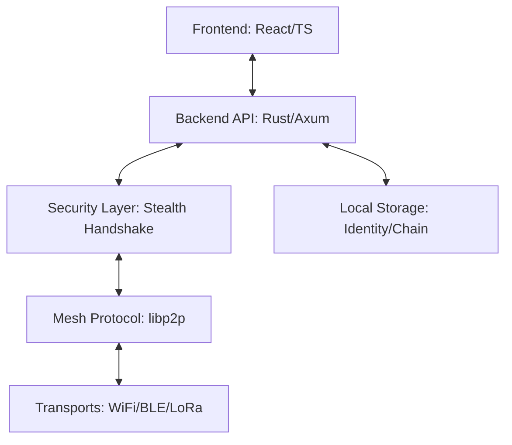

<!-- SPDX-License-Identifier: AGPL-3.0-or-later -->
# 🚀 **GhostWire** - Secure Mesh Networking & Communication


[](LICENSE)
[](https://github.com/Phantomojo/GhostWire-secure-mesh-communication/stargazers)


**GhostWire** is a high-performance, decentralized communication platform built for resilience in adverse environments. It combines high-speed peer-to-peer mesh networking with a tactical interface designed for coordination and secure information sharing when traditional infrastructure fails.

---

## ⚡ **Key Pillars**

### **🛡️ Security-First Architecture**
- **Stealth Transport**: Custom TCP handshake layer that appears as generic traffic to unauthorized scanners.
- **End-to-End Encryption**: All messages are encrypted by default; metadata is minimized.
- **Disposable Identities**: Support for multiple ephemeral profiles with cryptographic key separation.

### **🔍 Decentralized Resilience**
- **Heterogeneous Mesh**: Support for WiFi Direct, BLE, and LoRa (via Tiered Hardware adapters).
- **libp2p P2P Stack**: Utilizing Gossipsub for efficient message propagation and Kademlia DHT for peer discovery.
- **One-Click Scaling**: Spin up node swarms for testing or deployment using optimized shell controllers.

### **🛰️ Tactical HUD Interface**
- **Real-time Monitoring**: Glowing status indicators for CPU, RAM, and Security posture.
- **Network Radar**: Dynamic, interactive mesh topology visualization.
- **Modern Messaging**: Split-view, high-density communication interface optimized for coordination.

---

## 🏗️ **Technical Architecture**



### **Core Components**
- **Backend (Rust)**: High-performance core handling encryption, state management, and the p2p stack.
- **Frontend (TypeScript)**: Responsive, tactical interface using modern React patterns and real-time WebSocket updates.
- **Mesh Layer**: Pluggable transport architecture supporting a variety of hardware interfaces.

---

## 🚀 **Getting Started**

### **One-Line Installation (Linux/macOS)**
```bash
git clone https://github.com/Phantomojo/GhostWire-secure-mesh-communication.git && cd GhostWire-secure-mesh-communication && ./scripts/install.sh
```

### **Manual Build**
1. **Backend**: `cd ghostwire && cargo build --release`
2. **Frontend**: `cd webui && npm install && npm run build`
3. **Launch**: `./scripts/ghostwire-manager.sh start`

---

## 👥 **Multi-Profile Support**

Maintain separate identities for different operational contexts. Launch with a specific profile:

```bash
./scripts/ghostwire-manager.sh start --profile delta_force
```
Each profile manages its own identity keypair and peer database in `~/.ghostwire/`.

---

## 📚 **Documentation**

Comprehensive guides are located in the [docs/](docs/) directory:

- [🏗️ ARCHITECTURE.md](docs/ARCHITECTURE.md) - Deep dive into system internals.
- [🛠️ INSTALL.md](docs/INSTALL.md) - Detailed setup for various platforms.
- [🔒 SECURITY.md](docs/SECURITY.md) - Disclosure policy and security model overview.
- [🧪 TESTING_GUIDE.md](docs/TESTING_GUIDE.md) - How to run network and security simulations.

---

## 🏆 **Mission Roadmap**

- [x] **Phase 1: Foundation** - Rust core + libp2p basic integration.
- [x] **Phase 2: Tactical HUD** - Real-time UI overhaul (Node Cluster V2).
- [/] **Phase 3: Deep Resilience** - LoRa integration and Micro-Raiden state channels.
- [ ] **Phase 4: Knowledge Ark** - Offline content serving and ZK-privacy layers.

---

## 📞 **Community & Contribution**

- **Issues**: [Bug reports and feature requests](https://github.com/Phantomojo/GhostWire-secure-mesh-communication/issues)
- **License**: Licensed under the [AGPL-3.0-or-later](LICENSE).

---

<div align="center">
    <b>Built for connection. Designed for resilience.</b><br>
    <i>Connecting the disconnected, regardless of the odds.</i>
</div>
