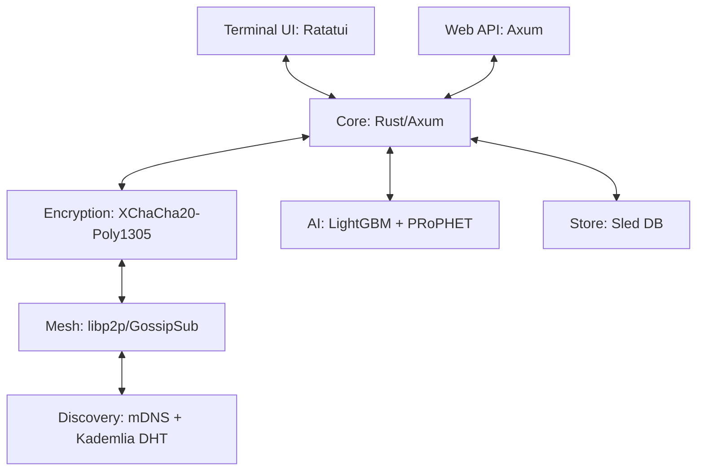

<!-- SPDX-License-Identifier: AGPL-3.0-or-later OR Commercial License -->

<div align="center">

### 🌐 **[Visit the GhostWire Website →](https://phantomojo.github.io/GhostWire-secure-mesh-communication/)**


# 🚀 GhostWire

**Decentralized encrypted mesh networking. Run it on any machine — no servers, no cloud, no middlemen.**

[](ghostwire/CHANGELOG.md)
[](LICENSE)
[](COMMERCIAL_LICENSE.md)


[](docs/FIRST_PING.md)
[](https://github.com/Phantomojo/GhostWire-secure-mesh-communication/stargazers)

**GCD4F 2026 Submission** | [Learn More →](#-competition)

</div>

---

## 🌍 The Problem

**2.6 billion people lack reliable internet access.** When disasters strike, infrastructure fails, or communities are remote, traditional communication breaks down—precisely when coordination is most critical.

Existing solutions require centralized infrastructure, sacrifice privacy, or lack the resilience needed for adverse environments.

## 💡 The Solution

**GhostWire** is a peer-to-peer encrypted mesh communication platform that operates without servers. It uses AI-powered routing to learn from network experience, post-quantum cryptography for future-proof security, and multiple transports (WiFi, Bluetooth, LoRa) to maintain communication when traditional infrastructure fails.

**Built for:** Disaster responders, rural communities, privacy advocates, researchers, and anyone who needs communication that works regardless of the odds.

---

## ⚡ Quick Start

### Build & Run
```bash
git clone https://github.com/Phantomojo/GhostWire-secure-mesh-communication.git
cd GhostWire-secure-mesh-communication/ghostwire
cargo run --release
```

The node starts on `http://127.0.0.1:8080`. Mesh networking activates with `--mesh-port`.

### Interactive TUI
```bash
cargo run --release -- tui
```

Terminal interface with dashboard, peer list, message history, and compose — all in one screen.

| Key | Action |
|-----|--------|
| `Tab` | Switch tabs |
| `i` | Compose message |
| `q` | Quit |

**Full installation guide:** [docs/INSTALL.md](docs/INSTALL.md)

---

## 🎯 First Ping

On **April 5, 2026 at 22:50:37.125669222 UTC**, GhostWire achieved its first
cross-machine communication. A message traveled from one computer to another
through the mesh network — no central server, no internet, just pure P2P.

| | |
|---|---|
| **Message** | `"FINAL TEST - should work now!"` |
| **From** | Node A (omen) → Node B (stratsytem) |
| **Protocol** | libp2p/gossipsub |
| **Latency** | ~18ms |
| **Record** | [docs/FIRST_PING.md](docs/FIRST_PING.md) |

This is GhostWire's equivalent of ARPANET's "LO" (October 29, 1969).

---

## 🎯 Key Features

### 🛡️ Security-First
- **End-to-End Encryption:** XChaCha20-Poly1305 with X25519 key exchange
- **Forward Secrecy:** Symmetric ratchet with chain key aliasing
- **Identity:** Ed25519 signing + X25519 encryption keypairs
- **Recovery:** Shamir Secret Sharing with encrypted shares
- **Threat Detection:** Isolation Forest anomaly scoring

### 🔗 Decentralized Mesh
- **Serverless Architecture:** Pure P2P via libp2p — no central point of failure
- **GossipSub + Kademlia:** Efficient message propagation and peer discovery
- **AI-Powered Routing:** 4-layer system (LightGBM → Gemma 4 → GNN → PRoPHET)
- **Delay-Tolerant Networking:** PRoPHET protocol for store-and-forward delivery
- **Stealth TCP Transport:** Obfuscated handshakes and traffic patterns

### 📊 Real-time Monitoring
- **Terminal UI:** Ratatui-based dashboard with peer list and message history
- **Web API:** Axum HTTP server with REST endpoints
- **Network Visualization:** Live topology and health metrics

---

## 📸 Screenshots

<div align="center">


*Real-time mesh network topology with peer discovery and message routing*


*Encrypted messaging interface with peer management*


*System health dashboard with live CPU, RAM, and network metrics*

</div>

---

## 🏗️ Architecture



### Core Components

| Component | Technology | Purpose |
|-----------|------------|---------|
| **Core** | Rust + Axum | High-performance mesh engine, encryption, state management |
| **Terminal UI** | Ratatui | Interactive dashboard with peer list, messages, compose |
| **Web API** | Axum HTTP | REST endpoints for external integrations |
| **Mesh Protocol** | libp2p v0.56 | P2P networking, Kademlia DHT, GossipSub |
| **Encryption** | XChaCha20-Poly1305 | E2E encryption with X25519 key exchange |
| **AI Routing** | LightGBM + PRoPHET | 4-layer intelligent path selection |
| **Security** | Isolation Forest | Anomaly detection and threat scoring |

---

## 🆚 Why GhostWire?

| Feature | GhostWire | Briar | Meshtastic | Matrix |
|---------|-----------|-------|------------|--------|
| **Works Offline** | ✅ | ✅ | ✅ | ❌ |
| **AI-Powered Routing** | ✅ | ❌ | ❌ | ❌ |
| **Forward Secrecy** | ✅ | ✅ | ❌ | ✅ |
| **Multi-Transport** | ✅ (planned) | Limited | Limited | ❌ |
| **Serverless** | ✅ | ✅ | ✅ | ❌ |
| **Open Source** | ✅ | ✅ | ✅ | ✅ |
| **Terminal UI** | ✅ | ❌ | ❌ | ❌ |
| **Anomaly Detection** | ✅ | ❌ | ❌ | ❌ |

**Key Differentiators:**
1. **AI Integration:** 4-layer routing (LightGBM → Gemma 4 → GNN → PRoPHET)
2. **Terminal-First UX:** Full TUI for operators who live in the terminal
3. **Zero External Dependencies:** Runs entirely offline, no cloud required
4. **Dual Licensing:** AGPL for community, Commercial for proprietary use

---

## 🏆 Competition

### GCD4F 2026

GhostWire is submitted to the **Global Competition on Design for Futures (GCD4F) 2026**, organized by Beijing Normal University and UNESCO IITE.

| Detail | Information |
|--------|-------------|
| **Track** | Higher Education — AI for Society |
| **Team** | Team GhostWire |
| **Institution** | Open University of Kenya |
| **Theme** | AI for Society |
| **SDG Alignment** | SDG 9 (Infrastructure), SDG 11 (Communities), SDG 17 (Partnerships) |

---

## 📚 Documentation

Comprehensive guides are located in the [`docs/`](docs/) directory and the [Wiki](https://github.com/Phantomojo/GhostWire-secure-mesh-communication/wiki):

| Guide | Description |
|-------|-------------|
| **[🏗️ Architecture](docs/ARCHITECTURE.md)** | System internals and design decisions |
| **[🛠️ Installation](docs/INSTALL.md)** | Detailed setup for various platforms |
| **[🔒 Security](docs/SECURITY.md)** | Security model and vulnerability disclosure |
| **[📡 First Ping](docs/FIRST_PING.md)** | First cross-machine mesh communication record |
| **[🤖 AI Integration](ghostwire/GEMMA4_INTEGRATION.md)** | Gemma 4 and AI routing setup |
| **[🔧 Build Instructions](ghostwire/BUILD_INSTRUCTIONS.md)** | Compilation and development guide |
| **[📋 Wiki](https://github.com/Phantomojo/GhostWire-secure-mesh-communication/wiki)** | Full project knowledge base |

---

## 🤝 Contributing

We welcome contributions from everyone! Whether you're fixing bugs, adding features, or improving documentation, you're part of our community.

### Get Started
1. **Fork** the repository
2. **Create** a feature branch (`git checkout -b feature/amazing-feature`)
3. **Make** your changes
4. **Test** thoroughly
5. **Submit** a pull request

### Ways to Contribute
- 🐛 **Bug Reports:** [Create an issue](https://github.com/Phantomojo/GhostWire-secure-mesh-communication/issues)
- 💻 **Code:** Fix bugs, add features
- 📖 **Documentation:** Improve guides, fix typos
- 🎨 **Design:** UI/UX improvements, branding
- 🧪 **Testing:** Write tests, report issues
- 💬 **Discussions:** [Join the conversation](https://github.com/Phantomojo/GhostWire-secure-mesh-communication/discussions)

**Guidelines:** [CONTRIBUTING.md](docs/CONTRIBUTING.md) | [Code of Conduct](CODE_OF_CONDUCT.md)

---

## 📜 Licensing

**GhostWire is dual-licensed:**

| License | Use Case | Cost |
|---------|----------|------|
| **🆓 AGPL-3.0-or-later** | Personal, Research, Education, Open Source | Free |
| **🏢 Commercial License** | Proprietary Products, SaaS, Closed-Source | Contact for pricing |

### Which License Do I Need?

| Your Use Case | License |
|---------------|---------|
| Personal projects | ✅ AGPL-3.0 (free) |
| University research | ✅ AGPL-3.0 (free) |
| Open source projects | ✅ AGPL-3.0 (free) |
| Internal tools (with source disclosure) | ✅ AGPL-3.0 (free) |
| Proprietary products | 🏢 Commercial |
| SaaS without source disclosure | 🏢 Commercial |
| Commercial hosting | 🏢 Commercial |

**Commercial inquiries:** mirungu015@proton.me

**Full terms:** [LICENSE](LICENSE) | [COMMERCIAL_LICENSE.md](COMMERCIAL_LICENSE.md) | [LICENSE_EXPLANATION.md](LICENSE_EXPLANATION.md)

---

## 👥 Team

**Team GhostWire** — Open University of Kenya, Nairobi

| Name | Role | Contact |
|------|------|---------|
| **Michael Irungu Muriithi** | Team Lead, Architecture | mirungu015@proton.me |

**Advisors & Contributors:**
- Frank — Technical Advisor
- Austin — Hardware Lead (Mechatronics)

---

## 📞 Community & Support

### Get Help
- 📖 **Documentation:** [Read the docs](https://github.com/Phantomojo/GhostWire-secure-mesh-communication/tree/main/docs)
- 💬 **Discussions:** [Ask questions](https://github.com/Phantomojo/GhostWire-secure-mesh-communication/discussions)
- 🐛 **Bug Reports:** [Create an issue](https://github.com/Phantomojo/GhostWire-secure-mesh-communication/issues)
- 📧 **Contact:** mirungu015@proton.me

### Stay Updated
- ⭐ **Star this repo** to get release notifications
- 🔔 **Watch** for major updates
- 🐦 **Follow:** [Twitter/X handle] (coming soon)

### Security
- 🔒 **Security Policy:** [SECURITY.md](docs/SECURITY.md)
- 🚨 **Report Vulnerability:** mirungu015@proton.me (encrypted email preferred)
- 🛡️ **Security Audit:** [SECURITY_AUDIT.md](docs/SECURITY_AUDIT.md)

---

## 🏆 Roadmap

### ✅ Completed
- [x] **P2P mesh networking** — libp2p GossipSub + Kademlia DHT
- [x] **End-to-end encryption** — XChaCha20-Poly1305 with X25519
- [x] **Forward secrecy** — Symmetric ratchet
- [x] **AI routing** — LightGBM + PRoPHET fallback (4-layer system)
- [x] **Terminal UI** — Ratatui dashboard
- [x] **Web API** — Axum HTTP server
- [x] **Anomaly detection** — Isolation Forest
- [x] **Shamir recovery** — Secret sharing for key recovery
- [x] **First cross-machine ping** — April 5, 2026

### 🔄 In Progress
- [ ] Message persistence and history
- [ ] Full Double Ratchet with DH steps
- [ ] GNN routing optimization (target: 85%+ accuracy)
- [ ] Mobile clients (Tauri Android/iOS)

### 📋 Planned
- [ ] Voice over mesh (VoIP)
- [ ] LoRa/Reticulum bridge
- [ ] Protocol adapters (Matrix, Meshtastic, Briar)
- [ ] Knowledge Ark — offline content serving
- [ ] Zero-knowledge proofs

---

<div align="center">

### 🌟 Built for connection. Designed for resilience.

**GhostWire** — Connecting the disconnected, regardless of the odds.


**📍 Nairobi, Kenya** | **🌐 [Website](https://phantomojo.github.io/GhostWire-secure-mesh-communication/)** | **📧 mirungu015@proton.me**

---

**Licensed under** [AGPL-3.0-or-later](LICENSE) **or** [Commercial License](COMMERCIAL_LICENSE.md)

**GCD4F 2026 Submission** — Global Competition on Design for Futures

</div>
