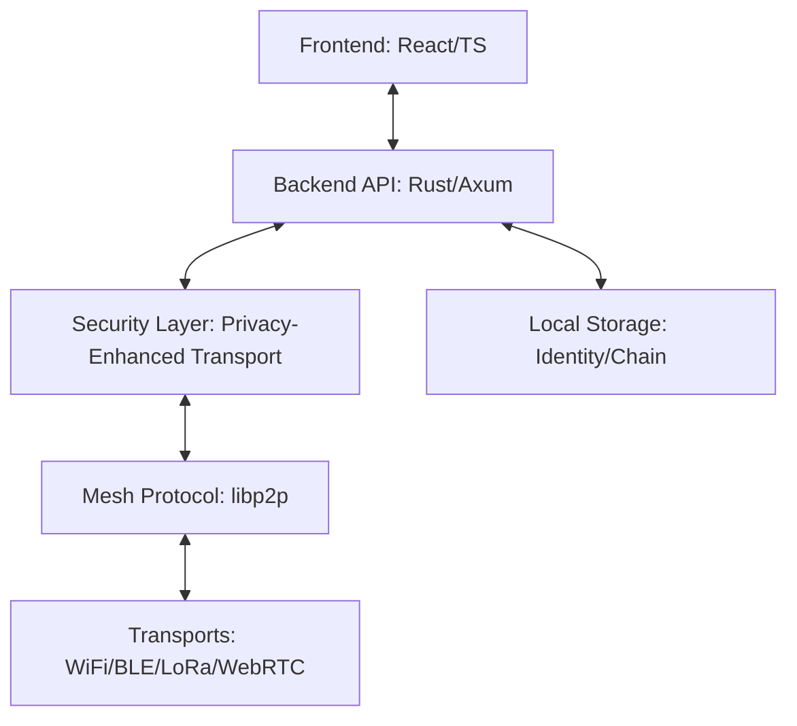

<!-- SPDX-License-Identifier: AGPL-3.0-or-later OR Commercial License -->

<div align="center">

### 🌐 **[Visit the GhostWire Website →](https://phantomojo.github.io/GhostWire-secure-mesh-communication/)**


# 🚀 GhostWire

**Resilient Mesh Communication for Connectivity-Constrained Communities**

[](LICENSE)
[](COMMERCIAL_LICENSE.md)


[](https://github.com/Phantomojo/GhostWire-secure-mesh-communication/stargazers)

**GCD4F 2026 Submission** | [Learn More →](#-competition)

</div>

---

## 🌍 The Problem

**2.6 billion people lack reliable internet access.** When disasters strike, infrastructure fails, or communities are remote, traditional communication breaks down—precisely when coordination is most critical.

Existing solutions require centralized infrastructure, sacrifice privacy, or lack the resilience needed for adverse environments.

## 💡 The Solution

**GhostWire** is a peer-to-peer encrypted mesh communication platform that operates without servers. It uses AI-powered routing to learn from network experience, post-quantum cryptography for future-proof security, and multiple transports (WiFi, Bluetooth, LoRa) to maintain communication when traditional infrastructure fails.

**Built for:** Disaster responders, rural communities, privacy advocates, researchers, and anyone who needs communication that works regardless of the odds.

---

## ⚡ Quick Start

### One-Line Installation
```bash
git clone https://github.com/Phantomojo/GhostWire-secure-mesh-communication.git && cd GhostWire-secure-mesh-communication && ./scripts/install.sh
```

### First Message
```bash
# Start GhostWire
./scripts/ghostwire-manager.sh start --profile community_coordinator

# Send a test message
curl -X POST http://localhost:8080/api/v2/messages \
  -H "Content-Type: application/json" \
  -d '{"to": "peer_id", "message": "Hello, mesh!"}'
```

### Docker (Alternative)
```bash
docker-compose up -d
```

**Full installation guide:** [docs/INSTALL.md](docs/INSTALL.md)

---

## 🎯 Key Features

### 🛡️ Security-First
- **End-to-End Encryption:** AES-256-GCM, Ed25519/X25519
- **Post-Quantum Ready:** ML-KEM-768 integration
- **Privacy-Preserving:** Metadata minimization, traffic obfuscation
- **Multi-Profile Support:** Separate identities for different contexts

### 🔗 Decentralized Mesh
- **Serverless Architecture:** Pure P2P, no central point of failure
- **Multi-Transport:** WiFi Direct, Bluetooth LE, LoRa, WebRTC, TCP/IP
- **AI-Powered Routing:** PRoPHET protocol learns optimal paths
- **Delay-Tolerant Networking:** Messages queue and deliver when peers reconnect

### 📊 Real-time Monitoring
- **Network Visualization:** Interactive mesh topology
- **System Health:** Live CPU, RAM, and network metrics
- **Message Dashboard:** High-density communication interface

---

## 📸 Screenshots

<div align="center">


*Real-time mesh network monitoring with peer discovery and message routing*

</div>

> **Note:** Add your actual screenshots to `docs/assets/` and update the image reference above.

---

## 🏗️ Architecture



### Core Components

| Component | Technology | Purpose |
|-----------|------------|---------|
| **Backend** | Rust + Axum | High-performance core, encryption, state management |
| **Frontend** | React + TypeScript | Real-time monitoring dashboard |
| **Mesh Protocol** | libp2p v0.56 | P2P networking, Kademlia DHT, Gossipsub |
| **Security** | Custom + Standard | AES-256-GCM, Ed25519, ML-KEM-768, Double Ratchet |
| **Transports** | Pluggable | WiFi, Bluetooth, LoRa, WebRTC, TCP/IP |

---

## 🆚 Why GhostWire?

| Feature | GhostWire | Briar | Meshtastic | Matrix |
|---------|-----------|-------|------------|--------|
| **Works Offline** | ✅ | ✅ | ✅ | ❌ |
| **AI-Powered Routing** | ✅ | ❌ | ❌ | ❌ |
| **Post-Quantum Crypto** | ✅ | ❌ | ❌ | ❌ |
| **Multi-Transport** | ✅ | Limited | Limited | ❌ |
| **Serverless** | ✅ | ✅ | ✅ | ❌ |
| **Open Source** | ✅ | ✅ | ✅ | ✅ |
| **Commercial License** | ✅ | ❌ |  | ❌ |

**Key Differentiators:**
1. **AI Integration:** PRoPHET routing learns from network experience
2. **Future-Proof Security:** Post-quantum cryptography ready
3. **Flexible Deployment:** From Raspberry Pi to enterprise servers
4. **Dual Licensing:** AGPL for community, Commercial for proprietary use

---

## 🏆 Competition

### GCD4F 2026

GhostWire is submitted to the **Global Competition on Design for Futures (GCD4F) 2026**, organized by Beijing Normal University and UNESCO IITE.

| Detail | Information |
|--------|-------------|
| **Track** | Higher Education — AI for Society |
| **Team** | Team GhostWire |
| **Institution** | Open University of Kenya |
| **Theme** | AI for Society |
| **SDG Alignment** | SDG 9 (Infrastructure), SDG 11 (Communities), SDG 17 (Partnerships) |

---

## 📚 Documentation

Comprehensive guides are located in the [`docs/`](docs/) directory:

| Guide | Description |
|-------|-------------|
| **[🏗️ Architecture](docs/ARCHITECTURE.md)** | System internals and design decisions |
| **[🛠️ Installation](docs/INSTALL.md)** | Detailed setup for various platforms |
| **[🔒 Security](docs/SECURITY.md)** | Security model and vulnerability disclosure |
| **[🧪 Testing](docs/TESTING_GUIDE.md)** | Network and security simulations |
| **[🌐 libp2p Guide](docs/LIBP2P_NETWORK_CONNECTIVITY.md)** | Connecting to bootstrap nodes |
| **[👤 Identity Lifecycle](docs/PROFILE_IDENTITY_LIFECYCLE.md)** | Profile management from creation to deletion |
| **[🎨 Brand Guidelines](docs/BRAND_GUIDELINES.md)** | Visual identity and logo usage |

---

## 🤝 Contributing

We welcome contributions from everyone! Whether you're fixing bugs, adding features, or improving documentation, you're part of our community.

### Get Started
1. **Fork** the repository
2. **Create** a feature branch (`git checkout -b feature/amazing-feature`)
3. **Make** your changes
4. **Test** thoroughly
5. **Submit** a pull request

### Ways to Contribute
- 🐛 **Bug Reports:** [Create an issue](https://github.com/Phantomojo/GhostWire-secure-mesh-communication/issues)
- 💻 **Code:** Fix bugs, add features
- 📖 **Documentation:** Improve guides, fix typos
- 🎨 **Design:** UI/UX improvements, branding
- 🧪 **Testing:** Write tests, report issues
- 💬 **Discussions:** [Join the conversation](https://github.com/Phantomojo/GhostWire-secure-mesh-communication/discussions)

**Guidelines:** [CONTRIBUTING.md](docs/CONTRIBUTING.md) | [Code of Conduct](CODE_OF_CONDUCT.md)

---

## 📜 Licensing

**GhostWire is dual-licensed:**

| License | Use Case | Cost |
|---------|----------|------|
| **🆓 AGPL-3.0-or-later** | Personal, Research, Education, Open Source | Free |
| **🏢 Commercial License** | Proprietary Products, SaaS, Closed-Source | Contact for pricing |

### Which License Do I Need?

| Your Use Case | License |
|---------------|---------|
| Personal projects | ✅ AGPL-3.0 (free) |
| University research | ✅ AGPL-3.0 (free) |
| Open source projects | ✅ AGPL-3.0 (free) |
| Internal tools (with source disclosure) | ✅ AGPL-3.0 (free) |
| Proprietary products | 🏢 Commercial |
| SaaS without source disclosure | 🏢 Commercial |
| Commercial hosting | 🏢 Commercial |

**Commercial inquiries:** mirungu015@proton.me

**Full terms:** [LICENSE](LICENSE) | [COMMERCIAL_LICENSE.md](COMMERCIAL_LICENSE.md) | [LICENSE_EXPLANATION.md](LICENSE_EXPLANATION.md)

---

## 👥 Team

**Team GhostWire** — Open University of Kenya, Nairobi

| Name | Role | Contact |
|------|------|---------|
| **Michael Irungu** | Team Lead, Architecture | mirungu015@proton.me |
| [Team Member] | [Role] | [Email] |
| [Team Member] | [Role] | [Email] |

**Advisors & Contributors:**
- Frank — Technical Advisor
- Austin — Hardware Lead (Mechatronics)

---

## 📞 Community & Support

### Get Help
- 📖 **Documentation:** [Read the docs](https://github.com/Phantomojo/GhostWire-secure-mesh-communication/tree/main/docs)
- 💬 **Discussions:** [Ask questions](https://github.com/Phantomojo/GhostWire-secure-mesh-communication/discussions)
- 🐛 **Bug Reports:** [Create an issue](https://github.com/Phantomojo/GhostWire-secure-mesh-communication/issues)
- 📧 **Contact:** mirungu015@proton.me

### Stay Updated
- ⭐ **Star this repo** to get release notifications
- 🔔 **Watch** for major updates
- 🐦 **Follow:** [Twitter/X handle] (coming soon)

### Security
- 🔒 **Security Policy:** [SECURITY.md](docs/SECURITY.md)
- 🚨 **Report Vulnerability:** mirungu015@proton.me (encrypted email preferred)
- 🛡️ **Security Audit:** [SECURITY_AUDIT.md](docs/SECURITY_AUDIT.md)

---

## 🏆 Roadmap

### Completed
- [x] **Phase 1: Foundation** — Rust core + libp2p integration
- [x] **Phase 2: Monitoring Dashboard** — Real-time UI (Node Cluster V2)
- [x] **Phase 3: Security Hardening** — Post-quantum crypto, threat detection

### In Progress
- [/] **Phase 4: Deep Resilience** — LoRa integration, delay-tolerant networking
- [/] **Phase 5: AI Enhancement** — PRoPHET routing optimization, trust scoring

### Planned
- [ ] **Phase 6: Knowledge Ark** — Offline content serving
- [ ] **Phase 7: Privacy Layers** — Zero-knowledge proofs, enhanced anonymity
- [ ] **Phase 8: Mobile Apps** — Android/iOS native applications

**Full roadmap:** See [project milestones](https://github.com/Phantomojo/GhostWire-secure-mesh-communication/milestones)

---

<div align="center">

### 🌟 Built for connection. Designed for resilience.

**GhostWire** — Connecting the disconnected, regardless of the odds.


**📍 Nairobi, Kenya** | **🌐 [Website](https://gcd4fe.bnu.edu.cn/en/)** | **📧 mirungu015@proton.me**

---

**Licensed under** [AGPL-3.0-or-later](LICENSE) **or** [Commercial License](COMMERCIAL_LICENSE.md)

**GCD4F 2026 Submission** — Global Competition on Design for Futures

</div>
