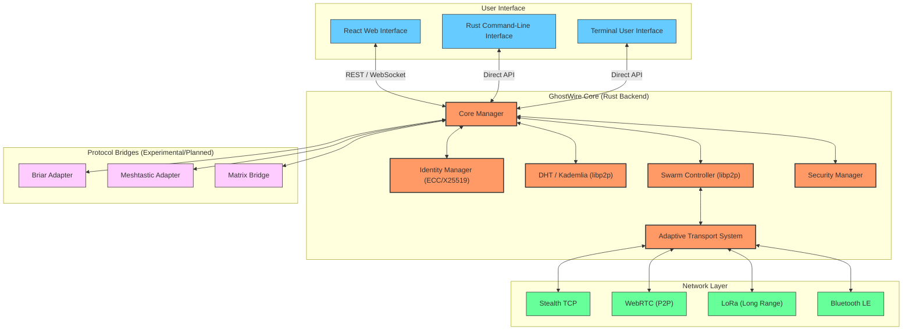

# 🏗️ GhostWire Architecture Guide

GhostWire is a secure, decentralized mesh networking and communication platform built for resilience and privacy. This document provides a high-level overview of how the system works.

---

## 🛰️ System Overview

GhostWire follows a modular architecture where the **Backend (Rust)** acts as the central hub, coordinating between various **Transports**, **Security Modules**, and **User Interfaces**.

---

## 🧠 Core Components

### 1. **Core Manager (`src/core/mod.rs`)**
The "brain" of the node. It orchestrates identity management, message routing, and peer discovery. It holds the global state and coordinates all other modules.

### 2. **Identity Manager (`src/core/identity/`)**
Handles user identities using Elliptic Curve Cryptography:
- **X25519** for key exchange.
- **Ed25519** for digital signatures.
- **AES-256-GCM** for local identity persistence.
- **Shamir's Secret Sharing (SSS)** - Experimental support for decentralized account restoration.

### 3. **Swarm Controller & DHT (`src/core/mesh.rs`)**
Built on `libp2p` (v0.56.0), this module manages:
- **Kademlia DHT**: For decentralized username lookups and peer discovery.
- **Gossipsub**: For efficient message broadcasting.
- **Noise Protocol**: For end-to-end encrypted transport links.
- **CBOR Serialization**: Optimized binary serialization for cross-platform message exchange via `request-response`.

### 4. **Adaptive Transport System**
Allows GhostWire to communicate over various mediums:
- **Stealth TCP**: Standard internet protocol, obfuscated to look like generic traffic.
- **WebRTC**: Peer-to-peer web communication (browser-friendly).
- **LoRa/Bluetooth**: Low-power, off-grid communication (via adapters).

### 5. **Security Manager (`src/core/security.rs`)**
Enforces system-wide security policies:
- **Lockdown Mode**: Instantly severs all network connections.
- **Threat Hunting**: Scans for suspicious peer behavior or unauthorized access attempts.
- **Firewall Integration**: Dynamically blocks malicious IP addresses.

---

## 💬 Message Lifecycle

1. **Composition**: The user writes a message in the Web UI or TUI.
2. **Encryption**: The `Identity Manager` encrypts the payload using the recipient's public key (retrieved from DHT or local cache).
3. **Routing**: The `Swarm Controller` decides whether to send it directly (if the peer is connected) or broadcast it via Gossipsub.
4. **Transmission**: The message is fragmented and sent across the most resilient available transport.
5. **Reception**: The recipient's node receives the fragments, reassembles them, and verifies the digital signature.
6. **Decryption**: If valid, the message is decrypted and shown to the user.

---

## 🛠️ Extensibility

GhostWire is built to grow. Developers can add:
- **New Transports**: By implementing the `Transport` trait.
- **New Adapters**: To bridge GhostWire with other ecosystems like Matrix or Briar.
- **New UI Clients**: By connecting to the standardized REST/WebSocket API.

---
*GhostWire - Privacy-First, Decentralized, Resilient.*
