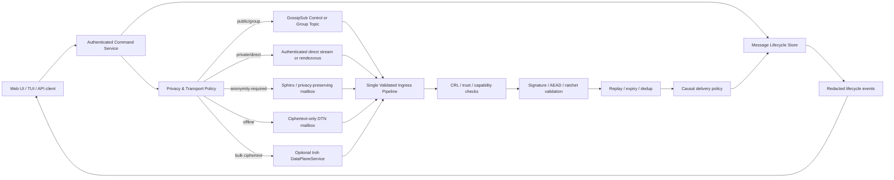

# GhostWire Architecture, Protocol, Error, and Test Audit

**Status:** Engineering audit and remediation roadmap.
**Scope:** `feat/security-hardening-and-optimizations`, audited after commit `7a4b72f7`.
**Audience:** GhostWire maintainers, security reviewers, and future implementation agents.
**Position:** This document distinguishes verified repository behavior from proposed design. It is not a claim that every experimental feature is production-ready.

## Executive assessment

GhostWire has made meaningful progress toward a secure decentralized messenger. The recent split of the prior `Core` god struct into identity, network, security, storage, AI, and social stacks is a sound first boundary. The branch also now contains CRL propagation/enforcement, causal buffering, identity-crypto hardening, property tests, a bounded QUIC frame allocation, and an offline libp2p–Iroh design. The focused QUIC suite and the library suite passed at the audited point (**274 passed, 0 failed, 1 ignored**).

The remaining production blockers are principally **wiring and policy problems**, not missing cryptographic primitives. Transport selection is not authoritative, direct-message delivery uses a shared GossipSub topic, privacy-preserving delivery can silently downgrade to metadata-exposing gossip, WebSocket authentication and command handling are incomplete, and the optional Reticulum implementation neither compiles nor implements Reticulum. These findings undermine delivery truthfulness and metadata protection even when payload cryptography succeeds.

> **Release position:** The default libp2p control plane can continue to be hardened. Private direct delivery, WebSocket exposure, Reticulum, and external data-plane integrations must remain experimental or disabled until the P0 controls in this document are implemented and tested.

| Priority | Release condition | Findings |
|---|---|---|
| **P0 — block public/private-delivery claims** | Implement before a production security or anonymity claim. | `ARCH-001` to `ARCH-010`, `PROTO-001` to `PROTO-005`, `TEST-001` to `TEST-004`. |
| **P1 — required for dependable operation** | Implement before broad user testing or a stable daemon API. | `ARCH-011`, `ARCH-012`, `API-001` to `API-004`, `ERR-001` to `ERR-003`, `TEST-005`. |
| **P2 — resilience and maintainability** | Deliver incrementally after P0/P1. | State-machine extraction, bounded-resource accounting, lint ratchet, TUI/API convergence, health metrics. |
| **P3 — research/prototype only** | No production promises until independently validated. | Reticulum bridge, Iroh ciphertext plane, Tor/overlay adapters, payment-request messages. |

## Verified baseline and current evidence

The audit found approximately **44,319 Rust source lines across 132 files**. `core/mesh.rs`, `core/mod.rs`, `core/encryption.rs`, and several controller/AI modules remain very large, so the initial stack split must be followed by extraction of narrow state machines and command services rather than further accumulation. The source tree contains many `unwrap`/`expect` and `anyhow` uses. Those counts are triage signals, not vulnerabilities by themselves; each use reachable from network, API, storage, configuration, or secret input must be classified by trust boundary.

The default library test suite is not the complete test boundary. `cargo test --all-targets` fails to compile `tests/node_to_node.rs` after the mesh constructor changed, while `cargo check --no-default-features --features reticulum` fails with 27 compile errors. A library-only green result therefore cannot substantiate integration or optional-feature support. The library lint run also completed with **410 warnings**, including lossy casts, broad error paths, incomplete wiring, and style debt.

| Area | Verified state | Consequence |
|---|---|---|
| Core decomposition | Six stack wrappers are present and configuration uses `ArcSwap`. | A valuable start, but orchestration remains concentrated in broad modules and initialization paths. |
| CRL and causal ordering | Gossip merge/enforcement and vector-clock buffering have deterministic/property coverage. | Keep these paths as shared ingress policy; avoid alternate delivery paths bypassing them. |
| QUIC framing | Length validation now bounds peer-controlled allocation. | This is a correct resource-boundary hardening; apply the same discipline to every decode/queue boundary. |
| Direct message transport | Production delivery publishes non-Sphinx frames to one fixed GossipSub direct-message topic. | Payload confidentiality does not prevent relationship and traffic metadata exposure. |
| Reticulum | Compile failure and a local queue/prototype implementation. | It must not be presented as interoperable Reticulum support. |
| WebSocket | Registered outside authenticated `/api` routes; `SendMessage` is a no-op. | Local/LAN metadata disclosure and client-visible success without dispatch are possible. |
| CI | Required test job is non-blocking and does not cover all targets or supported feature combinations. | Known compilation regressions can pass CI. |

## Threat-model and protocol design constraints

libp2p authenticates peers, but application authorization remains a separate responsibility. GossipSub delivers a published message to every subscriber of the topic and exchanges subscription information between connected peers. Consequently, a fixed direct-message topic cannot be a private direct-delivery primitive: it exposes topic participation and message/forwarding metadata even if the payload is encrypted.[1]

Mature private messengers demonstrate that transport is a **threat-model decision**, not a reachability preference. Briar combines local links, Tor, and asynchronous mailbox behavior; Session separates onion-routed small-message submission from larger transfers; and Ricochet explicitly recognizes residual timing-analysis risk. GhostWire should therefore describe privacy classes and residual risks honestly, rather than silently changing an anonymity-preserving request into ordinary gossip.[2] [3] [4]

Signal’s Double Ratchet design provides a useful ordering and state-management lesson: skipped-key storage is bounded, decryption failures must discard provisional state, and ratchet out-of-order support is distinct from application causal ordering. GhostWire must keep those queues separate and bounded per peer/conversation.[5]



## Architecture findings and remediation plan

### P0: Make transport policy authoritative

`Core::send_message` selects `MeshManager` whenever it exists before consulting the active transport, while `NetworkStack::switcher` is constructed but does not drive outbound dispatch. This makes policy switching decorative: QUIC, StealthTCP, simulated transport, and future adapters cannot be selected or retried under a single security/privacy policy.

Create a `TransportCoordinator` owned by `NetworkStack`. It should accept an immutable `OutboundIntent` containing message identifier, delivery class, privacy class, required capabilities, size, expiry, and retry budget. Candidate adapters must report capabilities rather than merely a transport name. The coordinator should record each route attempt and return a typed result; it must never silently downgrade `AnonymityRequired` to ordinary gossip.

| Capability | Example adapter | Required coordinator behavior |
|---|---|---|
| Public/group dissemination | GossipSub | Permit only explicit public/group topics; validate before forwarding. |
| Private low-latency delivery | Authenticated request-response or stream | Bind recipient identity and expected session; return dispatch, not delivery, state. |
| Relationship/origin privacy | Sphinx/rendezvous/mailbox | Fail closed or queue when unavailable; no automatic public gossip fallback. |
| Offline store-and-forward | GhostPostbox/DTN | Ciphertext only, expiry, idempotency, quota, authenticated acknowledgement/deletion. |
| Bulk ciphertext transfer | Iroh `DataPlaneService` | Feature-gated; signed offer, recipient binding, byte limit, explicit relay policy. |

### P0: Replace global direct-message gossip

The production direct-message code uses a fixed `DM_TOPIC`; the current integration test instead subscribes to per-peer topics that production code does not use. This is both a privacy defect and a test-contract mismatch. Private delivery must move to authenticated request-response/direct stream, a properly designed rendezvous/onion route, or a ratcheted blinded-contact topic with a documented metadata threat model. A globally subscribed topic must remain public/group-only.

The accompanying black-box test must include three nodes: sender, intended recipient, and observer. It should prove that the observer cannot decrypt, receive a private-delivery event, or learn a deterministic globally shared direct topic. It should also prove that privacy-required traffic queues/fails with a typed policy result when no compliant path exists.

### P0: Use a single validated ingress pipeline

`handle_sphinx_packet` reaches message handling through a different sequence from ordinary gossip, creating a policy-bypass risk for CRL, replay, expiry, signature/decryption, causal-ordering, accounting, and event emission. Extract an `IngressValidator`/`DeliveryPipeline` with a fixed order:

1. Apply size/decode limits before allocation or expensive work.
2. Parse canonical versioned envelope and verify expiry/skew.
3. Check CRL, trust, capability, recipient/conversation binding, and transport-origin policy.
4. Verify signature and authenticate/decrypt while staging ratchet mutation.
5. Commit ratchet/session state only after successful authentication.
6. Enforce deduplication and replay policy, then causal delivery policy.
7. Persist ciphertext/lifecycle changes atomically where possible and emit redacted events.

This ordering reflects established Noise state-machine rules: failed authentication/decryption terminates or discards the affected state, static identity authentication is not authorization, and message bounds are intrinsic to secure framing.[6]

### P0: Retire the current Reticulum claim; redesign as a bridge

The optional Reticulum feature does not compile, references unavailable fields, and uses a queue/prototype rather than Reticulum transport behavior. Reticulum is a complete, interoperable, medium-agnostic stack with destination and link semantics; borrowing terminology or route ideas does not make a compatible implementation.[6]

Replace the current manager with a disabled `ReticulumBridge` milestone only after choosing an explicit adapter boundary to a real Reticulum process or interface. The bridge must carry opaque GhostWire-encrypted envelopes, bind local identity/trust at the GhostWire boundary, enforce MTU/TTL/queue limits, and expose delivery semantics accurately. It must not derive symmetric keys from public identity bytes or reproduce Reticulum routing/cryptography ad hoc.

### P0: Secure and complete the WebSocket boundary

The WebSocket endpoint is registered outside the path-based API authentication middleware and subscribes directly to core events. Its in-band encryption mechanism lacks an authenticated shared-secret protocol and falls back to plaintext on error; `SendMessage` constructs and discards a message. The safe immediate implementation is an authenticated daemon WebSocket bound to loopback by default, with explicit origin policy, authenticated upgrade, versioned typed commands, and no in-band cryptography until a reviewed local Noise session is actually required.

All WebSocket and HTTP mutation routes should call one `CommandService`. The service returns a `MessageOperation` with the message’s single canonical ID, lifecycle state, public-safe fault (if any), and retry policy. Do not use a random second identifier or convert a dispatch failure into a `BROADCAST_QUEUED` success unless a durable queue accepted the record.

### P1: Remove app-core lock coupling

Handlers keep `Arc<RwLock<Arc<Core>>>` read guards across awaited I/O, network, and crypto work. This can starve profile replacement and couples lifecycle latency to slow handlers. Clone the `Arc<Core>` under a short lock before the first `await`, or place the swappable core pointer in `ArcSwap`. The profile swap path should create/validate the new core independently, then atomically replace the pointer and shut down the old snapshot with a bounded deadline.

### P1: Finish the Core boundary split

`Core::new` still combines feature construction, I/O, persistence, networking, adapter registration, AI probing, and policy setup. Introduce per-stack builders that validate configuration and return typed startup errors. Then retain a narrow `CoreBuilder` that composes the stacks, starts supervised background tasks, and supports test doubles. This preserves the useful stack split while eliminating a second god method.

## API, UI, and TUI contract

The API currently validates some empty and nominal payload cases, but it uses Unicode scalar length rather than a protocol byte budget, ignores advertised `msg_type`, generates a response ID different from the actual message ID, and labels failure as queued without durable queue acceptance. Define a protocol-owned `MessageKind` enum and a byte budget at the command boundary. Reserve transport-frame limits for each adapter after encryption/padding overhead is known.

The TUI should retain its daemon-client model but become a truthful resilient-network cockpit inspired by the product lessons of NomadNet: delivery lifecycle, transport/privacy class, offline mailbox state, trust/link status, retries, and bounded diagnostics must be visible. NomadNet’s own design emphasizes link/retry visibility and offline interaction rather than pretending that every message is immediately deliverable.[7]

| Client contract field | Required meaning | Privacy rule |
|---|---|---|
| `operation_id` / `message_id` | One canonical immutable identifier. | Random opaque identifier; never encode peer identity. |
| `lifecycle` | `Queued`, `Persisted`, `Dispatched`, `Acknowledged`, `Expired`, or `Failed`. | Do not call `Dispatched` “delivered.” |
| `delivery_class` | Public group, direct, anonymous direct, offline mailbox, bulk ciphertext. | UI must show the selected class and any explicit user-approved downgrade. |
| `fault` | Stable public error code and retry hint. | No raw peer ID, multiaddr, route, secret, or source-chain serialization. |
| `diagnostic_ref` | Local protected correlation reference. | Full diagnostics only in operator-controlled local logs. |

## Unified error index and taxonomy

GhostWire currently has an orphaned numeric `ErrorCode` catalogue and a separate broad `GhostError` enum. Merge their roles rather than adding a third abstraction. Typed subsystem errors should remain internal, while a stable `GhostWireFault` is emitted only at command/API/CLI/event boundaries.

```rust
#[non_exhaustive]
pub struct GhostWireFault {
    pub code: ErrorCode,
    pub category: FaultCategory,
    pub retry: RetryDirective,
    pub exposure: Exposure,
    pub public_message: &'static str,
    pub diagnostic_ref: DiagnosticRef,
    // private: source error chain and protected redacted context
}
```

`ErrorCode` should be a `#[repr(u16)]`, `#[non_exhaustive]` public enum or a validated newtype with range allocation. Add conversion functions at subsystem boundaries; never serialize a raw `anyhow` chain. `peer_id`, multiaddr, payment identifier, conversation ID, route, IP, and secret-adjacent values must be `Sensitive` by default and transformed into local-only, salted short references before any UI/remote emission.

| Range | Category | Example codes | Default retry | Public exposure |
|---|---|---|---|---|
| `0x0000–0x00FF` | Connectivity / transport | unreachable, timeout, capability unavailable | Backoff/alternate candidate only if policy permits | Generic |
| `0x0100–0x01FF` | Authorization / local session | unauthenticated WebSocket, forbidden command, bad origin | No | Generic |
| `0x1000–0x10FF` | Identity / cryptography | invalid signature, revoked peer, ratchet authentication failure | No; security event | Generic only |
| `0x2000–0x20FF` | Protocol / validation | malformed frame, expired offer, replay, causal gap timeout | No or explicit retry after repair | Generic |
| `0x3000–0x30FF` | Privacy policy | required private route unavailable, prohibited downgrade | Queue or no retry | Generic with privacy class |
| `0x4000–0x40FF` | Resource / limits | frame too large, queue full, causal/mailbox cap hit | Backoff only | Generic |
| `0x5000–0x50FF` | Storage / lifecycle | encrypted persist failure, durable queue unavailable | No plaintext fallback | Generic |
| `0x6000–0x60FF` | Configuration / dependency | unsupported feature, adapter unavailable | No | Generic |
| `0x7000–0x70FF` | External optional connector | Iroh offer rejected, Reticulum bridge unavailable | Policy-dependent | Generic |
| `0x7F00–0x7FFF` | Internal bug | invariant violation / unknown | No | Generic + diagnostic ref |

## Test and verification matrix

Testing must demonstrate **security properties and user-visible truth**, not only code coverage. Required jobs must fail CI; unstable environmental suites must be explicitly quarantined, time-bounded, and excluded from production claims rather than hidden behind `continue-on-error`.

| Layer | Property | Test method | Required target |
|---|---|---|---|
| Frame/parser | No peer-controlled unbounded allocation; canonical decode; invalid lengths rejected. | Unit + property + fuzz corpus. | Default, QUIC, every new offer/envelope. |
| Identity/CRL | Revoked identity cannot connect/send; future-dated or invalid gossip rejected; dedup works. | Unit + multi-node integration. | Mesh ingress and all adapters. |
| Ratchet | Failed decrypt leaves state unchanged; skipped-key cap; authenticated associated-data binding. | Deterministic state-machine/property tests. | Direct-message/session layer. |
| Causal ordering | Gaps buffer, stale replay drops, cross-sender dependency holds, cap eviction is deterministic. | Existing deterministic/property tests expanded per peer. | Shared ingress pipeline. |
| Private delivery | Third observer does not receive/decrypt/correlate fixed DM topic; privacy-required no downgrade. | Three-node black-box tests with fake clock. | Direct/Sphinx/mailbox policy. |
| Lifecycle | Queue/persist/dispatch/ack/fail transitions are truthful, idempotent, and monotonic. | Service + API + TUI contract tests. | HTTP, WebSocket, daemon client. |
| WebSocket/auth | No unauthenticated upgrade/event feed; command is wired; origin and malformed input rejected. | Axum/WebSocket integration tests. | Loopback and non-loopback configuration. |
| Persistence | Direct-message encrypted persistence fails closed; no plaintext fallback; retention/expiry works. | Temp-vault fault injection. | Storage stack. |
| Transport coordinator | Capability selection, privacy-policy gating, bounded retry, and lifecycle results. | Fake adapter simulation. | Network stack. |
| Optional features | Every supported feature set compiles and has a smoke contract. | CI feature matrix. | Reticulum bridge, Matrix, Bluetooth/Meshtastic where supported. |
| Release supply chain | Dependency licenses approved; advisories reviewed; no unverified license metadata. | `cargo-deny`/license report + advisory workflow. | Release and nightly CI. |

The initial CI change set should make `cargo test --all-targets`, default-feature linting, formatting, and the default library/integration suite mandatory. It should add a declared supported matrix for optional features. The current Reticulum profile should be marked unsupported until it compiles and passes protocol tests; it must not be a required release feature merely because it has a flag.

## Hybrid data-plane roadmap

The existing libp2p–Iroh design direction is valid if its policy boundary remains strict. Iroh uses authenticated QUIC endpoints, direct connectivity/hole punching, and relay fallback, but relay/discovery infrastructure still sees endpoint/traffic metadata; its default public discovery/relay preset is therefore not privacy-by-default.[8]

Iroh must be feature-gated as an independently restartable `DataPlaneService`. It transports only already-encrypted opaque blobs after a recipient validates a signed `DataPlaneOffer`. The offer must bind GhostWire identity, recipient/conversation, protocol version/ALPN, content identifier, byte ceiling, expiry, nonce, and explicit relay policy. Do not allow Iroh tickets, endpoint keys, discovery records, or relays to become GhostWire identity authority.[8]

| Milestone | Scope | Exit criteria |
|---|---|---|
| H0 | Documentation/design only. | Threat model, offer schema, privacy classes, and no-default-public-relay policy reviewed. |
| H1 | Outbound-only fixed encrypted blob over direct or self-hosted relay. | Signed offer binding, expiry/replay/size tests; no control-plane payload in data plane. |
| H2 | Supervised `DataPlaneService` and lifecycle events. | Failure isolation, policy simulation, rate/byte quotas, observability redaction. |
| H3 | Optional third-party relay/discovery class. | Explicit consent, separate metadata disclosure, adversarial routing tests, legal/privacy review. |

## Concrete implementation sequence

1. **Repair the test boundary.** Update `node_to_node` for the refactored constructor and make it test real production delivery. Disable or repair the Reticulum feature before claiming support.
2. **Implement a minimal typed public fault model.** Start at HTTP/WebSocket/message dispatch boundaries; add no raw-source serialization and regression tests for redaction.
3. **Introduce `MessageOperation` and lifecycle persistence.** Correct canonical ID usage and remove false `queued`/`sent` responses.
4. **Create the transport adapter contract and coordinator.** Initially adapt mesh and simulated transport; write deterministic privacy/failover tests before moving direct delivery.
5. **Replace fixed-topic direct delivery.** Build the three-node privacy regression first, then implement authenticated direct/rendezvous/mailbox paths. Delete silent Sphinx-to-gossip downgrade.
6. **Extract shared ingress validation.** Route gossip, direct, Sphinx, mailbox, and later data-plane receipt through it.
7. **Secure WebSocket and converge clients.** Authenticate before upgrade, bind loopback by default, route commands through `CommandService`, and version the daemon schema.
8. **Reduce lifecycle/lock coupling and decompose initialization.** Clone/swap core snapshots safely and extract builders.
9. **Add CI ratchets.** Make core checks blocking, build supported features, then lower the lint baseline by category.
10. **Keep advanced transports experimental.** Implement Reticulum only as a real bridge; integrate Iroh only for ciphertext blobs and only under explicit privacy policy.

## References

[1]: https://libp2p.io/docs/security-considerations/ "libp2p Security Considerations"
[2]: https://briarproject.org/how-it-works/ "Briar — How it works"
[3]: https://docs.getsession.org/session-network/session-protocol/onion-requests-and-message-routing "Session — Onion requests and message routing"
[4]: https://www.ricochetrefresh.net/ "Ricochet Refresh"
[5]: https://signal.org/docs/specifications/doubleratchet/ "Signal — Double Ratchet Algorithm"
[6]: https://noiseprotocol.org/noise.html "Noise Protocol Framework"
[7]: https://github.com/markqvist/nomadnet "NomadNet repository"
[8]: https://docs.iroh.computer/languages/rust "Iroh Rust documentation"
