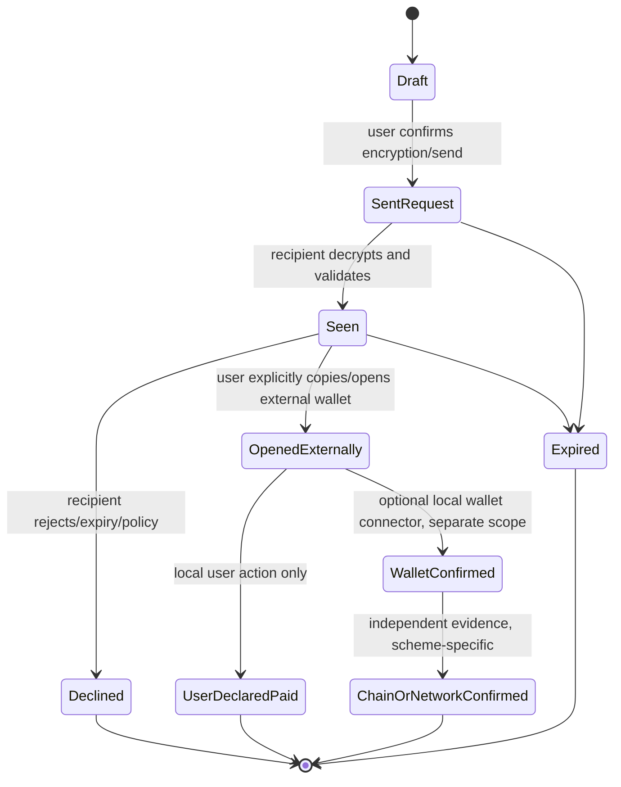

# GhostWire Privacy-Preserving Payment-Request Design

**Status:** Architecture and regulatory-risk design.
**Recommendation:** Implement no custody, transaction signing, broadcast, conversion, escrow, payment channel, mobile-money, or wallet-RPC feature in GhostWire core.
**Primary operating context:** Kenya, with cross-border use treated as a separate risk factor.

> **Important:** This is a technical and regulatory-risk assessment, not Kenyan or other jurisdiction legal advice. The design intentionally stays on the lowest-risk side of the product boundary. Obtain Kenyan counsel’s review of the exact released flow, marketing, hosting, telemetry, and commercial model before enabling any payment-adjacent production feature.

## Executive decision

There is **no universal private payment rail**. Monero, shielded Zcash, Lightning offers, and ordinary on-chain methods have different privacy, availability, wallet support, liquidity, metadata, regulatory, and jurisdictional trade-offs. A protocol that automatically chooses or falls back between them would create false privacy expectations and a large security/compliance surface.

GhostWire should therefore implement, at most, an **opt-in, encrypted payment-request message**. It carries a bounded, signed payment instruction from one GhostWire identity to another. The user chooses an external wallet; the wallet keeps all private keys and executes any transaction outside GhostWire. GhostWire must not know or store seeds, private keys, wallet-RPC credentials, payment-channel state, exchange credentials, payment balances, or transaction-signing material.

| Design choice | Decision | Reason |
|---|---|---|
| “Universal” cryptocurrency selection | **Do not implement.** | No asset is universal, private by default, accepted everywhere, or free of legal/availability risk. |
| Embedded wallet / custody | **Prohibited in core.** | Converts a messenger into a high-risk key-management and potential virtual-asset service surface. |
| Wallet RPC, chain-node, Lightning-node, or M-Pesa API invocation | **Out of scope.** | Creates payment execution/intermediation, credential, privacy, and regulatory responsibilities. |
| Encrypted payment request | **Permitted as a staged optional protocol message.** | Preserves user control while supplying a private messaging primitive, subject to strict parsing, expiry, and UI controls. |
| “Payment received” assertion | **Never trust a peer assertion as settlement.** | Distinguish user-declared, wallet-confirmed, and chain/network-confirmed states. |

## Why the boundary matters

Monero’s official wallet RPC exposes sensitive operations including wallet opening/creation, transfer construction, transaction relay, key-related operations, and proof methods. Its documented default example uses a loopback JSON-RPC service with optional digest authentication, which is appropriate for a user-controlled local wallet process—not a remote-messenger component.[1] The community `monero-rs` project is useful for Rust serialization and address/key/scanning primitives but is not a complete custody or wallet-security solution.[2]

Zcash Unified Addresses support multiple receiver types, including shielded-only forms, but the format is a recipient/payment-instruction mechanism rather than a payment processor. A user must deliberately choose privacy-preserving receiver compatibility; the protocol cannot infer that a transparent fallback is acceptable.[3]

BOLT 12 offers improve Lightning receiver privacy with reusable offers and route blinding, but implementation availability, liquidity, routing metadata, and settlement behavior remain distinct operational concerns. It is a possible external-wallet request format, not a reason to embed a Lightning node in GhostWire.[4]

| Scheme class | Example external request | Useful property | Important constraint | GhostWire status |
|---|---|---|---|---|
| Private-value request | Monero URI/address | Strong privacy-oriented on-chain design goal. | Wallet availability, access/exchange, local wallet security, and legal variability. | Typed instruction only; manual wallet handoff. |
| Shielded-value request | Zcash shielded-only unified address | Receiver can explicitly avoid transparent receiver selection. | Wallet support and recipient policy must be explicit. | Typed instruction only; enforce `shielded_only` policy if supported. |
| Fast-payment request | BOLT 12 offer | Reusable offer and route-blinding design. | Channel liquidity, router visibility, and uneven client support. | Typed instruction only; no embedded node/channel. |
| Conventional public request | On-chain address/URI | Broad external-wallet compatibility. | Public-chain traceability, often incompatible with anonymity expectations. | Optional explicit lower-privacy class; never automatic fallback. |
| Mobile-money/fiat request | PSP-specific reference/identifier | Local reach and ordinary payments. | PSP authorization, KYC/data handling, transaction processing and provider terms. | No core integration; separate licensed-partner project only. |

## Kenya-centered legal and privacy context

Kenya Law identifies the **Virtual Asset Service Providers Act, 2025 (Act No. 20 of 2025)** as effective in 2025. The Central Bank of Kenya subsequently published a 2026 notice stating that the National Treasury, CBK, and CMA had developed draft VASP Regulations. This shows that the detailed implementation environment was actively evolving and must be rechecked immediately before any launch.[5] [6]

Kenya’s 2023 VA/VASP ML/TF national risk assessment uses FATF-aligned VASP categories that include exchange, transfer, safekeeping/administration, and related services performed for or on behalf of another person. It distinguishes a non-custodial wallet as a program/device through which an owner retains control. The safest GhostWire posture is therefore to avoid actions that look like transfer execution, key administration, exchange, or payment processing for users.[7]

Kenya’s Data Protection Act applies to controllers/processors established or ordinarily resident in Kenya and to processing of personal data of data subjects located in Kenya. It defines personal data broadly, including online identifiers and location data, and requires lawful, fair, transparent, purpose-limited, minimized, accurate, and time-limited processing. Payment identifiers, payment requests, contact relationships, transaction hints, transport IPs, and wallet handoff telemetry should be treated as sensitive relationship data even when they are not statutory “sensitive personal data.”[8]

The CBK describes payment service providers as entities that send, receive, store, process, or otherwise provide electronic payment services. Its National Payment System framework regulates/oversees PSPs, and its regulations require authorization prior to commencing payment-service business. A GhostWire integration that executes M-Pesa or other PSP transactions, stores payment data for the PSP, intermediates funds, or provides settlement must therefore be treated as a separate regulated-provider/partner project—not as another messaging adapter.[9] [10]

| Feature boundary | Engineering position | Kenya-focused reason for caution |
|---|---|---|
| Encrypt and transmit a user-authored request | Possible after privacy/security review. | Lower-risk messaging behavior, but message/metadata are still personal and relationship-sensitive data. |
| Auto-open an external wallet from arbitrary message content | Prohibited. | Creates phishing, command-execution, tracking, and user-consent risk. |
| Call wallet RPC or mobile-money API | Prohibited in core. | Introduces credentials, payment execution, retention, availability, and potential regulated-service exposure. |
| Sign/broadcast a transaction | Prohibited. | GhostWire becomes involved in value transfer rather than messaging. |
| Charge per payment, escrow, conversion, merchant settlement, remittance | Prohibited. | Substantially increases VASP/PSP, consumer, AML/CFT, tax, and contract risk. |
| Collect/send KYC or Travel Rule data | Prohibited by default. | Defeats privacy posture and creates a separate data-governance/compliance system. |

Internationally, FATF guidance treats virtual-asset and VASP risks, peer-to-peer activity, licensing/registration, and Travel Rule implementation as a continuing risk-based regulatory area. EU transfer rules impose information requirements on relevant crypto-asset service providers and explicitly identify anonymity-enhancing technologies as a risk factor in the CASP context. OFAC’s virtual-currency guidance likewise describes sanctions exposure for parties subject to U.S. jurisdiction. These sources do not by themselves classify GhostWire’s proposed instruction-only feature; they reinforce why core must not drift into a hosted or intermediary service without specialist review.[11] [12] [13]

## Protocol design

### Security objectives

A payment instruction must be end-to-end encrypted in the existing GhostWire application envelope and must be cryptographically bound to the conversation/recipient. It should minimize metadata and permit user comprehension. It must never contain scripts, arbitrary URLs, callback endpoints, provider credentials, wallet-launch commands, secret keys, seed phrases, or opaque data that a client will execute.

A receiver must be able to tell the difference between a request, a local draft, a user-declared payment, and independently verified settlement. The protocol should not create an unearned “paid” claim.

### Typed envelope

The future message kind should be versioned and closed. A representation in Rust-like pseudocode is below; the final binary encoding must be canonicalized before signing and length-bounded before allocation.

```rust
#[non_exhaustive]
pub struct PaymentRequestV1 {
    pub version: u16,
    pub request_id: [u8; 16],
    pub conversation_binding: [u8; 32],
    pub recipient_identity: IdentityBinding,
    pub scheme: PaymentScheme,
    pub privacy_class: PaymentPrivacyClass,
    pub payload: BoundedBytes<1024>,
    pub amount: Option<DecimalAmount>,
    pub asset: Option<AssetCode>,
    pub expires_at: UnixSeconds,
    pub nonce: [u8; 16],
    pub issuer_signature: Signature,
}

pub enum PaymentScheme {
    MoneroUri,
    ZcashShieldedUri,
    Bolt12Offer,
    PublicOnChainUri,
    // No arbitrary URI or scheme variant.
}
```

The `payload` must be an opaque, grammar-validated scheme-specific object. It must not carry a network endpoint selected by an untrusted sender. `conversation_binding` prevents a request copied from one conversation from being accepted in another. `request_id` and `nonce` make replay handling explicit. `recipient_identity` prevents forwarding a request to a different intended receiver. `expires_at` is checked against a bounded clock-skew policy. Amount/asset are presentation constraints and must not be interpreted as proof of settlement.

### State model



No remote peer can force `OpenedExternally`, `UserDeclaredPaid`, `WalletConfirmed`, or `ChainOrNetworkConfirmed`. The first production version should expose only `Draft`, `SentRequest`, `Seen`, `Declined`, and `Expired`; external-wallet action should be a copy-to-clipboard/clear user-consent interface, not an automatic callback.

### Error and audit behavior

Payment requests require public-safe faults such as `PAYMENT_SCHEME_UNSUPPORTED`, `PAYMENT_REQUEST_EXPIRED`, `PAYMENT_REQUEST_REPLAYED`, `PAYMENT_RECIPIENT_MISMATCH`, `PAYMENT_PAYLOAD_INVALID`, and `PAYMENT_EXTERNAL_ACTION_DISALLOWED`. Logs/events must not include the payment payload, address/offer, amount, asset, peer identity, conversation identifier, or transport route. A local protected diagnostic reference is sufficient.

| Attack/failure | Required outcome | Required test |
|---|---|---|
| Oversized request | Reject before allocation; emit resource fault. | Property/fuzz test at codec boundary. |
| Unknown scheme / malformed URI | Reject; never pass to a wallet or browser. | Grammar and negative parser corpus. |
| Expired or future-skewed request | Reject. | Deterministic fake-clock test. |
| Replay / duplicate | Idempotently show existing request or reject. | Request-ID/nonce replay test. |
| Wrong recipient/conversation | Reject with no payment data leak. | Cross-conversation forwarding test. |
| Tampered amount/payload | Signature/AEAD failure; no state mutation. | Mutation/property test. |
| Unavailable privacy rail | Queue/fail based on explicit message privacy class. | Coordinator policy test proves no automatic downgrade. |
| UI claims completion | Display only the evidence level obtained. | TUI/web contract test. |
| Storage fault | Fail closed; never write plaintext request data. | Vault fault-injection test. |

## Implementation stages and go/no-go gates

| Stage | Scope | Go/no-go gate |
|---|---|---|
| P0 | Documentation and schema review only. | No code path accepts/acts on a payment request. |
| P1 | Parser/serializer behind disabled feature. | Canonical encoding, all negative cases, zero logs, no external action. |
| P2 | End-to-end encrypted request exchange, manual copy only. | Shared ingress pipeline, lifecycle accuracy, privacy tests, secure local storage. |
| P3 | Optional external-wallet connector design. | Separate threat model, local-only capability grant, Kenyan legal/privacy review, no network credential exposure. |
| P4 | Any PSP/VASP/mobile-money/wallet execution feature. | **Separate product programme only.** Written Kenyan counsel advice, provider authorization analysis, operational compliance, privacy impact assessment, incident response, and security audit. |

## Pre-release questions for Kenyan counsel

The requested advice should be based on the final working software, not an abstract “crypto feature.” The following questions make the review efficient:

1. Does an opt-in encrypted payment-request message, with no keys, custody, signing, broadcast, conversion, fee, settlement, or provider integration, fall within any Kenyan VASP/PSP authorization, registration, consumer-protection, or financial-promotion requirement when offered from Kenya?
2. Which feature changes—wallet launch, wallet-RPC connection, transaction status lookup, provider API, referral fee, merchant directory, escrow, payment confirmation, hosting, or analytics—would change the answer?
3. What Data Protection Act role, registration threshold, DPIA, retention, cross-border transfer, user notice, and breach-response obligations apply to GhostWire’s actual hosting/telemetry/support model?
4. Are there launch, marketing, sanctions, AML/CFT, tax, export-control, or consumer-disclosure restrictions for the intended user locations and supported schemes?
5. What contractual and licensing requirements arise if GhostWire links to or integrates any specific external wallet, exchange, PSP, mobile-money provider, or blockchain service?

## References

[1]: https://docs.getmonero.org/rpc-library/wallet-rpc/ "Monero Wallet RPC documentation"
[2]: https://github.com/monero-rs/monero-rs "monero-rs repository"
[3]: https://zips.z.cash/zip-0316 "ZIP 316 — Unified Addresses and Unified Viewing Keys"
[4]: https://bolt12.org/ "BOLT 12"
[5]: https://new.kenyalaw.org/akn/ke/act/2025/20/eng@2025-11-04/source "Kenya Virtual Asset Service Providers Act, 2025"
[6]: https://www.centralbank.go.ke/2026/03/18/public-notice-invitation-for-comments-from-the-public-on-the-draft-virtual-asset-service-providers-regulations-2026/ "CBK notice — Draft VASP Regulations, 2026"
[7]: https://www.frc.go.ke/wp-content/uploads/2024/02/VAs-and-VASPs-ML_TF-Risk-Assessment-Report-1.pdf "Kenya VA/VASP ML/TF National Risk Assessment"
[8]: https://new.kenyalaw.org/akn/ke/act/2019/24/eng@2022-12-31 "Kenya Data Protection Act"
[9]: https://www.centralbank.go.ke/national-payments-system/ "Central Bank of Kenya — National Payments System"
[10]: https://www.centralbank.go.ke/images/docs/legislation/NPSRegulations2014.pdf "National Payment System Regulations, 2014"
[11]: https://www.fatf-gafi.org/en/publications/Fatfrecommendations/Guidance-rba-virtual-assets-2021.html "FATF — Virtual Assets and VASPs risk-based guidance"
[12]: https://eur-lex.europa.eu/eli/reg/2023/1113/oj/eng "EU Regulation 2023/1113"
[13]: https://ofac.treasury.gov/media/913571/download?inline "OFAC — Sanctions Compliance Guidance for the Virtual Currency Industry"
