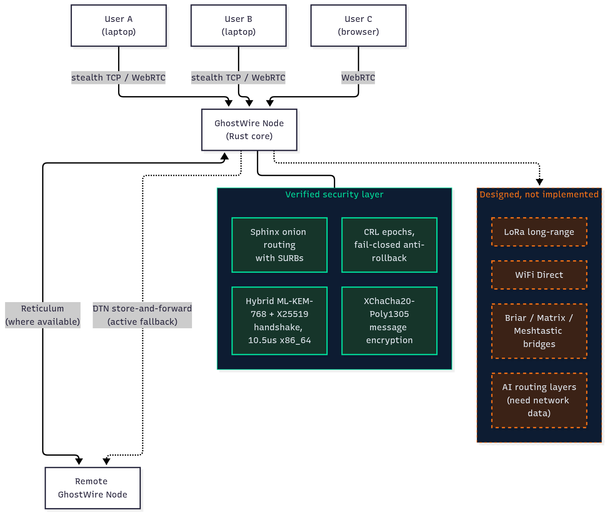

# GhostWire Project Overview

---

## Executive Summary

**GhostWire** is a modular, privacy-focused mesh networking and messaging platform designed for everyone, from disaster responders and journalists to rural communities and tech enthusiasts. It enables secure, decentralized communication even when the internet is down or unavailable.

---

## Table of Contents

1. What is GhostWire?
2. Why Mesh Networking?
3. Real-World Scenarios
4. Key Features & Benefits
5. How GhostWire Works (Plain & Technical)
6. Visual Guide: GhostWire in Action
7. Best Practices & Anti-Patterns
8. Frequently Asked Questions
9. Further Reading & Resources

---

## 1. What is GhostWire?

GhostWire lets people connect and communicate directly, forming a mesh network over whichever transports are available: stealth TCP, WebRTC, and Reticulum today, with QUIC implemented and LoRa, WiFi Direct, and Bluetooth LE designed but not yet built. A protocol-bridge registry lets it interoperate with other networks (Briar, Meshtastic, Matrix — none of these bridges is implemented yet). Privacy and security are the point of the design: hybrid post-quantum key establishment, onion routing, and coercion resistance.

- **For non-technical readers:** Think of GhostWire as a walkie-talkie for the digital age, but smarter and more private. You can send messages, share files, and connect with others, even if the internet is blocked or down.
- **For technical readers:** GhostWire is a modular, extensible platform built in Rust and TypeScript, supporting pluggable transports, protocol adapters, and advanced security modules.

---

## 2. Why Mesh Networking?

- **Resilience:** Mesh networks do not rely on a single server or internet connection. If one device goes down, others keep the network alive.
- **Privacy:** No central authority means enhanced data protection and user autonomy.
- **Flexibility:** Pluggable transports. Three work today (stealth TCP, WebRTC, Reticulum); LoRa, WiFi Direct, and BLE are designed and pending.

---

## 3. Real-World Scenarios

### Communities with Limited Connectivity
- **Problem:** Internet blackouts and connectivity constraints.
- **Solution:** GhostWire forms a local mesh, letting communities communicate securely and privately.

### Disaster Response
- **Problem:** Infrastructure is down after a natural disaster.
- **Solution:** First responders use GhostWire to coordinate rescue efforts, even without cell towers.

### Rural Communities
- **Problem:** No reliable internet access.
- **Solution:** GhostWire connects villages using LoRa and WiFi, enabling messaging and information sharing.

### Community Events
- **Problem:** Overloaded networks at large gatherings.
- **Solution:** Attendees use GhostWire to share updates and stay connected.

---

## 4. Key Features & Benefits

- **Decentralized:** No single point of failure.
- **Privacy-First:** End-to-end encryption, metadata protection, and traffic obfuscation.
- **Modular:** Add or remove transports and adapters as needed.
- **Cross-Protocol:** Bridge to Briar, Meshtastic, Matrix, and more.
- **User-Friendly:** Simple web and mobile interfaces.
- **Open Source:** Transparent, auditable, and community-driven.

---

## 5. How GhostWire Works (Plain & Technical)

### Plain-Language Overview

- Devices connect directly to each other, forming a web (mesh).
- Messages hop from device to device until they reach their destination.
- No internet? No problem, use Bluetooth, WiFi, or LoRa.
- Everything is encrypted and private.

### The Device Hierarchy

Not all devices are equal in GhostWire. The network organizes devices into tiers based on available RAM, storage, and power. A nearby laptop can take over relay duty from a phone, keeping the mesh alive when a low-power device needs to rest. This tiered approach keeps the network stable as it grows. The hierarchy works like this: phones and small devices handle sending and receiving, while laptops and servers take on heavier relay and storage tasks. As one project note puts it, "A flat mesh becomes unstable beyond a certain density. We should introduce a tiered architecture."

### AI Routing

GhostWire uses artificial intelligence to decide how messages travel across the mesh. A lightweight classification model examines each message and picks the best transport and route. A larger analytical model runs periodically to update the network map. This means messages can find their way even when the network is changing constantly, and the AI models run on devices themselves, not on a remote server.

### Technical Deep Dive

- **Core:** Rust backend with modular traits for transports, adapters, and security.
- **Frontend:** React/TypeScript web UI, CLI for power users.
- **Transports:** Pluggable modules. Working: stealth TCP, WebRTC, Reticulum. Implemented but not on the mesh handshake: QUIC. Designed, not implemented: LoRa, WiFi Direct, Bluetooth LE.
- **Adapters:** A protocol-bridge registry for Briar, Meshtastic, Matrix, and others. **None of these bridges is implemented yet** — see the status spine §7.
- **Security:** End-to-end encryption using **XChaCha20-Poly1305** with Ed25519 identities, X25519 key exchange, and a hybrid **ML-KEM-768 post-quantum** handshake. Sybil defence via proof-of-work node admission, quotas, blacklists, and traffic obfuscation.
- **Store & Forward:** Messages are cached and relayed when possible.

---

## 6. Visual Guide: GhostWire in Action

*Solid green = verified in the current build. Dashed orange = designed but not
implemented. Full evidence in [docs/BIBLE_STATUS_SPINE.md](../BIBLE_STATUS_SPINE.md).*

---

## 7. Best Practices & Anti-Patterns

### Best Practices
- Use multiple transports for resilience.
- Keep software updated for latest security patches.
- Use strong, unique passwords for device access.
- Educate users about privacy and security features.

### Anti-Patterns
- Relying on a single transport (e.g., only WiFi).
- Disabling encryption or security modules.
- Ignoring software updates.

---

## 8. Project Status (September 2026)

GhostWire is an active, growing project. As of 2026-09-28, `ghostwire/src/` contains 58,166 lines of Rust across 151 files (66,116 lines crate-wide including tests and benches). The test suite runs 368 unit tests, all passing. The project has applied to the Open Technology Fund, structured as 12 milestones across 8 phases. **Per-capability status with file-and-line evidence is maintained in [docs/BIBLE_STATUS_SPINE.md](../BIBLE_STATUS_SPINE.md); where this document and that file disagree, that file is correct.**

### Transports Working Today
Three transports are working today: stealth TCP, WebRTC, and Reticulum. QUIC is implemented but not yet on the mesh handshake. Bluetooth LE is a skeleton (the send path logs and returns), WiFi Direct returns `unsupported` because no OS provider is installed, and LoRa has no implementation at all — `TODO.md` records it as "protocol defined but no hardware integration." Full per-transport status with file-and-line evidence: [docs/BIBLE_STATUS_SPINE.md](../BIBLE_STATUS_SPINE.md) §4. Traffic Armor provides camouflage and auto-switching when a transport is blocked, using Thompson Sampling for energy-aware transport selection (energy weights: BLE 0.30, LoRa 0.35, Reticulum 0.25, WiFi 0.05, TCP/QUIC 0 — these are selector weights for *planned* transports as well as live ones).

### Protocol Bridges
- **Matrix:** Planned. No matrix bridge module exists in the codebase.
- **Meshtastic:** Planned. No meshtastic module exists. (Erasure-coding code exists for LoRa framing, but there is no bridge.)
- **Briar:** Planned. `briar.rs` contains Briar-*inspired* struct definitions; `BriarManager` is never instantiated and the registration call is commented out. It sits behind a non-default feature flag.
- **Reticulum:** This one is real, and it is a first-party transport rather than a bridge — 883 lines, wired into the transport layer.
- **Tor:** Not implemented.

### External Security Audit
An external security audit is planned but has not yet been conducted. Candidate auditors include Cure53, NCC Group, and Least Authority.

### New Chapters
Three new chapters expand the Bible: Chapter 15 covers device hierarchy and power-aware scaling, Chapter 16 covers AI routing and on-device intelligence, and the early chapter on who GhostWire serves.

---

## 9. Frequently Asked Questions

**Q: Is GhostWire legal to use?**
A: In most countries, yes, but always check local laws, especially regarding encryption and radio use.

**Q: Can I use GhostWire without the internet?**
A: Yes. That is one of its main features.

**Q: How secure is GhostWire?**
A: It uses strong encryption and privacy techniques, but no system is 100% secure. Follow best practices.

**Q: Can I contribute?**
A: Absolutely. See the Contributing chapter.

---

## 10. Further Reading & Resources

- [GhostWire GitHub](https://github.com/phantomojo/GhostWire-secure-mesh-communication)
- [Mesh Networking 101](https://en.wikipedia.org/wiki/Mesh_networking)
- [Briar Project](https://briarproject.org/)
- [Meshtastic](https://meshtastic.org/)
- [Matrix Protocol](https://matrix.org/)
- [LoRa Technology](https://lora-alliance.org/about-lorawan/)
- [Device Hierarchy & Power-Aware Scaling](15_device_hierarchy_and_scaling.md)
- [AI Routing & On-Device Intelligence](16_ai_routing_and_intelligence.md)
- [Who GhostWire Serves](01b_who_ghostwire_serves.md)

---

## Appendix: Glossary

- **Mesh Network:** A network where each device relays data for others.
- **Transport:** The method used to send messages (Bluetooth, WiFi, etc.).
- **Protocol Adapter:** Software that bridges GhostWire to other networks.
- **Node:** Any device running GhostWire.
- **Sybil Attack:** When one entity pretends to be many nodes.
- **Quota:** Limit on messages/actions to prevent abuse.

---

## End of Chapter
