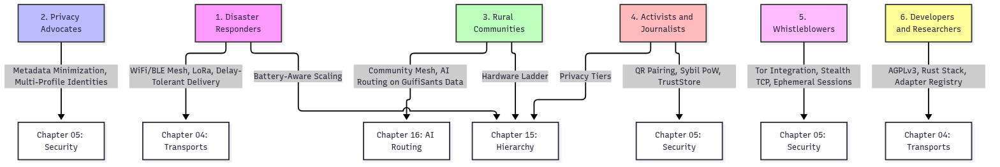

# Who GhostWire Serves

---

## In this chapter

1. Executive Summary
2. The Six Target Personas
3. Persona-to-Capability Map
4. Four Illustrative Scenarios
5. Which Persona Should Read Which Chapter

---

## Executive Summary

GhostWire is built for six communities that need communication when traditional networks fail, when they are watched, or when no network exists at all. This chapter describes each community, what they need, and how GhostWire features map to those needs. If you are not a technical reader, this chapter will help you understand who GhostWire is for and why it matters.

The six communities are disaster responders who coordinate when cell towers fall, privacy advocates who refuse to be tracked, rural communities that lack reliable internet, activists and journalists who speak under threat, whistleblowers who expose wrongdoing without being traced, and developers and researchers who build on open code. Each community uses a different combination of GhostWire features, and the modular design of the platform means that no one is forced to use features they do not need.

This chapter describes who GhostWire is for and which parts of it serve each community.

---

## 1. The Six Target Personas

GhostWire serves six distinct communities. Each has a different reason for needing the platform, a different threat model, and a different set of features that matter most to them. The taglines below are drawn directly from the project website and describe each community in a single sentence.

### 1. Disaster Responders

**Tagline:** "Coordinate when cell towers fail. Works on battery and solar"

Disaster responders need to communicate when the infrastructure is destroyed. Cell towers go down, internet connections disappear, and traditional phones become useless. GhostWire provides mesh networking over stealth TCP, WebRTC, and Reticulum, plus delay-tolerant delivery so messages are stored and forwarded when a connection becomes available. **WiFi Direct, Bluetooth LE, and LoRa are designed but not implemented** — see the status spine §4.

In a hurricane response scenario within 200 kilometers of infrastructure, responders can deploy LoRa nodes at key locations and use battery-powered devices to maintain coordination. Messages hop from node to node until they reach their destination, even if no direct path exists. The store-and-forward routing ensures that no message is lost, even when connections are intermittent. This is covered in detail in Chapter 04 on transports.

Disaster responders also benefit from the security architecture described in Chapter 05. XChaCha20-Poly1305 encryption with a hybrid classical + post-quantum handshake protects sensitive operational data, and the delay-tolerant networking layer ensures that messages survive temporary disconnections. The device hierarchy in Chapter 15 describes how responders can use battery-aware scaling to preserve both charge and operational security.

### 2. Privacy Advocates

**Tagline:** "No logs. No traces"

Privacy advocates need communication that leaves no metadata behind. GhostWire supports metadata minimization techniques and multi-profile identities, allowing users to maintain separate personas for different contexts. The network does not require phone numbers, email addresses, or any other identifying information to join.

The privacy architecture is detailed in Chapter 05. Messages carry only what is necessary for routing. No phone numbers, no email addresses, no persistent identifiers. Multi-profile identities let users compartmentalize their digital lives, keeping work, personal, and sensitive communication entirely separate. Traffic obfuscation through cover traffic and timing randomization makes traffic analysis significantly harder.

The privacy architecture is designed so that no raw message content is analyzed: routing decisions work on transport and topology metadata, not message bodies. Note that the learned routing layers described in Chapter 16 are not active in the current build — routing uses PRoPHET and the mesh — so there is no inference to opt into today.

### 3. Rural Communities

**Tagline:** "2.6 billion people lack reliable internet"

Rural communities around the world lack dependable internet access. GhostWire enables community-owned mesh networks using LoRa and WiFi. The AI routing system can be trained on datasets like the GuifiSants dataset, which contains 7,931 samples from 63 nodes over 31 days, to optimize routing for real-world rural topologies.

Community members can share news, alerts, and resources without relying on an internet service provider. The mesh is owned and operated by the community itself. Each device is a node, and the more people who join, the stronger the network becomes. The hardware ladder described in Chapter 15 is a design target for low-cost sensor and leaf nodes. **No ESP32 firmware exists in the repository**, and the LoRa transport that such nodes would use is not implemented.

Training a routing model on public mesh datasets such as GuifiSants (7,931 samples, 63 nodes, 31 days) is a planned step. **No model has been trained or shipped**: there are no model files in the repository, and the learned routing layers are not called from routing decisions today. See Chapter 16 and the status spine §5.

### 4. Activists and Journalists

**Tagline:** "Coordinate without infiltration. Disposable identities. Mesh during protests."

Activists and journalists face internet shutdowns, surveillance, and censorship. During protests, governments shut down internet access. Journalists lose their ability to communicate with editors. Activists are infiltrated by informants. Standard communication tools become liabilities.

GhostWire provides mesh networking that works during internet shutdowns using WiFi Direct and Bluetooth Low Energy. Disposable identities allow users to create separate profiles for different operations and discard them when compromised. Direct peer connection uses public key identifiers rather than a central registry, so there is no directory to subpoena. (QR pairing was described in earlier revisions of this chapter; it is not implemented in the current build.)

Sybil resistance through proof-of-work node admission makes it computationally expensive to flood the mesh with fake nodes; peers whose NodeId PoW does not verify are rejected (`routing/skademlia.rs:171,328`). **Important caveat:** the eclipse-defence functions that would enforce IP diversity and disjoint lookups are defined but never called, so this protection is narrower than it appears — see the status spine §6.

### 5. Whistleblowers

**Tagline:** "Send documents without revealing identity. Tor integration supported."

Whistleblowers need to transmit sensitive documents without revealing their identity. Standard channels leave traces. Even encrypted services can be compelled to hand over metadata. GhostWire provides several features that address this need.

Tor integration is planned and will route GhostWire traffic through the Tor network for additional anonymity layers. In the meantime, stealth TCP provides obfuscated transport that can blend GhostWire traffic with normal HTTPS traffic, making it harder to detect. Ephemeral sessions ensure that session keys are destroyed after use, leaving no persistent state to subpoena.

No identifying information is required to create a GhostWire identity. No phone number, email, or real name is needed. The end-to-end encryption described in Chapter 05 ensures that documents are encrypted before they leave the device, and no intermediary can read them.

### 6. Developers and Researchers

**Tagline:** "AGPL-licensed. Built in Rust. AI models trained on real mesh data."

GhostWire is **dual-licensed**: AGPL-3.0-or-later for personal, research, educational, and open-source use, and a separate commercial licence for proprietary, closed-source, and SaaS deployments (see `LICENSE`). The codebase is written in Rust for memory safety. The architecture supports pluggable transports and an adapter registry for building bridges to other protocols.

The technology stack includes libp2p networking, Kademlia DHT, Gossipsub pub/sub, stealth TCP and WebRTC transports, and a web dashboard. An AI layer is designed — LightGBM anomaly detection exported to ONNX, and a Graph Neural Network — but **no model files are present in the repository and the AI layers are not wired into routing decisions**. Researchers can study the routing algorithms and contribute transports today; contributing to the AI models requires training them first.

The adapter registry described in Chapter 04 provides a structured way to add new transports and protocols. Developers can implement the relevant adapter interface and register it without modifying the core codebase. This modular design makes GhostWire a fertile ground for research into mesh networking, privacy-preserving communication, and AI-driven routing.

---

## 2. Persona-to-Capability Map

The diagram below maps each persona to the GhostWire capabilities they rely on. Cross-references point to the chapters that describe those capabilities in detail.

The table below provides a more detailed mapping of features to personas.

**Yes** = works in the current build. **Planned** = designed, not implemented. **Partial** = code exists but is not wired into a user-reachable path.

| Feature | Status | Disaster | Privacy | Rural | Activists | Whistleblowers | Developers |
|---|---|---|---|---|---|---|---|
| Stealth TCP / WebRTC / Reticulum | Yes | Yes | Yes | Yes | Yes | Yes | Yes |
| Delay-Tolerant Delivery | Yes | Yes | Yes | Yes | Yes | Yes | Yes |
| Hybrid PQ + XChaCha20 encryption | Yes | Yes | Yes | Yes | Yes | Yes | Yes |
| Sphinx onion routing (SURBs) | Yes | Yes | Yes | Yes | Yes | Yes | Yes |
| Multi-Profile Identities | Partial | No | Yes | No | Yes | Yes | Yes |
| Sybil Proof-of-Work admission | Partial | No | No | No | Yes | No | Yes |
| Pluggable Transports | Yes | Yes | Yes | Yes | Yes | Yes | Yes |
| Adapter Registry | Partial | No | No | No | No | No | Yes |
| WiFi Direct / BLE Mesh | Planned | Yes | Yes | Yes | Yes | Yes | Yes |
| LoRa long-range | Planned | Yes | No | Yes | Yes | No | Yes |
| QR Pairing | Planned | No | No | No | Yes | Yes | Yes |
| AI routing (LightGBM / GNN) | Planned | Yes | Yes | Yes | No | No | Yes |
| Tor Integration | Planned | No | No | No | No | Yes | Yes |

> The earlier version of this table marked unimplemented transports, QR pairing, and
> AI routing as "Yes" for every persona, which overstated what a user of any of
> these communities could actually do. Status column added 2026-09-28; see
> [docs/BIBLE_STATUS_SPINE.md](../BIBLE_STATUS_SPINE.md).

---

## 3. Four Illustrative Scenarios

The following scenarios are illustrative examples drawn from the project's documented use cases. They show how GhostWire might work in practice for different communities. These are not descriptions of completed deployments but rather plausible scenarios based on the project's stated goals and capabilities. Chapter 13 frames these same scenarios in detail and is cross-referenced below.

### Scenario 1: Community Blackout with Protesters

During a citywide internet blackout, a community forms a mesh using phones and laptops. Bluetooth and WiFi Direct connect nearby devices, and a few laptops act as relays. Messages flow through the mesh without any internet connection. Activists coordinate protests, share safety alerts, and maintain communication with external journalists. This scenario is explored in more detail in the [Case Studies](13_case_studies.md) chapter, which frames it as a community network during a communication blackout.

### Scenario 2: Hurricane Disaster Response

After a hurricane destroys infrastructure, responders deploy LoRa nodes at shelters and staging areas. Battery-powered devices communicate over long distances. Store-and-forward delivery ensures that messages reach their destination even when nodes are temporarily out of range. The AI routing system helps messages find the best available path across the mesh. The Case Studies chapter describes this as a disaster response in a blackout, with responders operating 200 kilometers from infrastructure.

### Scenario 3: Rural Village Connectivity

A village with no internet access connects homes, a school, and a clinic using LoRa and WiFi. A Raspberry Pi gateway bridges the local mesh to the wider network when a satellite internet connection is available. The AI routing system, trained on real-world rural data including the GuifiSants dataset, optimizes message paths. Community members share news, alerts, and educational resources. The Case Studies chapter frames this as rural village connectivity, showing how community-owned mesh transforms isolated areas.

### Scenario 4: Festival

At a large outdoor festival, attendees use GhostWire to share updates and stay connected when cell networks become overloaded. Phones form a Bluetooth and WiFi mesh, and information spreads quickly through the crowd. The tiered architecture from Chapter 15 ensures that the mesh remains stable even as hundreds of devices join simultaneously. The Case Studies chapter describes this as a community event mesh, demonstrating how GhostWire handles congestion during large gatherings.

---

## 4. Which Persona Should Read Which Chapter

Different readers will find different chapters most useful. The table below helps each persona navigate the GhostWire Bible to the sections most relevant to their needs.

| Persona | Start Here | Then Read | Also Relevant |
|---|---|---|---|
| Disaster Responders | Chapter 04 (Transports) | Chapter 15 (Hierarchy) | Chapter 05 (Security), Chapter 13 (Case Studies) |
| Privacy Advocates | Chapter 05 (Security) | Chapter 16 (AI Routing) | Chapter 04 (Transports), Chapter 13 (Case Studies) |
| Rural Communities | Chapter 16 (AI Routing) | Chapter 15 (Hierarchy) | Chapter 04 (Transports), Chapter 13 (Case Studies) |
| Activists and Journalists | Chapter 05 (Security) | Chapter 04 (Transports) | Chapter 15 (Hierarchy), Chapter 13 (Case Studies) |
| Whistleblowers | Chapter 05 (Security) | Chapter 04 (Transports) | Chapter 13 (Case Studies) |
| Developers and Researchers | Chapter 04 (Transports) | Chapter 06 (Adapters) | Chapter 12 (Developer Guide), Chapter 16 (AI Routing) |
| General Readers | Chapter 01 (Project Overview) | Chapter 07 (FAQ) | Chapter 13 (Case Studies), Chapter 14 (Glossary) |

---

## End of Chapter
