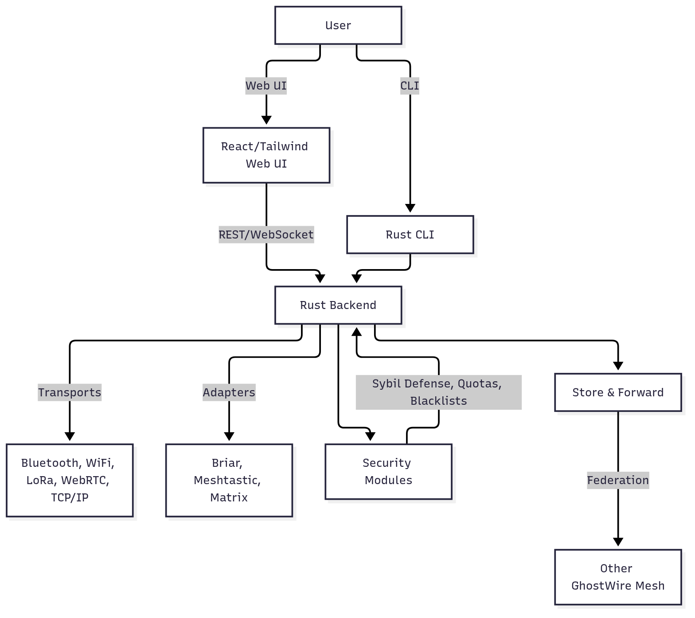
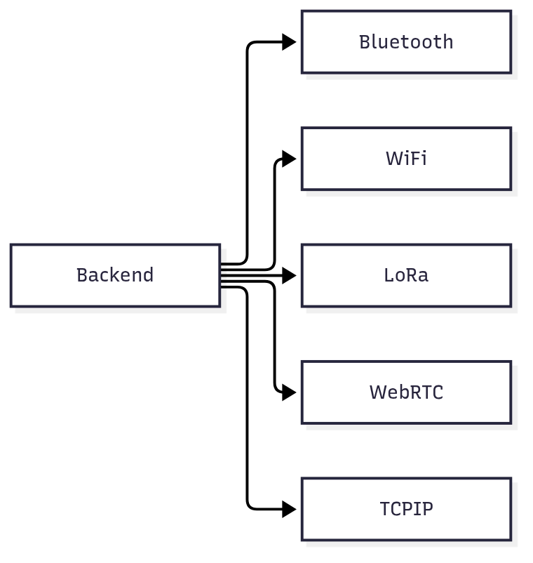
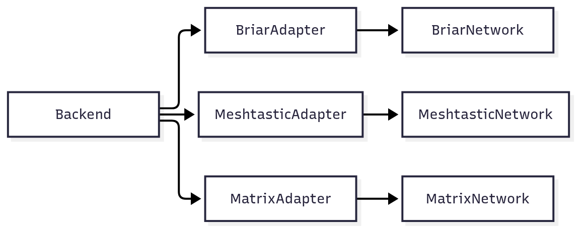
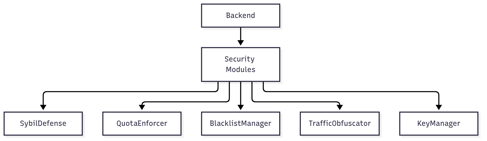
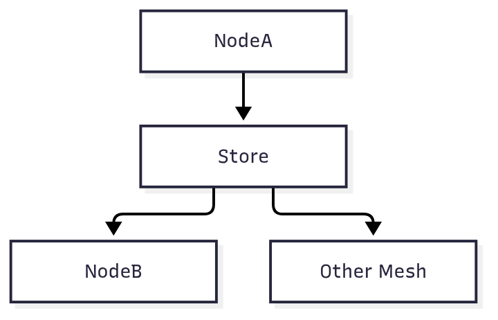

# Architecture Deep Dive

---

## Table of Contents
1. Overview & Philosophy
2. System Diagram & Visuals
3. Core Components (Plain & Technical)
4. Device Hierarchy and Supernodes
5. Transports Layer
6. Protocol Adapters Layer
7. AI Routing Layer
8. Security & Trust Layer
9. Store & Forward / Federation
10. Data Flow: Message Lifecycle
11. Deployment Blueprints
12. Best Practices & Anti-Patterns
13. Glossary & Reference

---

## 1. Overview & Philosophy

GhostWire is built for modularity, security, and real-world flexibility. The architecture is designed to:
- Support multiple transports and protocols
- Enable privacy and resilience by default
- Allow easy extension and adaptation for new use cases

---

## 2. System Diagram & Visuals

---

## 3. Core Components (Plain & Technical)

### Plain-Language
- **Web UI:** The dashboard you use in your browser.
- **CLI:** Command-line tool for advanced users.
- **Backend:** The "brain" that connects everything, runs on your device.
- **Transports:** The "roads" messages travel on (WiFi Direct, LoRa, stealth TCP, WebRTC, Reticulum).
- **Adapters:** "Translators" that let GhostWire talk to other networks.
- **Security Modules:** Keep your messages private and your network safe.
- **Store & Forward:** Lets messages wait and be delivered later if needed.

### Technical
- **Rust Backend:** Implements core traits: `Transport`, `ProtocolAdapter`, `KeyManager`, `QuotaEnforcer`, etc.
- **Frontend:** React/TypeScript, communicates via REST/WebSocket APIs.
- **Transports:** Each is a Rust module implementing the `Transport` trait, can be enabled/disabled at runtime.
- **Adapters:** Rust modules implementing `ProtocolAdapter`, handle translation, deduplication, and relay.
- **Security:** Modular, pluggable, with Sybil defense, quotas, blacklists, traffic obfuscation, and more.
- **Store & Forward:** Message cache, relay, and federation logic.

---

## 4. Device Hierarchy and Supernodes

A flat mesh becomes unstable beyond a certain density. We introduce a tiered architecture so that devices with more resources can serve as relays and anchors, while resource-constrained devices focus on messaging.

### Device Classes

| Class | Memory | Max Peers | Storage | Role |
|-------|--------|-----------|---------|------|
| Phone | <=6GB | 20 | 1GB | Leaf |
| Tablet | <=8GB | 30 | 2GB | Leaf or light Relay |
| Raspberry Pi | <=4GB | 15 | 500MB | Relay or Sensor |
| Laptop | <=16GB | 50 | 5GB | Relay |
| Server | >16GB | 100+ | 50GB+ | Full, Replicator |

### Roles
- **Full Node:** Maintains the complete mesh state, participates in routing and relay. Typically a server or always-on laptop.
- **Relay:** Forwards messages between nodes. Can be a Raspberry Pi, laptop, or tablet with sufficient uptime and bandwidth.
- **Leaf:** A messaging endpoint that does not relay traffic for others. Phones and lightweight tablets typically operate as leaves.
- **Sensor:** A device that generates or consumes data but does not relay. Examples include environmental sensors or battery-constrained devices.
- **Replicator:** A full node that stores and replicates messages for the mesh, ensuring availability even when original senders are offline. Typically a server-class machine.

### Supernode Election
Dynamically elect nodes with high uptime, stable IP addresses, and significant bandwidth to act as "Relay Hubs." These supernodes coordinate routing tables and serve as anchor points for the mesh. Election is based on observable metrics: uptime history, bandwidth availability, and peer count. A node does not need to be a server to become a supernode; a Raspberry Pi with stable power and connectivity can qualify.

### Trust and Relay Authority
Relays carry no trust authority. A relay forwards messages but cannot validate, modify, or censor the content it carries. Trust is established end-to-end between the original sender and the final recipient through cryptographic signatures. This separation ensures that even a compromised relay cannot impersonate a user or read message contents.

### Hardware Ladder and ESP32 Gateway Bridge
The hardware ladder runs from a $20 ESP32 through a $100 Raspberry Pi gateway to server-class machines. The ESP32 gateway-bridged architecture creates a mini-mesh locally and bridges it to a WiFi uplink, allowing low-cost sensors and devices to participate in the mesh through a gateway node. This is ideal for rural deployments and disaster scenarios where dedicated hardware is scarce.

### Mailbox Pattern for Leaf Devices
Leaf devices that cannot maintain persistent connections use a mailbox pattern. Messages destined for a leaf are cached at the leaf's last-known relay node. When the leaf reconnects, it pulls all queued messages in batch. This decouples availability from connectivity.

---

## 5. Transports Layer

- **Working today:** stealth TCP, WebRTC, Reticulum (feature-flagged) — plus QUIC implemented but not yet on the mesh handshake. WiFi Direct is a platform boundary with no OS provider installed; LoRa is not implemented; Bluetooth LE is a skeleton. See [docs/BIBLE_STATUS_SPINE.md](../BIBLE_STATUS_SPINE.md) §4.
- **In progress:** Bluetooth LE
- **Pluggable:** Add new transports by implementing the `Transport` trait.
- **Runtime Selection:** Enable/disable transports via config or UI.
- **Visual:**
    
- **Best Practice:** Use multiple transports for resilience.

---

## 6. Protocol Adapters Layer

- **Purpose:** Bridge GhostWire to other networks (Matrix, Meshtastic, Briar, etc.)
- **How:** Implement the `ProtocolAdapter` trait.
- **Features:** Message translation, deduplication, relay, group chat, file sharing.
- **Visual:**
    

---

## 7. AI Routing Layer

The AI Routing Layer applies machine learning to decide how messages are classified, routed, and prioritized across the mesh. It operates across four distinct layers, each with a different scope and cadence.

### Layer 1: LightGBM Per-Message Classification
The design calls for a LightGBM classifier to assign each message a priority category, with features including message size, destination type, transport metrics, and battery level, so that routine, priority, and emergency messages can be routed differently and metered differently. **This layer is not active in the current build** — no model file is present in the repository and the classifier is not called from routing decisions (see [docs/BIBLE_STATUS_SPINE.md](../BIBLE_STATUS_SPINE.md) §5). Priority handling today comes from the message type on the wire, not from an ML classifier.

### Layer 2: Gemma 4 Analytical Pass
Every 30 seconds, a Gemma 4 model runs an analytical pass over recent mesh activity. This pass identifies traffic patterns, anomalies, and potential congestion points. The output feeds into routing table adjustments and supernode election decisions. This is a periodic batch process, not a per-message classifier.

### Layer 3: GNN Graph Router
A Graph Neural Network models the mesh as a dynamic graph where nodes are devices and edges are transport links with associated latency, reliability, and energy cost. The GNN computes optimal routing paths in real time, adapting to topology changes. This layer handles the heavy lifting of pathfinding across a volatile mesh.

### Layer 4: PRoPHET Delay-Tolerant Routing
For partitions and disconnected scenarios, PRoPHET (Probabilistic Routing Protocol Using History of Encounters and Transitivity) provides delay-tolerant message forwarding. Messages are carried by nodes that are likely to encounter the destination in the future. This is essential for disaster response and off-grid scenarios where continuous connectivity cannot be guaranteed.

### Model Ladder
Models are deployed across the hardware ladder based on capability:
- **E2B (Edge-to-Base):** Runs on edge devices (phones, Raspberry Pi) for lightweight classification.
- **E4B (Edge-to-Cloud):** Runs on relay laptops for analytical passes and local graph inference.
- **26B MoE (Mixture of Experts) Coordinator:** Runs on a coordinator node to aggregate routing decisions across the mesh.
- **31B Server Model:** Runs on server-class machines for full analytical depth and training.

### Telemetry and Model Distribution
Telemetry flows up (opt-in only) so that model training data is collected with explicit user consent. Model files flow down via DHT hash verification and P2P sync, not federated learning. Each node verifies model integrity through content hashes distributed over the DHT before loading a new model version.

### Store-and-Forward DTN Integration
The AI Routing Layer integrates with store-and-forward DTN protocols (PRoPHET, Spray-and-Wait) to make intelligent decisions about when to hold messages versus when to forward them. In partitioned networks, the AI predicts which relay nodes are most likely to reach the destination and queues messages accordingly.

---

## 8. Security & Trust Layer

- **Modules:**
    - SybilDefense
    - QuotaEnforcer
    - BlacklistManager
    - TrafficObfuscator
    - KeyManager
- **Features:**
    - End-to-end encryption (XChaCha20-Poly1305, X25519, hybrid ML-KEM-768)
    - Perfect forward secrecy
    - Ephemeral keys, key rotation
    - Quotas and rate limiting
    - Blacklisting and abuse prevention
    - Traffic obfuscation and anti-analysis
    - ML-KEM-768 post-quantum key encapsulation (10.5us measured, x86_64)
    - SPHINX SURBs and cover traffic for metadata protection
    - Privacy tiers: L0 (minimal), L1 (standard), L2 (enhanced), L3 (maximum)
- **Privacy Tiers by Device:**
    - Server: L3 (maximum privacy)
    - Laptop and Tablet: L2
    - Phone and Raspberry Pi: L1 (drops one tier when battery is 20% or below)
- **Visual:**
    

---

## 9. Store & Forward / Federation

- **Store & Forward:** Messages are cached and relayed when possible. DTN protocols (PRoPHET, Spray-and-Wait) handle disconnected scenarios.
- **Federation:** Meshes can connect to each other for wider reach.
- **Visual:**
    

---

## 10. Data Flow: Message Lifecycle

1. **User sends message via UI/CLI**
2. **Backend encrypts and signs message**
3. **AI Routing Layer classifies and selects route**
4. **Message routed via best available transport(s)**
5. **Adapters translate if needed**
6. **Security modules enforce quotas, check blacklists**
7. **Message hops node-to-node (store & forward as needed)**
8. **Recipient decrypts and reads message**

---

## 11. Deployment Blueprints

### Home/Personal Mesh
- Single device or small group, WiFi Direct/Bluetooth
- Simple setup, auto-discovery
- Phone as leaf, laptop as relay

### Community/Neighborhood Mesh
- Dozens of nodes, mix of WiFi Direct, LoRa, WebRTC
- Some nodes act as relays and supernodes
- Store & forward for offline delivery
- Raspberry Pi gateways bridge ESP32 sensors

### Disaster/Field Deployment
- LoRa nodes at key locations
- Battery/solar-powered relays
- Store & forward, federation with other meshes
- PRoPHET routing for partitioned scenarios
- Privacy tier drops to L0/L1 on low battery

### Enterprise/Federated Mesh
- Multiple sites, federation, quotas, advanced security
- Integration with existing systems via adapters
- Server-class nodes as Replicators and supernodes
- Matrix bridge for external reach

---

## 12. Best Practices & Anti-Patterns

### Best Practices
- Use multiple transports for resilience
- Enable all relevant security modules
- Regularly update software
- Monitor mesh health and logs
- Educate users on privacy and security
- Use the AI Routing Layer to optimize message priority
- Verify model integrity via DHT hashes before loading

### Anti-Patterns
- Relying on a single transport
- Disabling security features
- Ignoring updates or logs
- Running relays without adequate uptime guarantees
- Assuming relays have trust authority (they do not)

---

## 13. Glossary & Reference

- **Node:** Any device running GhostWire
- **Transport:** WiFi Direct, LoRa, stealth TCP, WebRTC, Reticulum
- **Adapter:** Bridge to other protocols
- **Supernode:** A dynamically elected relay hub with high uptime and bandwidth
- **Sybil Attack:** One entity pretends to be many nodes
- **Quota:** Limit on messages/actions
- **Federation:** Connecting multiple meshes
- **DTN:** Delay-Tolerant Networking, for disconnected scenarios
- **SPHINX:** Source-routed onion protocol for metadata protection
- **Privacy Tier:** L0-L3, controlling the level of traffic obfuscation and cover traffic

---

## End of Chapter
