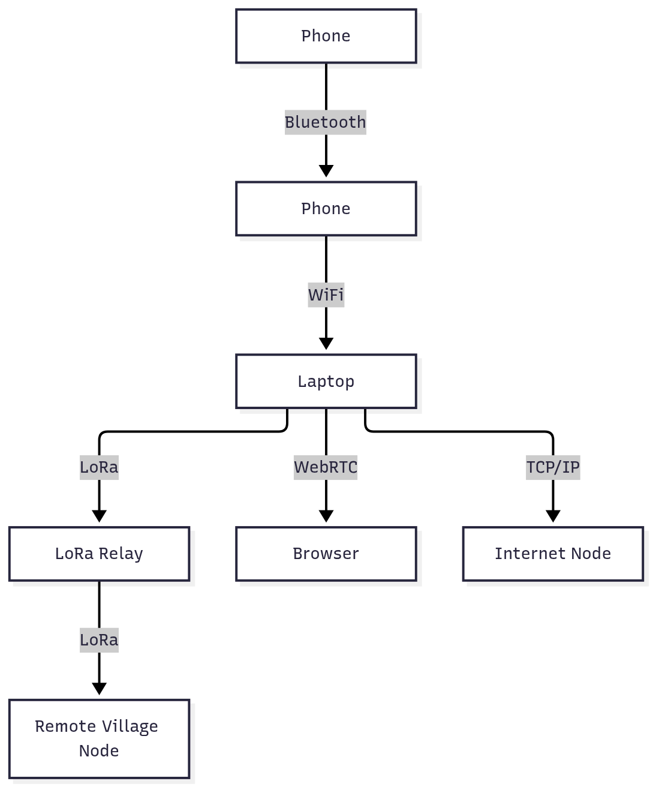

# Transports & Protocols

---

## Table of Contents
1. What is a Transport?
2. Supported & Planned Transports
3. Traffic Armor and Auto-Switching
4. Transport Selection: Thompson Sampling
5. How Transports Work (Plain & Technical)
6. Which Transport When
7. Real-World Use Cases
8. Configuration & Code Examples
9. Visual Guide: Transport Topologies
10. Best Practices & Anti-Patterns
11. Troubleshooting & FAQ
12. Further Reading & Resources

---

## 1. What is a Transport?

- **Plain:** A transport is the "road" your messages travel on: WiFi Direct, LoRa, stealth TCP, WebRTC, and more.
- **Technical:** In GhostWire, each transport is a pluggable module implementing the `Transport` trait, allowing for runtime or compile-time enable/disable.

---

## 2. Supported & Planned Transports

> Status verified 2026-09-28 against `rescue/sep-disk-tree` @ `e4028f2`. Evidence and file:line references: [docs/BIBLE_STATUS_SPINE.md](../BIBLE_STATUS_SPINE.md) §4. This table is generated from that file — if you edit one, edit the other.

| Transport | Status | Use Case / Notes |
|-----------|--------|-----------------|
| stealth TCP | **Working** | Evades DPI, auto-escalates when blocked. 615 lines, wired at `transport.rs:12` |
| WebRTC | **Working** | Browser-to-browser, disguises as video call traffic. Real `webrtc::tokio::Transport` in the swarm at `mesh.rs:262-277` |
| Reticulum | **Working** (feature-flagged) | Encapsulated transport, 883 lines, wired at `transport.rs:17`. Enable with `reticulum = true` |
| QUIC | Implemented, not on mesh handshake | Present in `TransportKind`; downgrade refusal wired into QUIC only |
| Bluetooth LE | **Skeleton** | 63 lines. `send_ble_data` logs "Skeleton" and returns `Ok(())`; `stop_scanning` is a no-op; `/ble/*` routes commented out at `web.rs:552-554` |
| WiFi Direct | **Platform boundary only** | `medium_adapter.rs:111-130` returns `unsupported_snapshot` — "OS provider is not installed" |
| LoRa | **Not implemented** | No LoRa transport exists in the codebase. `disaster.rs:65` defines a `LoRa` variant used only as a selector weight. `TODO.md:186`: "Protocol is defined but no hardware integration" |

---

## 3. Traffic Armor and Auto-Switching

GhostWire's Traffic Armor makes your mesh traffic look like ordinary web traffic so it is harder to identify, block, or throttle.

- **WebRTC Disguise:** WebRTC traffic is shaped to look like a Discord-style voice or video call. Deep packet inspection cannot easily distinguish it from legitimate real-time communication.
- **stealth TCP:** Evades DPI (Deep Packet Inspection) by obfuscating packet headers and payload patterns. When a network blocks stealth TCP, the transport auto-escalates: it falls back to WebRTC or Reticulum, which use different obfuscation strategies.
- **Auto-Switching:** If one transport is blocked or degraded, GhostWire automatically tries alternatives. The selection is not random; it is guided by the Thompson Sampling algorithm described below.

---

## 4. Transport Selection: Thompson Sampling

GhostWire uses Thompson Sampling, a bandit algorithm, to balance reliability, latency, and energy efficiency when choosing which transport to use for each message. Each transport is modeled as a slot machine with a probability distribution over its expected quality. The algorithm explores transports that are uncertain and exploits those that have proven reliable.

Energy-efficiency weights guide the exploration-exploitation tradeoff:

| Transport | Energy Efficiency Weight |
|-----------|------------------------|
| Bluetooth LE | 0.30 |
| LoRa | 0.35 |
| Reticulum | 0.25 |
| WiFi Direct | 0.05 |
| TCP/QUIC | 0.00 |

Higher weights mean the transport is preferred when energy is the dominant concern. On battery-powered devices, the algorithm favors LoRa and Bluetooth LE. On plugged-in devices, WiFi Direct and WebRTC get higher priority because they offer lower latency and higher bandwidth.

---

## 5. How Transports Work (Plain & Technical)

### Plain-Language
- Devices use whatever "roads" are available to connect: WiFi Direct for local mesh, LoRa for long distance, WebRTC for browser-based communication.
- GhostWire automatically picks the best available transport, or you can choose manually.

### Technical
- Each transport implements the `Transport` trait in Rust:
    ```rust
    pub trait Transport {
        fn send(&self, msg: Message) -> Result<(), TransportError>;
        fn receive(&self) -> Option<Message>;
        fn is_available(&self) -> bool;
        // ...
    }
    ```
- Transports can be enabled/disabled at runtime via config or UI.
- Multiple transports can be active at once for resilience.

---

## 6. Which Transport When

| Scenario | Recommended Transport(s) | Why |
|----------|------------------------|-----|
| Indoor messaging, low latency | WiFi Direct | High bandwidth, low latency, no external hardware needed |
| Rural area, no internet | LoRa | Long-range, low-power, works without infrastructure |
| Censored or monitored network | stealth TCP, WebRTC | Evades DPI, disguises as ordinary traffic |
| Browser-based peer-to-peer | WebRTC | No plugins, NAT traversal built in |
| Maximum anonymity, obfuscation | Reticulum | Encapsulated, feature-flagged for advanced users |
| Mobile, battery-constrained | Bluetooth LE (when available) | Very low energy, short range |
| Mixed environment | Multiple transports active | Thompson Sampling picks the best option per message |

---

## 7. Real-World Use Cases

### Disaster Response
- **Scenario:** Power and cell towers are down after a hurricane.
- **Solution:** LoRa nodes relay messages across miles; WiFi Direct and WebRTC fill in gaps.

### Urban Mesh
- **Scenario:** Protesters need secure, local communication.
- **Solution:** Phones use WiFi Direct and WebRTC to form a dense, resilient mesh. stealth TCP evades network monitoring.

### Rural Connectivity
- **Scenario:** Villages with no internet need to share news.
- **Solution:** LoRa radios connect homes and farms over long distances.

### Connectivity in Constrained Environments
- **Scenario:** Authorities restrict internet access or monitor traffic.
- **Solution:** stealth TCP and WebRTC provide obfuscated, hard-to-block channels. Traffic Armor disguises the traffic as ordinary video-call or web traffic.

---

## 8. Configuration & Code Examples

### Enabling/Disabling Transports (Config)
```toml
[transports]
bluetooth = false
wifi = true
lora = true
webrtc = true
tcpip = true
stealth_tcp = true
# reticulum = true  # Uncomment to enable Reticulum (feature-flagged)
```

### Using Transports in Code
```rust
let wifi = WifiDirectTransport::new();
let lora = LoRaTransport::new();
backend.add_transport(Box::new(wifi));
backend.add_transport(Box::new(lora));
```

### Web UI Example
- Go to Settings > Transports
- Toggle available transports on/off
- See real-time status and diagnostics

---

## 9. Visual Guide: Transport Topologies



---

## 10. Best Practices & Anti-Patterns

### Best Practices
- Enable multiple transports for best coverage.
- Test transport availability before deployment.
- Use LoRa for long-range, low-power needs.
- Use WebRTC or stealth TCP for connectivity in constrained environments.
- Monitor transport health in the UI.
- Let Thompson Sampling manage transport selection when you are unsure.

### Anti-Patterns
- Relying on a single transport.
- Disabling security features on transports.
- Ignoring hardware compatibility.
- Forcing a transport when Thompson Sampling would choose a better option.

---

## 11. Troubleshooting & FAQ

| Problem | Solution |
|---------|----------|
| Can't connect via Bluetooth LE | Check permissions, try WiFi Direct or LoRa |
| LoRa not working | Check hardware, drivers, and range |
| WebRTC fails | Check firewall/NAT, try TCP/IP or stealth TCP fallback |
| stealth TCP blocked | Auto-escalation should switch to WebRTC or Reticulum; check if feature flag is enabled |
| Slow performance | Use higher-bandwidth transport if possible |
| Security warning | Ensure encryption is enabled on all transports |

---

## 12. Further Reading & Resources
- [LoRa Alliance](https://lora-alliance.org/)
- [Bluetooth Mesh](https://www.bluetooth.com/learn-about-bluetooth/bluetooth-technology/bluetooth-mesh-networking/)
- [WebRTC](https://webrtc.org/)
- [Mesh Networking 101](https://en.wikipedia.org/wiki/Mesh_networking)
- [GhostWire Developer Guide](12_developer_guide.md)

---

## End of Chapter
