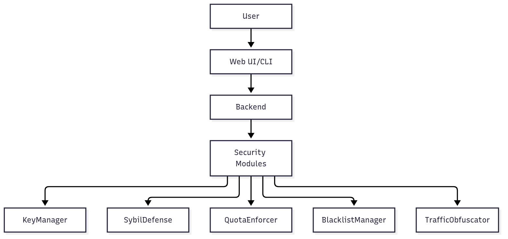

# Security & Privacy

---

## Table of Contents
1. Executive Summary
2. Security Foundations (Plain & Technical)
3. Threat Models & Real-World Risks
4. Security Architecture & Modules
5. Encryption & Key Management
6. Sybil Defense & Trust
7. Quotas, Blacklists, and Abuse Prevention
8. Traffic Obfuscation & Anti-Analysis
9. Disaster & Infrastructure Failure Scenarios
10. Best Practices & Anti-Patterns
11. Actionable Security Checklists
12. Visuals: Security Layers & Flows
13. FAQ & Troubleshooting
14. Further Reading & Resources

---

## 1. Executive Summary

GhostWire is built with security and privacy as core principles. This chapter explains how GhostWire protects users, what threats it defends against, and how to use its security features, whether you are a non-technical user or a security engineer.

---

## 2. Security Foundations (Plain & Technical)
- **Plain:** GhostWire keeps your messages private and your identity safe, even if someone tries to spy or block you.
- **Technical:** End-to-end encryption (XChaCha20-Poly1305, X25519), perfect forward secrecy, ephemeral keys, key rotation, secure storage, and **hybrid post-quantum key establishment (ML-KEM-768) — implemented and tested**, not planned.

---

## 3. Threat Models & Real-World Risks
- **Connectivity Loss:** Governments, ISPs, or natural disasters causing communication blackouts.
- **Surveillance:** Adversaries trying to read or analyze messages.
- **Sybil Attacks:** Fake nodes trying to disrupt or spy on the mesh.
- **Denial of Service:** Flooding the network to disrupt communication.
- **Traffic Analysis:** Inferring who is talking to whom, even if messages are encrypted.
- **Device Seizure:** Physical access to a device running GhostWire.

---

## 4. Security Architecture & Modules
- **SybilDefense:** Prevents fake nodes from overwhelming the mesh.
- **QuotaEnforcer:** Limits message rates to prevent spam/DoS.
- **BlacklistManager:** Blocks known abusers or compromised nodes.
- **TrafficObfuscator:** Makes traffic patterns harder to analyze.
- **KeyManager:** Handles encryption keys, rotation, and secure storage.

---

## 5. Encryption & Key Management
- **End-to-end encryption:** All messages are encrypted from sender to recipient.
- **Key exchange:** X25519 for secure, ephemeral key exchange.
- **Key rotation:** Regularly rotates keys for forward secrecy.
- **Secure storage:** Keys are stored encrypted on disk.
- **Post-quantum:** Research and planning for future upgrades.

---

## 6. Modern Crypto & Identity Stack

GhostWire deploys a layered cryptographic and identity system designed for both current threats and future risks.

### Post-Quantum Key Encapsulation
- **ML-KEM-768:** GhostWire integrates ML-KEM-768 (Module-Lattice-Based Key-Encapsulation Mechanism at the 768-bit security level) for post-quantum key establishment, combined with classical X25519 in a hybrid handshake. Measured encapsulation is **10.5 microseconds** on x86_64 development hardware (`cargo bench --bench hot_paths -- mlkem768`; keygen 10.5 us, decapsulation 11.2 us). Constrained embedded hardware will be slower — these figures have not been measured on a Raspberry Pi-class device, and should not be quoted as on-device numbers until they are.
- **Hybrid mode:** ML-KEM-768 is combined with X25519 during the transition period, so a session retains security even if one algorithm is later broken.

### Symmetric Encryption
- **XChaCha20-Poly1305:** The message cipher. Provides authenticated encryption with associated data (AEAD), ensuring both confidentiality and integrity. It uses a 192-bit nonce, which removes the nonce-reuse risk that affects standard ChaCha20, and performs well on devices without AES hardware acceleration.

  > **Correction:** earlier revisions of this chapter described **AES-256-GCM** as the default cipher with XChaCha20 as a fallback. The codebase uses XChaCha20-Poly1305 throughout (`core/encryption.rs`); there is no AES-GCM on the message path.
- **Ed25519 / X25519:** Ed25519 signs and authenticates identities; X25519 provides the classical half of the key exchange, which is then mixed with the ML-KEM-768 shared secret via HKDF to form a 1,248-byte hybrid key. Hybrid key exchange means a session stays secure even if either the classical or the post-quantum assumption is later broken.

### Key Exchange and Forward Secrecy
- **X25519:** Elliptic-curve Diffie-Hellman key exchange on the Curve25519 group. Provides fast, constant-time key agreement.
- **Perfect Forward Secrecy (PFS):** Every session generates ephemeral key pairs. Compromise of a long-term key does not expose past session traffic. Keys are rotated after each session and at defined intervals during active conversations.

### Duress PIN and Coercion Resistance
- **Duress PIN:** Users can configure a secondary PIN that, when entered under coercion, unlocks a plausible-deniability mode. The device presents a harmless or empty view of the mesh while the real identity and keys remain cryptographically hidden.
- **Plausible deniability under seizure:** If a device is seized, the duress PIN mode ensures that an adversary cannot distinguish whether real data exists on the device. Encrypted volumes and key material remain inaccessible without the primary credentials.

### Identity: DIDs, Shamir Secret Sharing, Dead Man's Switch
- **Decentralized Identifiers (DIDs):** GhostWire assigns each node a DID that is not tied to any central authority. DIDs enable verifiable, self-sovereign identity across meshes without relying on a directory server.
- **Shamir Secret Sharing:** Recovery keys are split into shares distributed among trusted contacts. A threshold number of shares is required to reconstruct the master key, preventing single-point failure and single-point compromise.
- **Dead Man's Switch:** If a node goes silent beyond a configured timeout, the dead man's switch triggers and can notify trusted contacts or publish a revocation certificate. The timer logic is implemented, but **the wipe itself is not performed by the current code** — `panic.rs:151-155` explicitly leaves it to the caller, and `execute_panic` has no production call site. Treat key wiping as a planned integration, not a working feature.
- **Device Pairing:** New devices pair via a secure out-of-band channel (QR code scan, near-field broadcast, or in-person verification). Pairing establishes a shared secret without exposing it to network observers.
- **KERI (Key Event Receipt Infrastructure):** Planned for future integration. KERI provides a fully decentralized, append-only log of key events, enabling trust anchoring without certificate authorities.

### Privacy Tiers (L0-L3)
GhostWire enforces privacy levels that adapt to device capabilities and battery state:

| Tier | Device Type | Metadata Exposure | Cover Traffic |
|------|------------|-------------------|---------------|
| L3 | Server | Minimal | Full |
| L2 | Laptop, Tablet | Reduced | Partial |
| L1 | Phone, Raspberry Pi | Basic | Minimal |
| L0 | Any device (battery critical) | Maximum | None |

- **Server nodes** operate at L3 with full cover traffic and minimal metadata leakage.
- **Laptops and tablets** operate at L2 with reduced metadata and partial cover traffic.
- **Phones and Raspberry Pi** operate at L1 with basic protections.
- **When battery drops below 20%,** the device automatically drops one privacy tier to conserve energy.

### SPHINX Unlinkable Replies and Cover Traffic
- **SPHINX (Scalable Hybrid Incremental N-way Exchange):** GhostWire uses SPHINX-style onion routing for replies. Each message is wrapped in multiple layers of encryption so that intermediate nodes can only decrypt the layer intended for them. No single node knows both the sender and the ultimate recipient.
- **Unlinkable Replies (SURBs):** Single-Use Reply Blocks allow a recipient to reply without revealing their identity to the sender or any intermediary. Each SURB is consumed after one use.
- **Cover traffic:** Nodes generate dummy packets at regular intervals to mask the timing and volume of real messages. This defeats traffic analysis that relies on observing communication patterns.

---

## 7. Sybil Defense & Trust
- **Proof-of-Work/Stake:** Optional modules to make Sybil attacks expensive.
- **Reputation:** Nodes can build trust over time.
- **Manual approval:** Option for closed/curated meshes.

---

## 8. Quotas, Blacklists, and Abuse Prevention
- **Quotas:** Rate limits on messages, connections, and actions.
- **Blacklists:** Block known abusers or compromised nodes.
- **Automated & manual controls:** Admins can adjust settings in real time.

---

## 9. Traffic Obfuscation & Anti-Analysis
- **Padding:** Adds random data to messages to hide true size.
- **Timing obfuscation:** Randomizes message timing to prevent correlation.
- **Stealth transports:** Use WebRTC, Stealth TCP, or other obfuscated channels.
- **Traffic Armor:** WebRTC traffic is disguised to look like a video call. Stealth TCP automatically escalates to alternative protocols when blocked.

---

## 10. Disaster & Infrastructure Failure Scenarios
- **Disaster mode:** Store-and-forward, minimal metadata, offline queuing.
- **Connectivity resilience:** Privacy-enhanced transports, traffic obfuscation, rapid key rotation.

---

## 11. Best Practices & Anti-Patterns
### Best Practices
- Always use the latest version.
- Enable all security modules.
- Use strong passwords and device security.
- Educate users about privacy features.
### Anti-Patterns
- Disabling encryption or security modules.
- Using default passwords.
- Ignoring updates or logs.

---

## 12. Actionable Security Checklists
- [ ] Update software regularly
- [ ] Enable all security modules
- [ ] Use strong, unique passwords
- [ ] Monitor mesh health and logs
- [ ] Educate users on privacy and security
- [ ] Verify ML-KEM-768 is enabled on supported nodes
- [ ] Confirm perfect forward secrecy is active on all sessions
- [ ] Test duress PIN mode before deployment
- [ ] Configure dead man's switch timeout
- [ ] Distribute Shamir secret sharing shares to trusted contacts

---

## 13. Visuals: Security Layers & Flows

---

## 14. FAQ & Troubleshooting
- **Q: How do I know my messages are secure?**
  - All messages are end-to-end encrypted by default.
- **Q: What if my device is seized?**
  - Keys are encrypted on disk; use device encryption for extra safety. Enable duress PIN mode for plausible deniability.
- **Q: Can I disable security features?**
  - Not recommended; only for advanced users in test environments.
- **Q: What is ML-KEM-768?**
  - A post-quantum key encapsulation mechanism that protects against future quantum computer attacks. Measured at 10.5 microseconds on x86_64 development hardware; constrained-device figures are not yet measured.
- **Q: How does the duress PIN work?**
  - Entering the duress PIN activates a plausible-deniability mode that hides real data from coercive actors.

---

## 15. External Audit Status

**An external security audit has NOT been performed.** GhostWire's current protections are self-reviewed engineering controls. The development team has conducted internal reviews of the cryptographic implementations, module interactions, and threat model coverage.

**External audit is PLANNED.** Candidate auditing firms include Cure53, NCC Group, and Least Authority. No engagement has been confirmed and no audit has commenced as of September 2026.

Users and organizations deploying GhostWire should understand that:
- All security claims in this document reflect self-assessed engineering confidence, not third-party verification.
- The cryptographic designs (ML-KEM-768, XChaCha20-Poly1305, X25519 with PFS) are based on well-studied, published algorithms, but their integration into GhostWire has not been independently audited.
- Organizations requiring certified security assurance should plan for an external audit before deploying GhostWire in production environments handling sensitive data.

---

## 16. Further Reading & Resources
- [EFF Surveillance Self-Defense](https://ssd.eff.org/)
- [OWASP Top 10](https://owasp.org/www-project-top-ten/)
- [GhostWire Advanced Security](10_advanced_security.md)
- [NIST Post-Quantum Cryptography Standards](https://csrc.nist.gov/projects/post-quantum-cryptography)
- [Signal Protocol Design](https://signal.org/docs/)

---

## End of Chapter
