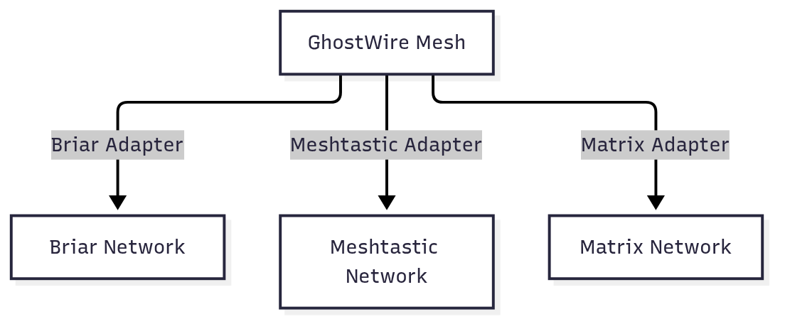

# Protocol Adapters

---

## Table of Contents
1. What is a Protocol Adapter?
2. Supported & Planned Adapters
3. How Adapters Work (Plain & Technical)
4. The Adapter Registry
5. Real-World Bridging Scenarios
6. Configuration & Code Examples
7. Visual Guide: Adapter Topologies
8. Companion Projects
9. Developer Notes & API Reference
10. Best Practices & Anti-Patterns
11. Troubleshooting & FAQ
12. Further Reading & Resources

---

## 1. What is a Protocol Adapter?

- **Plain:** A protocol adapter is like a translator that lets GhostWire talk to other messaging networks (like Matrix, Meshtastic, Briar).
- **Technical:** Adapters are software modules that translate messages and events between GhostWire and other protocols, enabling cross-network messaging, group chat, and file sharing.

---

## 2. Supported & Planned Adapters

| Adapter | Status | Notes / Features |
|---------|--------|-----------------|
| Matrix | Planned | No matrix bridge module exists in the codebase. A `matrix-bridge` feature name appears in older notes; there is no implementation behind it. |
| Meshtastic | Planned | No meshtastic module exists. Erasure coding (3 data + 2 parity shards) is implemented for LoRa framing, but there is no bridge — and LoRa itself is not implemented. |
| Briar | Planned | Contact-based messaging, offline queuing, groups |
| Reticulum bridge | Planned/experimental | Feature `reticulum`; experimental bridge to Reticulum mesh |
| Tor | Not implemented | No Tor bridge exists yet |
| Custom | Supported | Build your own adapter via the adapter registry |

---

## 3. How Adapters Work (Plain & Technical)

### Plain-Language
- Adapters "translate" messages so GhostWire can talk to other networks.
- You can bridge a GhostWire mesh to Matrix, Meshtastic, or Briar, sharing messages and files.

### Technical
- Each adapter implements the `ProtocolAdapter` trait in Rust:
    ```rust
    pub trait ProtocolAdapter {
        fn send(&self, msg: Message) -> Result<(), AdapterError>;
        fn receive(&self) -> Option<Message>;
        fn connect(&self) -> Result<(), AdapterError>;
        // ...
    }
    ```
- Adapters handle translation, deduplication, relay, and group management.
- **Note on Briar:** Internal structs inspired by Briar exist in the codebase, but a real Briar bridge has not been built yet. The "Briar" adapter remains in the Planned state.

---

## 4. The Adapter Registry

GhostWire uses an adapter registry to manage ProtocolAdapter instances at runtime. To add a new bridge adapter:

1. Implement the `ProtocolAdapter` trait for your adapter.
2. Register the adapter at startup via the registry.
3. The backend will load and initialize the adapter automatically.
4. Test both directions: GhostWire-to-external and external-to-GhostWire.

The registry is the single entry point for all adapters. It ensures that adapters are initialized in the correct order, that dependencies are resolved, and that failed adapters do not crash the backend. See the Matrix and Meshtastic adapters as reference implementations.

---

## 5. Real-World Bridging Scenarios

### Disaster Response
- **Scenario:** GhostWire mesh bridges to Meshtastic LoRa radios for long-range communication.
- **Outcome:** First responders can relay messages between phone users and LoRa devices.
- **Quotable:** "GhostWire to Meshtastic lets a phone talk over LoRa through a nearby relay."

### Activist Network
- **Scenario:** Protesters use GhostWire to bridge to Matrix for global reach.
- **Outcome:** Local mesh messages are relayed to Matrix rooms, connecting to the outside world.

### Rural Community
- **Scenario:** GhostWire connects to Briar for secure, contact-based messaging.
- **Outcome:** Villagers can chat securely, even offline. (Note: Briar bridge is Planned, not yet implemented.)

---

## 6. Configuration & Code Examples

### Enabling/Disabling Adapters (Config)
```toml
[adapters]
briar = false
meshtastic = true
matrix = true  # Requires the matrix-bridge feature flag
custom = true
```

### Using Adapters in Code
```rust
let matrix = MatrixAdapter::new();
let meshtastic = MeshtasticAdapter::new();
backend.add_adapter(Box::new(matrix));
backend.add_adapter(Box::new(meshtastic));
```

### Web UI Example
- Go to Settings > Adapters
- Toggle available adapters on/off
- See real-time status and diagnostics

---

## 7. Visual Guide: Adapter Topologies



---

## 8. Companion Projects

Two companion projects extend the adapter ecosystem:

- **ghostwire-dtn:** A delay-tolerant networking crate that provides store-and-forward capabilities for adapter-based bridges. Useful when the target network does not support real-time messaging.
- **sphinx-rs:** A Rust implementation of the SPHINX onion-routing protocol, used for metadata protection across adapter bridges.

---

## 9. Developer Notes & API Reference

- **Implementing a new adapter:**
    - Implement the `ProtocolAdapter` trait.
    - Handle message translation, deduplication, and relay.
    - Register the adapter in the backend via the adapter registry.
    - Test both directions (GhostWire-to-external and external-to-GhostWire).
- **Reference implementations:** The Reticulum transport (`transport.rs:17`, 883 lines) is the one real interop in the codebase. Matrix and Meshtastic adapters are not implemented — see the status table above.
- **API Reference:**
    - See Developer Guide for full trait and API docs.

---

## 10. Best Practices & Anti-Patterns

### Best Practices
- Test adapters in isolated environments before production.
- Keep adapters updated for protocol changes.
- Monitor adapter health and logs.
- Test both directions of message flow.
- Use the adapter registry for all adapter registration.

### Anti-Patterns
- Relying on a single adapter for all bridging.
- Disabling security features on adapters.
- Ignoring protocol updates.
- Registering adapters outside the registry.

---

## 11. Troubleshooting & FAQ

| Problem | Solution |
|---------|----------|
| Can't connect to Matrix | Check credentials, server URL, and network; verify `matrix-bridge` feature flag is enabled |
| Briar messages not relayed | Briar bridge is Planned; not yet implemented |
| Meshtastic bridge fails | Check LoRa hardware and adapter config; verify erasure coding parameters |
| Duplicate messages | Ensure deduplication is enabled |
| Adapter not loading | Check that the adapter is registered via the adapter registry |

---

## 12. Further Reading & Resources
- [Matrix Protocol](https://matrix.org/)
- [Briar Project](https://briarproject.org/)
- [Meshtastic](https://meshtastic.org/)
- [GhostWire Developer Guide](12_developer_guide.md)
- [ghostwire-dtn](https://github.com/phantomojo/ghostwire-dtn)
- [sphinx-rs](https://github.com/phantomojo/sphinx-rs)

---

## End of Chapter
