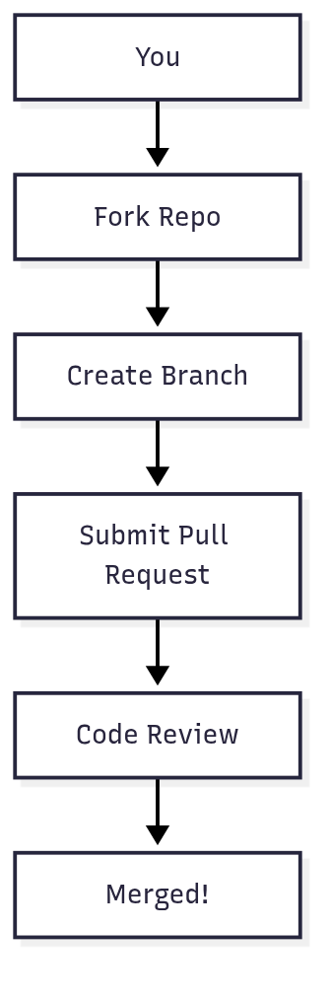

# Contributing & Community

---

## Table of Contents

1. Welcome & Philosophy
2. How Anyone Can Contribute
3. Code Contributions (Technical)
4. Writing, Design, and Outreach
5. Community Guidelines & Code of Conduct
6. Example Contribution Journey
7. Visuals: Contribution Flow
8. Best Practices for Contributors
9. Further Reading & Resources

---

## 1. Welcome & Philosophy

GhostWire is open to everyone, whether you are a coder, writer, designer, tester, or just curious. Here is how you can help build the future of secure, decentralized communication.

---

## 2. How Anyone Can Contribute

- **Test the app:** Try GhostWire and give feedback.
- **Report bugs:** Found a problem? Open an issue on GitHub.
- **Write docs:** Help make guides clearer for everyone.
- **Design:** Improve the UI/UX or create graphics.
- **Spread the word:** Share GhostWire with your community.
- **Join discussions:** Help shape the roadmap and features.

---

## 3. Code Contributions (Technical)

- **Code style:**
  - Rust: Follow rustfmt and clippy guidelines.
  - JS/TS: Use Prettier and ESLint.
- **How to contribute:**
  1. Fork the repo on GitHub.
  2. Create a feature branch.
  3. Make your changes and add tests.
  4. Run all tests and linters.
  5. Submit a pull request with a clear description.
- **Review process:**
  - All PRs are reviewed for security, style, and clarity.
  - Feedback is constructive and focused on improvement.

---

## 4. Writing, Design, and Outreach

- **Docs:** Improve guides, add visuals, translate content.
- **Design:** Create logos, UI mockups, infographics.
- **Outreach:** Write blog posts, give talks, organize events.

---

## 5. Community Guidelines & Code of Conduct

- **Be respectful:** Treat everyone with kindness and respect.
- **Be inclusive:** Welcome contributors of all backgrounds and skill levels.
- **No harassment:** Zero tolerance for abuse or discrimination.
- **Help others:** Support newcomers and share knowledge.

---

## 6. Example Contribution Journey

The following are hypothetical examples showing common paths new contributors take. They are not real stories but illustrate what a typical contribution looks like.

**Example 1: Documentation fix**
A contributor notices a typo in the FAQ chapter. They fork the repo, edit the markdown file, and submit a pull request. The fix is reviewed and merged within a day. This is a common first contribution because it requires minimal code knowledge.

**Example 2: Transport implementation**
A developer wants to add a new transport. They implement the `Transport` trait, write unit tests, and register it in the adapter registry. After code review and a few rounds of feedback, the transport is merged. This path requires deeper Rust knowledge.

**Example 3: Design contribution**
A designer creates a new icon set for the web UI. They submit the assets through a pull request with a preview. The design team reviews the assets for consistency with the project style guide.

---

## 7. Visuals: Contribution Flow

---

## 8. Best Practices for Contributors

- Communicate clearly and kindly.
- Ask questions if you are unsure.
- Test your changes before submitting.
- Review the documentation and guidelines.
- Celebrate your contributions.

---

## 9. Further Reading & Resources

- [GhostWire GitHub](https://github.com/phantomojo/GhostWire-secure-mesh-communication)
- [CONTRIBUTING.md](../CONTRIBUTING.md)
- [Code of Conduct](../ghostwire/CODE_OF_CONDUCT.md)
- [Open Source Guides](https://opensource.guide/)

---

## End of Chapter
