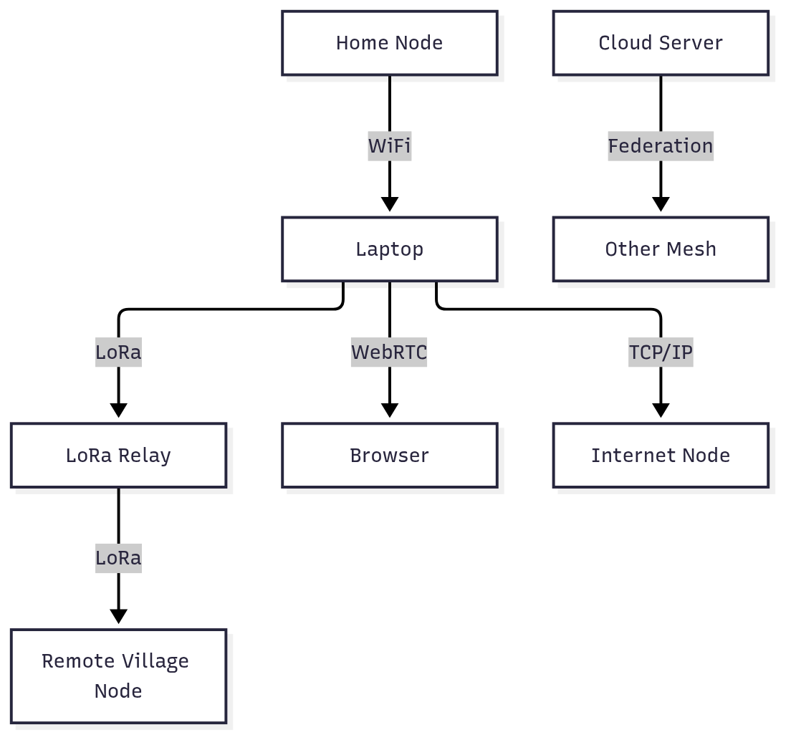

# Deployment & Operations

---

## Table of Contents
1. Overview
2. Deployment Scenarios
3. Assigning Roles by Power and Hardware
4. Step-by-Step Deployment Guides
5. Docker, Cloud, and Bare-Metal Installations
6. Monitoring, Logging, and Maintenance
7. Visuals: Deployment Topologies
8. Troubleshooting & Recovery
9. Best Practices & Anti-Patterns
10. Further Reading & Resources

---

## 1. Overview

This chapter covers how to deploy, operate, and maintain GhostWire in a variety of real-world scenarios, from a single home node to a city-wide mesh. Both non-technical and technical readers will find step-by-step guides, visuals, and best practices.

---

## 2. Deployment Scenarios

### Home/Personal Mesh
- **Goal:** Connect a few devices (phones, laptops) for secure messaging at home or in a small group.
- **Steps:**
  1. Download and install the GhostWire app or desktop client.
  2. Start the app and select your preferred transport (WiFi Direct, LoRa).
  3. Invite nearby devices to join your mesh.

### Community/Neighborhood Mesh
- **Goal:** Connect dozens of devices across a neighborhood or event.
- **Steps:**
  1. Deploy GhostWire on laptops, phones, and LoRa relays.
  2. Use WiFi Direct and LoRa for coverage.
  3. Assign some nodes as relays for better reach.

### Disaster/Field Deployment
- **Goal:** Restore communication after infrastructure failure.
- **Steps:**
  1. Deploy LoRa nodes at key locations (battery/solar powered).
  2. Use store-and-forward for offline delivery.
  3. Federate with other meshes if possible.

### Enterprise/Federated Mesh
- **Goal:** Connect multiple sites, enable advanced security, and integrate with existing systems.
- **Steps:**
  1. Deploy GhostWire on servers (bare-metal or cloud).
  2. Use Docker or Kubernetes for scaling.
  3. Integrate with protocol adapters for interoperability.

---

## 3. Assigning Roles by Power and Hardware

GhostWire assigns roles based on device capability. The right device in the right role makes the mesh faster, more resilient, and easier to operate.

### Device Classes

| Class | RAM | Max Peers | Typical Device |
|-------|-----|-----------|----------------|
| Phone | <=6GB | 20 | Consumer smartphone |
| Tablet | <=8GB | 30 | iPad, Android tablet |
| Raspberry Pi | <=4GB | 15 | Pi 4, Pi 5 |
| Laptop | <=16GB | 50 | Consumer laptop, ultrabook |
| Server | >16GB | 100+ | Rack server, cloud VM |

### Roles
- **Full Node:** Stores the complete mesh state. Participates in routing and relay. Requires the most resources.
- **Relay:** Forwards messages between nodes. Relays are the backbone of the mesh.
- **Leaf:** Connects to the mesh but does not relay for others. Lowest resource requirement.
- **Sensor:** Publishes telemetry or data feeds. Lightweight, often battery-powered.
- **Replicator:** Maintains copies of critical data for disaster recovery. Operates on servers or dedicated hardware.

### Role Assignment Principles
- "Assign key nodes (with good power and connectivity) as relays."
- "Use devices with more RAM/CPU for relays."
- Relays carry no trust authority. A relay forwards packets but cannot read their contents.

### Battery States and Role Behavior
GhostWire adjusts node behavior based on battery level:

| Battery State | Behavior |
|---------------|----------|
| Charging | Unrestricted. Full role, full cover traffic. |
| Above 50% | Normal operation. All roles available. |
| 20-50% | Cut cover traffic by 30% to conserve energy. |
| 20% or below | Drop to privacy L0/L1. Minimize all non-essential activity. |

### Solar and Battery-Powered LoRa Relays
LoRa relays in remote deployments run on solar panels with battery backup. These nodes prioritize store-and-forward messaging and minimize radio wake time. During low-light conditions, the relay drops to L1 privacy and reduces transmission frequency.

### Supernode Election Operations
- Elect nodes with high uptime, stable IP addresses, and good bandwidth as "Relay Hubs."
- Relay Hubs form the backbone of the mesh and handle inter-region traffic.
- Regional sharding is planned for v3/v4, where each geographic region operates its own DHT shard connected to a global backbone.
- Supernode election uses uptime history, bandwidth measurements, and peer reputation scores.

### ESP32 Gateway-Bridged Deployments
- **$20 ESP32 mini-mesh:** A low-cost ESP32 board running a lightweight mesh client bridged to WiFi. Ideal for adding legacy sensors or very low-power nodes to a WiFi-based mesh.
- **$100 Raspberry Pi gateway:** A Pi running GhostWire with a WiFi adapter and LoRa module. Bridges between WiFi Direct, LoRa, and the broader internet.
- **Server-class backbone:** A dedicated server acting as the root relay and federation point. Handles the highest peer counts and provides the bridge to external networks.

### OEM Battery Optimization Note
Many consumer devices sold in Kenya and East Africa come from OEMs such as Samsung, Xiaomi, Huawei, OPPO, and Transsion. These manufacturers aggressively optimize battery usage and may kill background processes. Follow the dontkillmyapp guidance to ensure GhostWire continues running in the background. Whitelist the GhostWire process in battery optimization settings and disable aggressive app standby modes.

---

## 4. Step-by-Step Deployment Guides

### Local (Laptop/Desktop)
1. Download and install GhostWire.
2. Run the backend and web UI.
3. Join or create a mesh.

### Docker
1. Pull the GhostWire Docker image:
   ```sh
   docker pull phantomojo/ghostwire:latest
   ```
2. Run the container:
   ```sh
   docker run -d -p 3000:3000 -p 9000:9000 phantomojo/ghostwire:latest
   ```
3. Access the web UI at [http://localhost:3000](http://localhost:3000)

### Cloud (AWS, GCP, Azure)
1. Provision a VM or container instance.
2. Install Docker or run natively.
3. Open required ports (3000, 9000, LoRa if needed).
4. Secure with firewalls and access controls.

### Bare-Metal
1. Install Rust and Node.js.
2. Build and run GhostWire as per Getting Started.
3. Set up systemd service for auto-restart.

---

## 5. Docker, Cloud, and Bare-Metal Installations
- **Docker:** Easiest for quick deployment and scaling.
- **Cloud:** Use for global reach, federation, and integration.
- **Bare-Metal:** Best for custom hardware, edge, or offline use.

---

## 6. Monitoring, Logging, and Maintenance
- **Monitoring:**
  - Use built-in web UI dashboard for node status and health.
  - Integrate with Prometheus/Grafana for advanced metrics.
- **Logging:**
  - Backend logs to file and stdout.
  - Use log rotation for long-term deployments.
- **Maintenance:**
  - Regularly update software.
  - Backup configuration and keys.
  - Test failover and recovery procedures.

---

## 7. Visuals: Deployment Topologies


---

## 8. Troubleshooting & Recovery
| Problem                        | Solution                                      |
|-------------------------------|-----------------------------------------------|
| Node won't start               | Check logs, ensure dependencies are installed  |
| Can't connect to mesh          | Check transport settings, firewall, and ports  |
| Docker container fails         | Check image version, logs, and port mapping    |
| Cloud instance unreachable     | Check security groups, firewall, and DNS       |
| LoRa not working               | Check hardware, drivers, and permissions       |
| OEM battery killing process    | Follow dontkillmyapp guidance, whitelist app   |

---

## 9. Best Practices & Anti-Patterns
### Best Practices
- Use Docker for easy scaling and updates.
- Monitor node health and logs.
- Regularly backup configuration and keys.
- Test failover and recovery.
- Secure cloud deployments with firewalls and access controls.
- Assign relays based on device capability, not just availability.
- Follow dontkillmyapp guidance on OEM-optimized Android devices.
### Anti-Patterns
- Ignoring updates or logs.
- Using default passwords or open ports.
- Not testing disaster recovery.
- Placing low-power devices as relays.

---

## 10. Further Reading & Resources
- [Docker Documentation](https://docs.docker.com/)
- [Prometheus](https://prometheus.io/)
- [Grafana](https://grafana.com/)
- [GhostWire Developer Guide](12_developer_guide.md)
- [dontkillmyapp](https://dontkillmyapp.com/)

---

## End of Chapter
