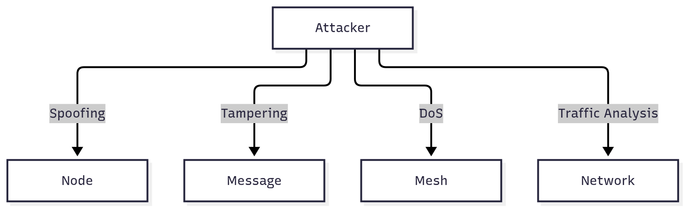
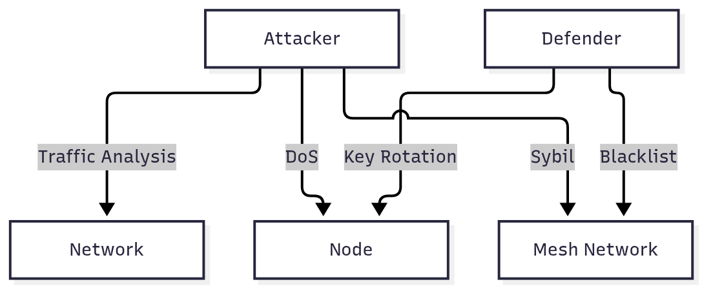

# Advanced Security & Threat Response

---

## Table of Contents
1. Overview
2. Threat Modeling (Plain & Technical)
3. Incident Response & Forensics
4. Security Module Configuration
5. Audit & Compliance
6. Example Attack/Defense Scenarios
7. Visuals: Threat Flows & Response
8. Actionable Checklists
9. Further Reading & Resources

---

## 1. Overview

This chapter is for those who want to go beyond the basics, security engineers, admins, and anyone responsible for defending a GhostWire mesh. It covers advanced threat modeling, incident response, forensics, and real-world attack/defense scenarios, with both plain-language and technical explanations.

---

## 2. Threat Modeling (Plain & Technical)
- **Plain:** Threat modeling is thinking ahead about what could go wrong and how to stop it.
- **Technical:** Use frameworks like STRIDE (Spoofing, Tampering, Repudiation, Information Disclosure, Denial of Service, Elevation of Privilege) to analyze risks.
- **Visual:**
  

---

## 3. Incident Response & Forensics
- **Preparation:**
  - Document your mesh topology and key nodes.
  - Regularly backup configuration and keys.
  - Configure dead man's switch timeouts for all relay nodes.
  - Distribute Shamir secret sharing shares to trusted contacts.
- **Detection:**
  - Monitor logs and alerts for suspicious activity.
  - Use anomaly detection tools if available.
  - Watch for unexpected peer count spikes (Sybil indicator).
  - Monitor for cover traffic pattern deviations.
- **Response:**
  - Isolate compromised nodes.
  - Rotate keys and update blacklists.
  - Communicate securely with trusted nodes.
  - Activate duress PIN mode if coercion is suspected.
  - Wipe the device manually if seizure is confirmed and the dead man's switch has not triggered — the switch notifies contacts but does not itself destroy keys.
- **Forensics:**
  - Collect logs and evidence.
  - Analyze attack vectors and entry points.
  - Report findings to the community.
  - Preserve encrypted volumes for post-incident analysis.

### Duress PIN Incident Response
If a device running GhostWire is seized or the operator is coerced:
1. **Enter duress PIN:** This activates plausible-deniability mode. The device presents a harmless or empty view of the mesh. Real identity and keys remain cryptographically hidden.
2. **Observe behavior:** Under duress mode, the device appears to have no active mesh connections and no stored messages. An adversary inspecting the device cannot distinguish this from a device that was never configured.
3. **Dead man's switch:** If the device goes silent beyond the configured timeout after seizure, the dead man's switch triggers and notifies trusted contacts. **It does not currently wipe local keys** — the wipe is left to the caller and is not wired into a production path, so an attacker who recovers the device before the switch fires still has the keys.
4. **Post-seizure recovery:** Once the operator is safe, they can use Shamir secret sharing shares to reconstruct their identity on a new device.

---

## 4. Security Module Configuration
- **SybilDefense:** Adjust proof-of-work/stake parameters.
- **QuotaEnforcer:** Set rate limits for messages and actions.
- **BlacklistManager:** Add/remove nodes as needed.
- **TrafficObfuscator:** Enable/disable padding and timing obfuscation.
- **KeyManager:** Schedule key rotation and backups.

---

## 5. Audit & Compliance
- **Audit:**
  - Regularly review logs and configuration.
  - Use automated tools for compliance checks.
- **Compliance:**
  - Follow local laws and regulations for encryption and radio use.
  - Document security policies and procedures.

### External Audit Status
**An external security audit has NOT been performed.** GhostWire's current protections are self-reviewed engineering controls. The development team has conducted internal reviews of the cryptographic implementations, module interactions, and threat model coverage.

**External audit is PLANNED.** Candidate auditing firms include Cure53, NCC Group, and Least Authority. No engagement has been confirmed and no audit has commenced as of September 2026.

Organizations requiring certified security assurance should plan for an external audit before deploying GhostWire in production environments handling sensitive data.

---

## 6. Example Attack/Defense Scenarios
- **Sybil Attack:**
  - **Attack:** Adversary floods mesh with fake nodes.
  - **Defense:** Enable SybilDefense, require proof-of-work/stake, monitor for anomalies.
- **DoS Attack:**
  - **Attack:** Flood of messages to overwhelm nodes.
  - **Defense:** Set quotas, enable rate limiting, blacklist offenders.
- **Traffic Analysis:**
  - **Attack:** Adversary infers communication patterns by observing timing, volume, and packet sizes.
  - **Defense:** Enable traffic obfuscation, use stealth transports. Traffic Armor disguises WebRTC traffic to look like a video call. Stealth TCP automatically escalates to alternative protocols when blocked. SPHINX onion routing ensures no single node knows both sender and recipient. Cover traffic generates dummy packets to mask real communication patterns.
- **Key Compromise:**
  - **Attack:** Device is seized, keys are stolen.
  - **Defense:** Use encrypted storage, rotate keys, wipe the device manually if needed. Enable duress PIN mode for plausible deniability. The dead man's switch provides automatic *notification* on extended silence; automatic key wiping is not yet wired up.
- **Device Seizure with Coercion:**
  - **Attack:** Adversary physically seizes a device and forces the operator to reveal credentials.
  - **Defense:** Duress PIN activates plausible-deniability mode. Real keys remain encrypted and inaccessible. Dead man's switch triggers if the device goes silent. Shamir secret sharing allows recovery on a new device without the seized one.

---

## 7. Visuals: Threat Flows & Response

---

## 8. Actionable Checklists
- [ ] Document mesh topology and key nodes
- [ ] Regularly backup configuration and keys
- [ ] Monitor logs and alerts
- [ ] Enable all security modules
- [ ] Review and update blacklists
- [ ] Test incident response procedures
- [ ] Test duress PIN mode before deployment
- [ ] Configure dead man's switch timeout
- [ ] Verify cover traffic is active on relay nodes
- [ ] Confirm stealth transports are configured
- [ ] Distribute Shamir secret sharing shares to trusted contacts
- [ ] Review external audit status and plan accordingly

---

## 9. Further Reading & Resources
- [OWASP Incident Response](https://owasp.org/www-community/Incident_Response)
- [NIST Cybersecurity Framework](https://www.nist.gov/cyberframework)
- [GhostWire Security & Privacy](05_security.md)
- [Signal Protocol Design](https://signal.org/docs/)
- [SPHINX Onion Routing](https://eprint.iacr.org/2017/222.pdf)

---

## End of Chapter
