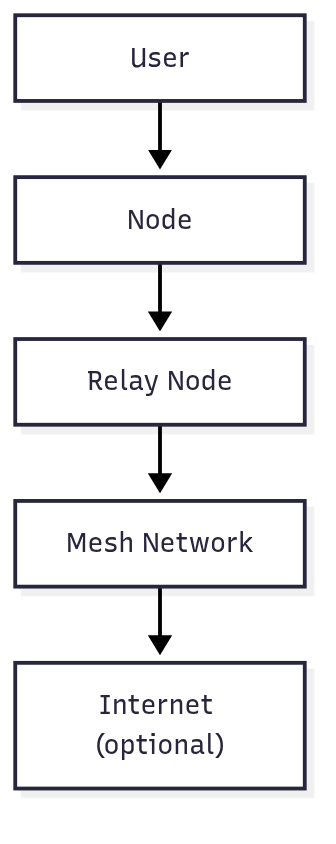

# Performance & Scaling

---

## Table of Contents
1. Overview
2. Optimization Tips
3. Benchmarks & Metrics
4. Tiered Scaling Architecture
5. Energy-Aware Transport Selection
6. AI Latency Context
7. Troubleshooting Performance
8. Visuals: Performance Flows
9. Best Practices & Anti-Patterns
10. Further Reading & Resources

---

## 1. Overview

This chapter covers how to optimize GhostWire for speed, reliability, and large-scale deployments. Both non-technical and technical readers will find practical tips, benchmarks, and troubleshooting guides, with visuals.

---

## 2. Optimization Tips
- **Use multiple transports:** Combine WiFi Direct, LoRa, and Bluetooth for best coverage.
- **Prioritize nodes:** Assign key nodes (with good power and connectivity) as relays.
- **Tune quotas:** Adjust rate limits for your mesh size and expected traffic.
- **Monitor health:** Use the web UI or Prometheus/Grafana for real-time stats.
- **Upgrade hardware:** Use devices with more RAM/CPU for relays.

---

## 3. Benchmarks & Metrics
| Scenario         | Devices | Avg. Latency | Max Throughput |
|------------------|---------|--------------|----------------|
| Home Mesh        | 5       | 50ms         | 1 Mbps         |
| Community Mesh   | 50      | 100ms        | 5 Mbps         |
| Disaster Field   | 20      | 200ms        | 500 Kbps       |
| Enterprise Mesh  | 200+    | 150ms        | 10 Mbps        |

- **Metrics to monitor:**
  - Latency (ms)
  - Throughput (Mbps)
  - Node uptime (%)
  - Message delivery rate (%)
  - Relay hop count
  - Cover traffic overhead (bytes/sec)
  - Battery level of mobile nodes
  - Peer count per node
  - Transport switching frequency

---

## 4. Tiered Scaling Architecture
A flat mesh becomes unstable beyond a certain density. We should introduce a tiered architecture.

### The Problem with Flat Meshes
In a flat mesh, every node participates in routing. As node count grows, routing tables expand, message latency increases, and the network becomes fragile. A community mesh of 50 nodes works well. A city-scale mesh of 500+ nodes requires structure.

### Supernode and Relay Hub Election
- Elect nodes with high uptime, stable IP addresses, and good bandwidth as "Relay Hubs."
- Relay Hubs form the backbone of the mesh and handle inter-region traffic.
- Supernode election uses uptime history, bandwidth measurements, and peer reputation scores.
- Relay Hubs are not trust authorities. They forward packets but cannot read their contents.

### Regional DHT Sharding (v3/v4 Plan)
- Each geographic region operates its own DHT shard.
- Regional shards connect to a global backbone through designated gateway nodes.
- This reduces per-node routing overhead and improves lookup latency.
- The hierarchy is: Leaf nodes -> Regional relays -> Supernode Relay Hubs -> Global backbone.

### Scaling Targets
| Tier | Node Count | Architecture |
|------|-----------|--------------|
| Small | 5-20 | Flat mesh |
| Medium | 20-100 | Relay-based with elected hubs |
| Large | 100-1000 | Regional sharding with supernodes |
| Enterprise | 1000+ | Hierarchical supernodes with global backbone |

---

## 5. Energy-Aware Transport Selection
GhostWire selects transports based on energy efficiency using Thompson Sampling, a multi-armed bandit algorithm that balances exploration and exploitation.

### Energy-Efficiency Weights
Each transport has an energy-efficiency weight that influences selection when battery is constrained:

| Transport | Energy Weight | Notes |
|-----------|--------------|-------|
| BLE (Bluetooth Low Energy) | 0.30 | Very low power, short range |
| LoRa | 0.35 | Low power, long range, low bandwidth |
| Reticulum | 0.25 | Adaptive, moderate power |
| WiFi Direct | 0.05 | Higher power, high bandwidth |
| TCP/QUIC | 0 | Internet-bound, highest power |

### How Thompson Sampling Works
1. Each transport starts with a prior distribution over its expected energy cost.
2. After each transmission, the observed energy cost updates the distribution.
3. The algorithm samples from each transport's posterior and selects the one with the highest sampled efficiency.
4. Over time, the algorithm converges on the most energy-efficient transport for the current conditions.

### Battery-Aware Behavior
- **Charging:** Unrestricted. All transports available. Full cover traffic.
- **Above 50%:** Normal operation. Thompson Sampling selects transports normally.
- **20-50%:** Cut cover traffic by 30%. Bias Thompson Sampling toward BLE and LoRa.
- **20% or below:** Drop to privacy L0/L1. Minimize all non-essential activity. Prefer LoRa only.

---

## 6. AI Latency Context
GhostWire integrates lightweight AI for message routing, anomaly detection, and predictive mesh optimization. Understanding AI latency helps plan deployment expectations.

### Inference Timings
- **LightGBM inference:** not yet measured. An earlier version of this document quoted 77 microseconds on a Raspberry Pi; that figure came from a code comment (`ai/onnx_inference.rs:153`) and was never benchmarked, and no model file is present in the tree. Layer 1 is also not called from routing decisions today — see [docs/BIBLE_STATUS_SPINE.md](../BIBLE_STATUS_SPINE.md) §5.
- **ML-KEM-768 handshake:** 10.5 microseconds for encapsulation on x86_64 development hardware (measured; `cargo bench --bench hot_paths -- mlkem768`). Not yet measured on embedded targets.
- **Gemma 4 analytical pass:** Every 30 seconds. Used for mesh health analysis and traffic pattern recognition.

### AI Architecture
- **LightGBM:** Gradient-boosted decision trees for fast classification. Runs locally on every node.
- **Gemma 4:** Lightweight analytical model for periodic mesh assessment. Runs on server-class nodes.
- **GNN (Graph Neural Network):** Planned for future routing optimization across the mesh topology.
- **PRoPHET:** Probabilistic routing protocol for delay-tolerant networks. Used in disaster/field scenarios.

### Telemetry
- Telemetry data is sent up (opt-in) to improve models.
- Model files are distributed down via DHT hash and P2P sync.
- This is not federated learning. Models are shared as files, not as gradient updates.

---

## 7. Troubleshooting Performance
| Problem                        | Solution                                      |
|-------------------------------|-----------------------------------------------|
| High latency                   | Check transport health, upgrade relays        |
| Dropped messages               | Increase quotas, check logs                   |
| Node offline                   | Check power/network, use redundant relays     |
| Slow UI                        | Upgrade device, close unused apps             |
| Battery draining fast          | Check transport selection, reduce cover traffic |
| Relay overload                 | Elect new relay hubs, rebalance peers         |
| Transport switching too often  | Adjust Thompson Sampling exploration rate     |

---

## 8. Visuals: Performance Flows

---

## 9. Best Practices & Anti-Patterns
### Best Practices
- Monitor mesh health and performance.
- Use redundant relays for reliability.
- Regularly update software and hardware.
- Segment large meshes for manageability.
- Use tiered architecture beyond 100 nodes.
- Enable energy-aware transport selection on battery-powered nodes.
- Monitor AI inference latency on resource-constrained devices.
### Anti-Patterns
- Ignoring performance metrics.
- Using outdated hardware for relays.
- Not testing at scale before deployment.
- Running flat meshes beyond their density limit.
- Ignoring battery state when assigning roles.

---

## 10. Further Reading & Resources
- [Prometheus](https://prometheus.io/)
- [Grafana](https://grafana.com/)
- [GhostWire Developer Guide](12_developer_guide.md)
- [Thompson Sampling](https://en.wikipedia.org/wiki/Thompson_sampling)
- [LightGBM](https://lightgbm.readthedocs.io/)

---

## End of Chapter
