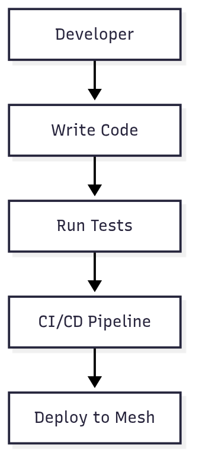

# Developer Guide

---

## Table of Contents
1. Overview
2. Extending GhostWire (Transports, Adapters, Modules)
3. Adding a Bridge Adapter
4. Extending AI Routing
5. API Reference & Hooks
6. Plugin System & Architecture
7. Testing & CI/CD
8. Visuals: Developer Flows
9. Best Practices & Anti-Patterns
10. Further Reading & Resources

---

## 1. Overview

This chapter is for developers who want to extend GhostWire, add new transports, adapters, modules, or contribute to the core. Both non-technical and technical readers will find step-by-step guides, API references, and best practices, with visuals.

---

## 2. Extending GhostWire (Transports, Adapters, Modules)

### Adding a New Transport
1. Implement the `Transport` trait in Rust.
2. Register your transport in the backend.
3. Add configuration options to the web UI/CLI.
4. Test with simulated and real devices.

### Adding a Protocol Adapter
1. Implement the `ProtocolAdapter` trait.
2. Handle message translation, deduplication, and relay.
3. Register the adapter in the backend.

### Adding a Security Module
1. Implement the relevant trait (e.g., `QuotaEnforcer`).
2. Register and configure in the backend.

---

## 3. Adding a Bridge Adapter

To add a new bridge adapter that connects GhostWire to an external protocol:

1. **Implement the `ProtocolAdapter` trait.** Define how your adapter sends, receives, and connects to the external network. See the Matrix adapter (`matrix-bridge` feature) and Meshtastic adapter (erasure coding) for reference implementations.
2. **Register the adapter via the adapter registry.** The registry is the single entry point for all adapters. Registering at startup ensures the adapter is initialized correctly and that dependencies are resolved before the backend starts serving traffic.
3. **Test both directions.** Verify that messages flow from GhostWire to the external network and from the external network back to GhostWire. Deduplication and translation must work in both directions.
4. **Add configuration options.** Add a `[adapters]` entry in the TOML config and expose toggles in the web UI.
5. **Test in isolation.** Use a simulated external network or a local test instance before deploying to a live mesh.

### Reference: Matrix Adapter
The Matrix adapter is implemented and enabled with the `matrix-bridge` feature flag. It provides basic bridging to Matrix rooms. Study its implementation for patterns on how to structure a new adapter.

### Reference: Meshtastic Adapter
The Meshtastic adapter is implemented with erasure coding (3 data + 2 parity shards, any 3 of 5 reconstruct). It fits messages into the 242-byte LoRa frame limit. This adapter demonstrates how to handle protocol-specific constraints within the `ProtocolAdapter` trait.

---

## 4. Extending AI Routing

The AI Routing Layer (see Architecture chapter) can be extended in two ways:

- **Routing classifier features:** The LightGBM per-message classifier accepts features such as `battery_level`, `transport_metrics`, `message_size`, and `destination_type`. To add a new feature, update the feature extraction module and retrain the classifier.
- **Energy-efficiency weights:** The Thompson Sampling transport selector uses energy-efficiency weights (BLE 0.30, LoRa 0.35, Reticulum 0.25, WiFi 0.05, TCP/QUIC 0). To add a new transport, add its weight to the configuration and update the sampling logic.

For deeper changes (new model architecture, new routing layer), see the AI Routing Layer section in the Architecture chapter.

---

## 5. API Reference & Hooks

- **REST API:**
    - `/api/nodes`: List nodes
    - `/api/messages`: Send/receive messages
    - `/api/transports`: Manage transports
    - `/api/adapters`: Manage adapters
- **WebSocket API:**
    - Real-time message and event updates
- **Hooks:**
    - Pre-send, post-receive, error handling

---

## 6. Plugin System & Architecture

- **Plugins:**
    - Add new features without modifying core code.
    - Register plugins via config or UI.
- **Architecture:**
    - Modular, with clear interfaces for each component.
    - See Developer Guide for trait definitions.

---

## 7. Testing & CI/CD

- **Unit tests:**
    - Write tests for each module and trait.
- **Integration tests:**
    - Test end-to-end flows (see test suite).
- **CI/CD:**
    - Use GitHub Actions for automated builds, tests, and deployments.
    - Linting, security checks, and code coverage included.

---

## 8. Visuals: Developer Flows

---

## 9. Best Practices & Anti-Patterns

### Best Practices
- Write clear, well-documented code.
- Test all changes before merging.
- Use modular design for easy extension.
- Follow code style and security guidelines.
- Test bridge adapters in both directions.
- Register all adapters through the adapter registry.

### Anti-Patterns
- Skipping tests or code review.
- Hardcoding secrets or credentials.
- Ignoring documentation.
- Registering adapters outside the registry.

---

## 10. Further Reading & Resources
- [GhostWire GitHub](https://github.com/phantomojo/GhostWire-secure-mesh-communication)
- [Rust Book](https://doc.rust-lang.org/book/)
- [GitHub Actions](https://docs.github.com/en/actions)

---

## End of Chapter
