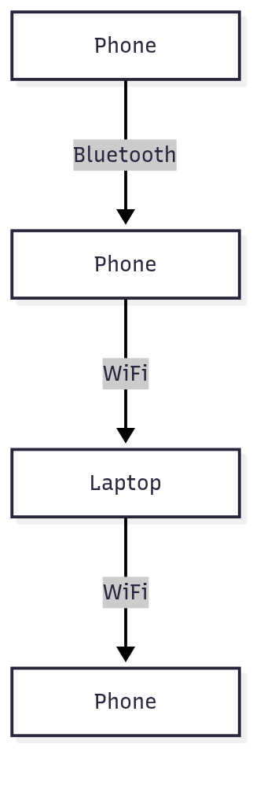
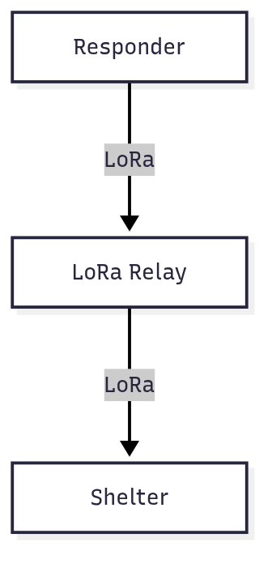
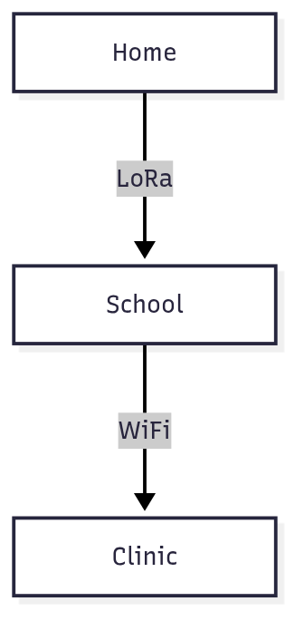
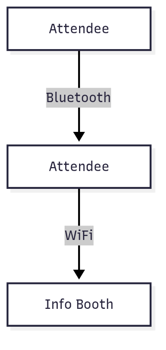
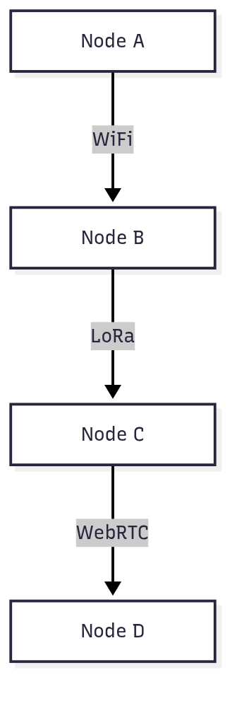

# Case Studies & Scenario Narratives

---

## Table of Contents
1. Overview
2. Hurricane Response Within 200km
3. Community Blackout
4. Rural Village Connectivity
5. Festival Mesh
6. Lessons Learned
7. Visuals: Scenario Topologies
8. Best Practices & Takeaways
9. Further Reading & Resources

---

## 1. Overview

This chapter presents illustrative deployment scenarios drawn from project materials. These are scenario narratives, not completed real-world rollouts. Each scenario shows how GhostWire could be deployed in a specific context, using the device hierarchy, transport options, and privacy tiers described in other chapters. The scenarios are designed to help planners understand how the system behaves under different conditions.

For context on the personas who would use these systems, see chapter 01b_who_ghostwire_serves.md. For the device hierarchy that governs role assignment, see chapter 15_device_hierarchy_and_scaling.md.

---

## 2. Hurricane Response Within 200km

**Scenario:** A hurricane has damaged infrastructure within a 200km radius. Cell towers are down, internet is unavailable, and first responders need to coordinate across a wide area.

**Hierarchy and deployment:**
- **Phones as leaf nodes:** First responders carry phones configured as leaf nodes. They send and receive messages but do not relay for others, conserving battery.
- **Laptops and Raspberry Pi as relays:** Field teams set up laptops and Raspberry Pi devices as relay nodes at staging areas. These devices forward messages between leaf nodes and extend the mesh reach.
- **Battery and solar LoRa relays:** LoRa relay nodes are deployed at key locations using battery and solar power. These relays provide long-range connectivity between staging areas that are out of WiFi Direct range.
- **Supernode election:** As the response matures, the team elects the most stable nodes (high uptime, stable power, good bandwidth) as supernode relay hubs. These hubs coordinate regional traffic and form the backbone of the emergency mesh.

**Transport mix (aspirational — this describes the target deployment, not today's build):** LoRa for long-range links between relay stations and WiFi Direct for short-range connections between nearby nodes are the intended transports for this scenario. **Neither is implemented yet** — today this case would run on stealth TCP and WebRTC over whatever internet is available, with Reticulum where amateur radio infrastructure exists. See [docs/BIBLE_STATUS_SPINE.md](../BIBLE_STATUS_SPINE.md) §4.

**Privacy tier:** Nodes operate at L2 (laptop/tablet tier) or L1 (phone tier) depending on battery. LoRa relays with solar power maintain L2. Phones on battery drop to L1.

**Lessons from this scenario:**
- LoRa relays are essential for bridging gaps beyond WiFi Direct range.
- Solar-powered relays maintain operation longer than battery-only nodes.
- Supernode election should happen early so the mesh has a stable backbone.

---

## 3. Community Blackout

**Scenario:** A city experiences a prolonged power outage. Residents need to coordinate, share information, and maintain communication without internet or cellular service.

**Hierarchy and deployment:**
- **Phones as leaf nodes:** Residents use phones as leaf nodes for messaging.
- **Laptops and Raspberry Pi as relays:** Community centers and key locations deploy laptops and Raspberry Pi devices as relays. These nodes form the mesh backbone.
- **Battery and solar LoRa relays:** Solar-powered LoRa relays are placed on rooftops and at community centers to provide neighborhood-wide coverage.
- **Supernode election for the blackout city:** The city-wide mesh elects relay hubs based on uptime and connectivity. Nodes with stable power (e.g., community centers with generators) become supernodes. Regional sharding divides the city into zones, each with its own relay hub, connected to a city-wide backbone.

**Transport mix:** WiFi Direct for neighborhood-level communication, LoRa for inter-neighborhood links, WebRTC for any node that regains partial internet access.

**Privacy tier:** Laptops and Raspberry Pi relays operate at L2. Phones operate at L1. Nodes on battery below 50% cut cover traffic by 30%.

**Lessons from this scenario:**
- Community centers with stable power naturally become supernodes.
- Regional sharding prevents a single point of failure from collapsing the entire mesh.
- Solar LoRa relays are critical for maintaining connectivity during extended outages.

---

## 4. Rural Village Connectivity

**Scenario:** A rural village with no internet access needs to share news, alerts, and educational content among homes, schools, and clinics.

**Hierarchy and deployment:**
- **Phones as leaf nodes:** Villagers use phones to send and receive messages.
- **Laptops and Raspberry Pi as relays:** A central location (school or clinic) hosts a laptop or Raspberry Pi as a relay node. This relay connects the village mesh.
- **Battery and solar LoRa relays:** LoRa relays connect homes to the central relay. Solar-powered relays are placed at the edges of the village to extend coverage.
- **Supernode election:** The central relay node (at the school or clinic) becomes the supernode. It maintains the DHT shard for the village and connects to any external meshes via LoRa or available internet.

**Transport mix:** LoRa for home-to-relay links, WiFi Direct for local connections within the central hub, Reticulum for any external mesh federation.

**Privacy tier:** Central relay operates at L3 (server tier) if powered continuously. Home nodes operate at L1. Solar relays maintain L2.

**Lessons from this scenario:**
- A single central relay can serve an entire village if placed strategically.
- Solar relays at the village edges extend coverage without running power lines.
- The school or clinic is a natural supernode location due to reliable power and community trust.

---

## 5. Festival Mesh

**Scenario:** A large festival with overloaded cell networks. Attendees need to form a local mesh for updates, safety alerts, and coordination.

**Hierarchy and deployment:**
- **Phones as leaf nodes:** Attendees use phones as leaf nodes.
- **Laptops and Raspberry Pi as relays:** Event organizers deploy laptops and Raspberry Pi devices at key points (entrance, stages, info booths) as relays.
- **Battery and solar LoRa relays:** LoRa relays are placed at high points to cover the festival grounds. Battery-powered relays are used where solar is not practical.
- **Supernode election:** The organizer nodes (laptops at the info booth and entrance) become supernodes. They coordinate traffic between zones and maintain the festival mesh backbone.

**Transport mix:** Bluetooth for very short-range peer-to-peer, WiFi Direct for local mesh connections, LoRa for ground-to-info-booth links, WebRTC disguised as video call for any internet-bound traffic.

**Privacy tier:** Attendee phones operate at L1. Organizer laptops operate at L2. LoRa relays operate at L2 if plugged in, L1 if battery-powered.

**Lessons from this scenario:**
- High-density events need relays at multiple points to avoid congestion.
- WebRTC traffic disguised as a video call avoids detection and blocking by event security.
- Bluetooth is useful for very short-range connections between nearby attendees.

---

## 6. Lessons Learned

- **Resilience:** Mesh networks keep working when infrastructure fails. The tiered hierarchy ensures that even if individual nodes fail, the mesh adapts.
- **Privacy:** End-to-end encryption protects users in hostile environments. Privacy tiers automatically adjust based on battery and device capability.
- **Flexibility:** Multiple transports and adapters enable diverse deployments. No single transport is required for the mesh to function.
- **Community:** Local knowledge and training are key to success. The right people in the right roles make the difference.
- **Hierarchy matters:** Assigning roles by device capability, not just availability, produces a more stable and efficient mesh.
- **Battery awareness:** Nodes that ignore battery state degrade the entire mesh. Energy-aware transport selection and privacy tier downgrades are essential.

---

## 7. Visuals: Scenario Topologies

---

## 8. Best Practices & Takeaways
- Train users before deployment.
- Test mesh in real-world conditions.
- Use multiple transports for coverage.
- Document lessons and share with the community.
- Assign roles by device capability.
- Monitor battery state and adjust privacy tiers accordingly.
- Elect supernodes early in any deployment.
- Plan for the tiered architecture from the start.
- Cross-reference the chapter on who GhostWire serves for persona-specific deployment guidance.
- Cross-reference chapter 15_device_hierarchy_and_scaling.md for the full device hierarchy specification.

---

## 9. Further Reading & Resources
- [Mesh Networking 101](https://en.wikipedia.org/wiki/Mesh_networking)
- [GhostWire Developer Guide](12_developer_guide.md)
- [GhostWire Target Users](01b_who_ghostwire_serves.md)
- [GhostWire Device Hierarchy and Scaling](15_device_hierarchy_and_scaling.md)

---

## End of Chapter
