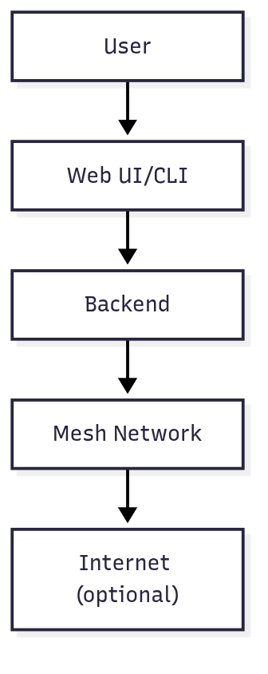

# Glossary & Reference

---

## Table of Contents

1. Glossary
2. Acronyms & Definitions
3. Quick Reference: Commands & Config
4. Troubleshooting Table
5. Visuals: Reference Flows
6. Cross-References
7. Further Reading & Resources

---

## 1. Glossary

| Term/Acronym | Meaning |
|--------------|---------|
| Mesh Network | A network where each device (node) relays data for others, creating a resilient web of connections. |
| Transport    | The method or technology used to send messages. Working today: stealth TCP, WebRTC, Reticulum. LoRa, WiFi Direct, and Bluetooth LE are designed but not implemented. |
| Protocol Adapter | Software that bridges GhostWire to other networks (Briar, Matrix, etc.). |
| Node         | Any device running GhostWire (phone, laptop, server, etc.). |
| Store & Forward | Technique where messages are cached and relayed when possible. |
| Sybil Attack | Attack where one entity pretends to be many nodes. |
| Quota        | Limit on messages or actions to prevent abuse. |
| Federation   | Connecting multiple meshes for wider reach. |
| Blacklist    | List of nodes blocked from the mesh. |
| QuotaEnforcer| Module that limits message rates. |
| KeyManager   | Module that manages encryption keys. |
| Supernode    | A node elected dynamically based on high uptime, stable IP, and significant bandwidth to act as a relay hub for the mesh. |
| Relay Hub    | A supernode that forwards messages between devices, carrying no trust authority over the data it relays. |
| Device Tier  | A classification of device based on available RAM, storage, and power, determining its role and capabilities in the mesh. |
| Roles (Full/Relay/Leaf/Sensor/Replicator) | Device roles in GhostWire: Full nodes do everything; Relay nodes forward messages; Leaf nodes send and receive only; Sensor nodes collect data; Replicator nodes store and replicate data. |
| Battery State | The current charge level of a device, which determines its allowed activity level in the mesh. |
| Privacy Tier (L0-L3) | A classification of privacy visibility. Servers operate at L3, laptops and tablets at L2, phones and Raspberry Pis at L1. Battery drops push a device one tier down. |
| Delay-Tolerant Networking (DTN) | A networking approach where messages are stored and forwarded when connectivity is intermittent or unavailable. |
| PRoPHET | A protocol for delay-tolerant routing that uses encounter history to make forwarding decisions. |
| Spray-and-Wait | A routing strategy where a message is sent to multiple nodes and the first to reach the destination wins. |
| LightGBM | A gradient boosting framework designed for per-message classification. Not present in the current build — no model file is in the repository and the layer is not called from routing decisions. |
| Gemma | A family of AI models used in GhostWire for analytical passes and network mapping, running on edge devices and relay laptops. |
| Graph Neural Network (GNN) | A neural network that operates on graph structures, used in GhostWire for routing decisions across the mesh. |
| ML-KEM-768   | A post-quantum key encapsulation mechanism providing quantum-resistant key exchange, measured at about 10.5 microseconds on x86_64 development hardware. |
| XChaCha20-Poly1305 | An authenticated encryption algorithm used for end-to-end message encryption in GhostWire. |
| Duress PIN   | A PIN that, when entered under coercion, switches the device to a decoy identity namespace. Implemented in the identity subsystem; not yet exposed through the API or controller layer. |
| Dead Man's Switch | A timer that fires when the user fails to check in within a set period, notifying trusted contacts. Automatic key wiping is not yet implemented. |
| Shamir Secret Sharing | A method to split a secret into parts, requiring a threshold number of parts to reconstruct, used for device recovery. |
| Decentralized Identifier (DID) | A self-owned identifier that does not depend on a central authority, used for device and user identity in GhostWire. |
| KERI        | A protocol for decentralized identifiers and verifiable events, planned for integration with GhostWire. |
| SPHINX       | A routing protocol that provides unlinkable replies, ensuring that the sender of a message cannot be identified by the recipient. |
| Unidirectional Reply Route (SURB) | A routing mechanism that allows a recipient to reply to a sender without revealing the sender's identity to the network. |
| Cover Traffic | Extra network traffic generated to obscure the patterns of real communication, making it harder to analyze who is talking to whom. |
| Erasure Coding | A method of encoding data into fragments with redundancy, allowing reconstruction from a subset of fragments (e.g., 3 of 5 shards). |
| Thompson Sampling | A bandit algorithm used for energy-aware transport selection, balancing exploration of new routes with exploitation of known good ones. |
| Traffic Armor  | A camouflage system that disguises GhostWire traffic and auto-switches transports when one is blocked. |
| Adapter Registry | A system that allows custom protocol bridges to register at startup, enabling pluggable bridge support. |
| Knowledge Ark | A distributed storage mechanism for preserving and sharing knowledge across the mesh. |
| DHT          | A distributed hash table used for peer-to-peer storage and lookup of model files and other data across the mesh. |

---

## 2. Acronyms & Definitions

- **E2EE:** End-to-End Encryption
- **UI:** User Interface
- **CLI:** Command-Line Interface
- **API:** Application Programming Interface
- **DoS:** Denial of Service
- **PoW:** Proof of Work
- **PoS:** Proof of Stake
- **LoRa:** Long Range (radio technology)
- **P2P:** Peer-to-Peer
- **PQC:** Post-Quantum Cryptography
- **DTN:** Delay-Tolerant Networking
- **DID:** Decentralized Identifier
- **KERI:** Key Event Receipt Infrastructure
- **SURB:** Unidirectional Reply Route
- **ZKP:** Zero-Knowledge Proof

---

## 3. Quick Reference: Commands & Config

### CLI Commands
```sh
ghostwire-cli start --transport wifi --mesh mymesh
ghostwire-cli send --to bob --message "Hello, Bob!"
ghostwire-cli nodes
```

### Config Example
```toml
[transports]
bluetooth = true
wifi = true
lora = false
webrtc = true
tcpip = true
stealth_tcp = false
```

---

## 4. Troubleshooting Table

| Problem                        | Solution                                      |
|-------------------------------|-----------------------------------------------|
| Can't find other nodes         | Check transport settings, try another method  |
| Messages not sending           | Ensure at least one transport is active       |
| Web UI won't load              | Check backend is running, try npm install     |
| LoRa not working               | Check hardware, drivers, and permissions      |
| Security warning               | Ensure you are using the latest version       |

---

## 5. Visuals: Reference Flows


---

## 6. Cross-References

- [Getting Started](02_getting_started.md)
- [Architecture Deep Dive](03_architecture.md)
- [Transports & Protocols](04_transports.md)
- [Security & Privacy](05_security.md)
- [Developer Guide](12_developer_guide.md)
- [Device Hierarchy & Power-Aware Scaling](15_device_hierarchy_and_scaling.md)
- [AI Routing & On-Device Intelligence](16_ai_routing_and_intelligence.md)
- [Who GhostWire Serves](01b_who_ghostwire_serves.md)

---

## 7. Further Reading & Resources

- [GhostWire GitHub](https://github.com/phantomojo/GhostWire-secure-mesh-communication)
- [Mesh Networking 101](https://en.wikipedia.org/wiki/Mesh_networking)

---

## End of Chapter
