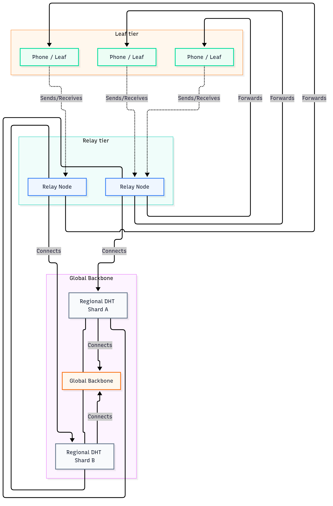

# 15. Device Hierarchy, Roles, and Scaling

---

## 1. Executive Summary

Not every device in a GhostWire mesh is the same. A phone has less memory and
battery than a laptop or a server. GhostWire organises devices into classes and
tiers so the network behaves predictably as it grows.

Two things are worth understanding before anything else, because both correct a
common misreading of this chapter in earlier revisions:

**A leaf device still relays.** "Leaf" is a *default assignment*, not a hard
capability limit. Every node forwards messages for others — the forwarding path
in `core/mesh.rs` has no role gate at all. What changes is willingness and
capacity, not permission. A phone that is the only node in range will relay
because nothing else can. That is the resilient case, not an exception to be
engineered around.

**The hierarchy also selects AI models.** Device class maps to a recommended
Gemma 4 model size (`DeviceClass::recommended_gemma4_model()` in
`core/ai/function_calling.rs`), so the same classification that governs relay
behaviour governs which model a device can run. Details in section 9.

---

## 2. Why a Hierarchy Exists

### Plain-Language Explanation

Think of a convoy. A motorcycle weaves between houses carrying messages for the
immediate neighbourhood. A truck carries supplies between neighbourhoods. The
motorcycle is quicker but carries less; the truck is slower but moves far more.

GhostWire works the same way. A phone is the motorcycle — always with you, always
connected, limited in what it can carry. A laptop or nearby server is the truck.
When a stronger machine is available it takes on more relay work. When a phone's
battery is low it prefers to hand that work to a nearby laptop — **and if there
is no nearby laptop, it keeps relaying anyway.**

### Technical Depth

A flat mesh is one where every device has an identical role. As the mesh grows,
every device must track every other, and the overhead outgrows the network. In
a fully-connected mesh of *n* nodes the edge count is *n(n-1)/2*: roughly 45
connections at 10 nodes, about 4,950 at 100, and about 499,500 at 1,000. No
consumer device sustains that.

GhostWire introduces tiers so devices at the top of the hierarchy hold more
connections and data, while devices at the bottom focus on sending and
receiving. This lets the network grow without collapsing under its own weight.

The principle from the project's scalability guidance: *assign key nodes with
good power and connectivity as relays, and use devices with more RAM/CPU for
relay duties.*

---

## 3. Device Classes

### Plain-Language Explanation

GhostWire sorts devices into five classes by available RAM, storage, and peer
capacity. A phone is limited because it also runs everything else and must
conserve battery. A server has no such constraint. Knowing the class tells you
what a device can reasonably be asked to do.

### Technical Depth

| Class | RAM threshold | Max peers | Storage |
|---|---|---|---|
| Phone | ≤6 GB | 20 | 1 GB |
| Tablet | ≤8 GB | 30 | 2 GB |
| Raspberry Pi | ≤4 GB | 15 | 500 MB |
| Laptop | ≤16 GB | 50 | 5 GB |
| Server | >16 GB | 100+ | 50 GB+ |

The classification is real and implemented. `DeviceClass` and
`detect_device_class()` live in `core/ai/function_calling.rs:808-841`, with
tests covering per-class model selection and Linux detection:

```rust
pub fn detect_device_class() -> DeviceClass {
    let total_ram_mb = get_total_ram_mb();
    if is_raspberry_pi() { return DeviceClass::RaspberryPi; }
    match total_ram_mb {
        0..=6144   => DeviceClass::Phone,
        6145..=8192 => DeviceClass::Tablet,
        8193..=16384 => DeviceClass::Laptop,
        _ => DeviceClass::Server,
    }
}
```

Raspberry Pi is checked before the RAM match, so a 4 GB Pi is classified as a Pi
rather than a phone. The authoritative source is
[`docs/DEVICE_TIERS.md`](../../ghostwire/docs/DEVICE_TIERS.md).

> **One caveat.** This classification currently drives **AI model selection**
> (section 9). It does **not** yet drive relay-role assignment — see section 4.

---

## 4. Node Roles — and What "Leaf" Actually Means

### Plain-Language Explanation

Five roles are described: Full, Relay, Leaf, Sensor, and Replicator. A leaf is a
device that mainly sends and receives its own messages. A relay forwards for
others. A full node stores the complete mesh state. A sensor publishes physical
data. A replicator keeps copies for recovery.

The important correction: **a leaf is a default, not a prohibition.**

### Technical Depth

| Role | Forwarding | Power | Storage | Dialable |
|---|---|---|---|---|
| Full | Full DHT + gossip | Always on | Full node store | Yes (listeners) |
| Relay | Core ports only | Low-current/solar | Warm tier | Yes (relay reservation) |
| Leaf | Primarily local, but **relays when no better peer is available** | Sleep-heavy | Minimal (own groups) | Outbound |
| Sensor | Local only | Ultra-low (duty cycle) | Read-only | No |
| Replicator | Forwards encrypted blocks | Always on | Full (cannot decrypt) | Yes |

**How forwarding actually works.** In `core/mesh.rs` the relay path is:

```rust
if !msg.is_broadcast()
    && msg.recipient != self.local_peer_id.to_string()
    && msg.hops < MAX_HOPS
{
    let mut forwarded = msg.clone();
    forwarded.hops += 1;
    // ... publish to the DM topic
}
```

The only conditions are *not for me*, *not a broadcast*, and *under the hop
limit*. There is no `is_leaf`, `can_relay`, or `role ==` check anywhere in
`src/`. **Every node relays.** A phone designated Leaf in a neighbourhood with
laptops will typically forward little, because gossipsub and the route selector
prefer better-suited peers — but that is emergent routing preference, not an
enforced restriction.

**This is the correct design for a resilient network.** In a blackout, the
assumption that a relay-class device exists is often false. If a leaf refused to
relay in that situation, the mesh would partition. Better to relay on a phone
for a short window than to have no path at all. Energy cost is real; connectivity
loss is worse.

**What is not yet implemented** is the *positive* side: there is no mechanism
that promotes a leaf to relay when the network needs it, nor one that demotes it
when battery is low. Role assignment is currently a documented design, not
runtime behaviour. The `DeviceTier` enum that does exist (`core/armor.rs:8-16` —
High/Medium/Low) adjusts traffic-shaping parameters, not roles:

| Tier | Devices | Packet size | Max padding | Chaff delay | Cover interval |
|---|---|---|---|---|---|
| High | Desktop, laptop on AC, server | 1024 | 512 | 200 ms | 5–15 s |
| Medium | Laptop on battery, modern phone | — | — | — | — |
| Low | IoT, old phone, constrained | — | — | — | fast cover |

---

## 5. Relay Authority

Relays and supernodes carry **no trust authority**. They route messages; they
cannot read, modify, or block them. End-to-end encryption means only the sender
and intended recipient can read a message. A relay is a postal worker carrying a
sealed letter — it cannot open it.

This holds regardless of how many relays participate, including the case where a
phone is the only node relaying.

---

## 6. The Mailbox Pattern

When a leaf device is off or out of range, an always-on node buffers messages
until it reconnects — a post-office box. The design follows the Briar project's
observation that *power-constrained nodes offload storage and forwarding to a
friend*.

In GhostWire the mailbox is a designated node holding messages for offline
devices, which the device pulls on reconnection. This is a design target; see the
status spine for implementation state.

---

## 7. Why a Flat Mesh Fails

See section 2 for the connection-count arithmetic. The project's own scalability
guidance states the problem directly: *"A flat mesh becomes unstable beyond a
certain density. We should introduce a tiered architecture."*

Staged targets from the scalability roadmap:

| Phase | Target | Approach |
|---|---|---|
| Current | 10–50 nodes | Flat mesh with DHT and gossipsub |
| V2.2 | 100–500 nodes | Protobuf and Kademlia DHT optimisation |
| V3.0 | 1,000+ nodes | Hierarchical supernodes, regional DHT sharding |
| V4.0 | 10,000+ nodes | Regional federation |

---

## 8. Supernodes and Relay Hubs

In larger deployments, Relay Hubs connect smaller clusters. Selection favours
nodes with high uptime, stable IP addresses, and sufficient bandwidth, and the
election is dynamic — if a hub goes offline, another is selected.

Regional DHT sharding splits the Kademlia DHT geographically so a device in one
city does not track every peer in another.



> Note: the diagram shows the *target* hierarchy. Supernode election and regional
> sharding are roadmap items, not current behaviour.

---

## 9. The Hardware Ladder — and the AI Model Ladder

### Plain-Language Explanation

The hardware ladder describes what class of device can participate. The model
ladder describes which AI model that device can run. Both are driven by the same
device classification, so a deployment's hardware decisions automatically
determine its intelligence budget.

### The Hardware Ladder

**Constrained microcontrollers (~$20 class).** An ESP32 has on the order of
148 KB of free RAM with WiFi and BLE active — far below what rust-libp2p needs
for a full node. The intended design is gateway-bridged: the device forms a
short-range mini-mesh (ESP-NOW or BLE) and bridges to the wider network over a
WiFi uplink, participating as a leaf or sensor rather than a full node. This
follows the Meshtastic bridge pattern and microfips' `no_std` handshakes.

> **Not implemented.** There is no ESP32 firmware in the repository, and the
> LoRa and BLE transports that such a node would use are not implemented. Treat
> this as an architectural direction.

**Raspberry Pi (~$100 class).** More memory, runs a fuller build. Serves as a
gateway for a neighbourhood or small deployment, can relay, store data, and act
as a mailbox.

**Server-class nodes.** The heaviest loads: supernode, relay hub, replicator,
full mesh state, backbone for large deployments.

### The Model Ladder

This part is **implemented and tested**. `DeviceClass::recommended_gemma4_model()`
maps each class to a model size — for example Laptop → `gemma4:26b`, Server →
`gemma4:31b` — with unit tests asserting the mapping
(`core/ai/function_calling.rs`, `test_device_model_selection`).

The reasoning is the same as the hardware ladder, applied to inference cost:

| Device class | Budget | Model expectation | Relay expectation |
|---|---|---|---|
| Server | Unlimited, always on | Largest model (e.g. `gemma4:31b`) | Full node, backbone |
| Laptop | Ample, intermittent | Large model (e.g. `gemma4:26b`) | Relay, full store |
| Tablet | Moderate | Mid-size model | Leaf or light relay |
| Phone | Constrained, battery | Small model, duty-cycled | Leaf by default, **relays when nothing else is available** |
| Raspberry Pi / constrained | Tight | Smallest viable model, or none | Relay for its segment |

**Two caveats, stated plainly.** First, the model *selection* logic exists and
is tested; the models themselves do not — no model file is present in the
repository, so nothing loads at runtime (chapter 16). Second, because no role
gating exists on forwarding (section 4), the "relay expectation" column describes
*design intent*. In practice any device may relay; capacity and routing
preference, not policy, determine how much.

---

## 10. Privacy Tiers by Device

### Plain-Language Explanation

Privacy tiers were designed to trade metadata exposure against practicality — a
plugged-in server can afford stronger cover traffic than a phone on 15% battery.

### Technical Depth

> **These tiers are documentation-only.** `PrivacyParams` and `PrivacyLevel`
> have **zero occurrences in `src/`.** The tables below are preserved because
> they document the intended design and the design source exists
> (`docs/PRIVACY_TIERS.md`), but nothing enforces them at runtime. The mechanism
> that *is* implemented is the `DeviceTier` (High/Medium/Low) in section 4, which
> adjusts cover traffic and padding rather than a five-level ladder.

| Level | Name | Latency | Cover traffic | Intended use |
|---|---|---|---|---|
| L0 | None | 0 ms | 0% | Debugging, trusted LAN |
| L1 | Low | 50 ms | 10% | Daily messaging |
| L2 | Medium | 150 ms | 30% | Sensitive communication |
| L3 | High | 500 ms | 50% | High-risk, censorship zones |

Intended defaults: Server L3, Laptop L2, Tablet L2, Phone L1, Raspberry Pi L1.
Intended battery rule: charging or above 50% means no change; 20–50% downgrades
one level; below 20% drops to L0/L1.

**The device also cannot read battery state today.** So the battery-driven tier
adjustment described in earlier revisions of this chapter does not happen, by
either route.

---

## 11. A Practical Worked Example

A community centre with four devices: a phone, a laptop, a Raspberry Pi, and a
server.

**Normal case.** The laptop relays, the Pi acts as a segment gateway, the server
holds full mesh state and connects outward, and the phone is primarily an
endpoint. This is the intended assignment.

**Resilience case — and this is the point.** The laptop goes home. The Pi's
uplink drops. Now the only node in range is the phone. The phone relays,
because `mesh.rs` has no role gate and nothing else can. Messages still flow
between whoever is present. When the laptop returns, routing prefers it again and
the phone's load drops.

**Model assignment.** The same classification picks models: the server would take
`gemma4:31b`, the laptop `gemma4:26b`, the phone a small duty-cycled model.

**Mailbox.** While the phone is away, a peer buffers messages for it; it pulls
them on return.

---

## 12. Best Practices and Anti-Patterns

- Use the tiered architecture; do not make every device do identical work.
- Assign relay roles to devices with stable power and connectivity.
- **Do not treat "leaf" as a safety guarantee.** If your only nearby node is a
  phone, it will relay. Design for that rather than assuming capacity you don't
  have.
- Size deployments against measured behaviour, not the tables in this chapter.
- Enable Android battery-optimisation exemptions on OEM devices (Samsung, Xiaomi,
  Transsion) — see [dontkillmyapp](https://dontkillmyapp.com/).
- Expect no external security audit yet. Cure53, NCC Group, and Least Authority
  have been identified as candidates; none has been engaged.

### Anti-Patterns

- Assuming a leaf device will refuse to relay, and relying on that for isolation.
- Expecting an ESP32 to perform full-node duties.
- Planning beyond current scale without measuring.
- Omitting battery-management exemptions on OEM Android devices.
- Assuming relays can read or censor message content — they cannot.
- Assuming an external audit has been performed.

---

## 13. Glossary

- **Device Class** — RAM-based classification: Phone, Tablet, Raspberry Pi, Laptop, Server. Implemented in `core/ai/function_calling.rs`.
- **DeviceTier** — High/Medium/Low, adjusts cover traffic and padding. Implemented in `core/armor.rs`. Distinct from the unimplemented privacy tiers.
- **Relay Hub / Supernode** — high-uptime node connecting mesh segments. Roadmap.
- **Mailbox Pattern** — an always-on peer buffers messages for an offline device.
- **Privacy Tier** — intended L0–L3 metadata ladder. **Documentation-only.**
- **Regional DHT Sharding** — geographic partitioning of the DHT for scale. Roadmap.
- **Gateway-Bridged Architecture** — constrained device joins via a short-range mini-mesh and a WiFi uplink. Design, not implemented.
- **Model Ladder** — device class to AI model size. Selection logic implemented and tested; models themselves absent.
- **Trust Authority** — ability to read, modify, or block messages. Relays have none.
- **Cover Traffic** — padding messages obscuring the timing and size of real ones.
- **Supernode Election** — dynamic selection of Relay Hubs by uptime, address stability, and bandwidth. Roadmap.

---

## 14. Further Reading

- [Project Overview](01_project_overview.md)
- [Performance & Scaling](11_performance_scaling.md)
- [Architecture Deep Dive](03_architecture.md)
- [AI Routing & Intelligence](16_ai_routing_and_intelligence.md)
- [Capability Status Spine](../BIBLE_STATUS_SPINE.md)
- [Device Tiers Guide](../../ghostwire/docs/DEVICE_TIERS.md)
- [Privacy Tiers Guide](../../ghostwire/docs/PRIVACY_TIERS.md) — design source
- [dontkillmyapp](https://dontkillmyapp.com/)

---

## End of Chapter
