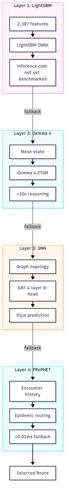

# 16. AI Routing and Intelligence

---

## Table of Contents

1. Executive Summary
2. The Four-Layer AI Routing Stack
3. Layer 1: LightGBM Per-Message Classifier
4. Layer 2: Gemma 4 Edge Model
5. Layer 3: Graph Neural Network (GNN)
6. Layer 4: PRoPHET Delay-Tolerant Routing
7. Model Ladder per Hardware
8. Model Update Flow and Training Pipeline
9. Thompson Sampling Transport Selection
10. Privacy and Local AI Decisions
11. Knowledge Ark and Anomaly Detection
12. Worked Example: A Message's Journey
13. Future Scopes
14. End of Chapter

---

## 1. Executive Summary

GhostWire does not rely on a central server to decide where your messages go. Instead, every device runs a four-layer AI routing stack locally. The stack reads the mesh network, predicts the best path, and adapts in real time. A lightweight model makes the fastest decisions. A larger model provides deeper analysis when needed. A graph neural network optimizes across the whole topology. And a battle-tested delay-tolerant protocol stands ready as the final fallback.

All of this happens on your own device. No cloud AI dependency. No external server making routing choices for you. Your data stays on your machine, and any telemetry shared upward is strictly opt-in and anonymized.

This chapter walks through each layer, the hardware each model runs on, how models get updated, how transport selection works, and what the future holds.

---

## 2. The Four-Layer AI Routing Stack

The AI routing design is a cascading fallback chain. Each layer is intended to handle a different kind of decision, with the next layer taking over when one is unavailable.

> **Current build status, verified 2026-09-28:** in the shipped configuration **only Layer 4 (PRoPHET) is active**. No model files are present in the repository — there are no `.onnx` artifacts anywhere in the tree — so Layers 1 and 3 both fail to load and resolve to `None` via silent `tracing::debug!` fallbacks (`core/mod.rs:781-806`) that are invisible at default log level. Layer 1 is additionally not called from routing decisions at all. Layer 2 requires a local Ollama instance.
>
> The chain below describes the **architecture being built**, not the behaviour of the current binary. Routing works today via PRoPHET and the gossipsub mesh. See [docs/BIBLE_STATUS_SPINE.md](../BIBLE_STATUS_SPINE.md) §5.

### Why the model layers come last

This ordering is deliberate, not unfinished work. A routing classifier is only
as good as the telemetry it was trained on, and GhostWire does not yet have that
telemetry: there are no deployed nodes producing sustained, representative mesh
traffic. Training on synthetic or lab-scale data would produce a model that
fails on the first real deployment — a worse outcome than honest PRoPHET, because
it would fail silently.

The dependency runs the other way. A working mesh generates the data, and the
data enables the model. So the sequence is: **get the core protocol into
production, let the network grow gradually, accumulate genuine multi-node
telemetry, and only then train Layer 1 and Layer 3.** PRoPHET is a principled
formula rather than a learned one, which is exactly why it is the right default
for a network that does not yet have the data to justify a model.

Shipping a model layer before the network is the mistake this sequencing avoids.

The arrows above show the intended fallback direction. Layer 1 is designed as the fast path; if it fails the system drops to Layer 2, and if Layer 2 fails, Layer 3 takes over. Layer 4 requires no model file, which makes it the only layer that is genuinely always available — and, in the current build, the only one that is actually running.

---

## 3. Layer 1: LightGBM Per-Message Classifier

### Plain-Language

Layer 1 is the fastest decision-maker in the stack. It looks at 2,387 features about the mesh network and outputs a delivery probability score in under a millisecond. Think of it as the reflex system: it reacts instantly, before you even think about the problem.

The model was trained on real data from the GuifiSants mesh network in Catalonia. That means it has seen how actual nodes behave, not just how simulated nodes behave. The training set included 7,931 samples across 63 nodes over 31 days.

### Technical Depth

The model is a LightGBM gradient boosting decision tree ensemble exported to ONNX format. It takes a single 2,387-dimensional feature vector and outputs a score between 0.0 and 1.0 representing the predicted probability of successful delivery.

| Property | Value |
|----------|-------|
| **Algorithm** | LightGBM (Gradient Boosting Decision Trees) |
| **Format** | ONNX (Open Neural Network Exchange) |
| **Input dimensions** | 2,387 features |
| **Output** | Delivery probability score (0.0 to 1.0) |
| **Inference time** | Not yet measured — no model file is present in the repository |
| **Model size** | ~2-5 MB |

The feature vector is built from seven categories:

| Category | Feature Count | Examples |
|----------|--------------|----------|
| Link quality | 256 | SNR, RSSI, packet loss rate, retransmission count |
| Latency | 128 | RTT, jitter, one-way delay, queue depth |
| Node health | 64 | Uptime, CPU usage, memory usage, buffer occupancy |
| Topology | 512 | Degree, betweenness centrality, clustering coefficient |
| Temporal | 256 | Hour of day, day of week, season, activity patterns |
| Geographic | 128 | Distance, elevation, line-of-sight probability |
| Historical | 512 | Rolling averages over 1h, 6h, 24h, 7d |
| Derived | 531 | Interaction terms, polynomial features, lag features |

Missing features are filled with the median value from the training distribution. If more than 30% of features are missing, Layer 1 is considered unavailable and the system falls back to Layer 2.

---

## 4. Layer 2: Gemma 4 Edge Model

### Plain-Language

When the fast path is not enough, the system turns to Gemma 4. This is a language model that actually understands mesh topology. It reads the network state, thinks about the options, and gives a reasoned recommendation. It runs every 30 seconds on a schedule, not on every single message, because it is slower and more expensive than Layer 1.

The model runs entirely on your device through Ollama or LiteRT. No data leaves your machine. The model is quantized to 4-bit precision (Q4_K_M) to keep it small enough for edge hardware.

### Technical Depth

| Property | Value |
|----------|-------|
| **Model** | Gemma 4 (270M parameter variant) |
| **Context window** | 32,768 tokens |
| **Runtime** | Ollama or LiteRT |
| **Quantization** | Q4_K_M (4-bit, ~150 MB) |
| **Inference time** | ~30 seconds |
| **Hardware minimum** | 4 GB RAM |

The prompt given to Gemma 4 includes the full network state: available peers, link qualities, recent delivery rates, current time, message priority, and TTL. The model returns a route as an ordered list of peer IDs, a confidence score, and a text explanation.

On devices with less than 4 GB of RAM, Layer 2 is skipped entirely and the system falls straight to Layer 3.

---

## 5. Layer 3: Graph Neural Network (GNN)

### Plain-Language

Layer 3 looks at the mesh as a graph. Every node is a point. Every connection between nodes is a line. The neural network learns patterns across this graph structure to predict which paths will work best. It is fast and precise, running in under a hundred microseconds.

### Technical Depth

| Property | Value |
|----------|-------|
| **Architecture** | Graph Attention Network (GAT) |
| **Layers** | 4 GAT layers |
| **Attention heads** | 8 heads per layer |
| **Format** | ONNX |
| **Inference time** | 91μs (ONNX Runtime, CPU) |

The mesh network is represented as a graph G = (V, E). Nodes are active peers. Edges are active communication links. Each node has features like uptime, buffer usage, average latency, packet loss rate, trust score, geographic coordinates, and transport capacity. Each edge has features like link quality, round-trip time, bandwidth, and how recently the peers were seen.

The GAT layers compute attention-weighted messages. Each node pays attention to its neighbors, weighting their importance based on learned patterns. Eight attention heads run in parallel, and their results are concatenated. The output is a delivery probability score for each candidate route.

---

## 6. Layer 4: PRoPHET Delay-Tolerant Routing

### Plain-Language

Layer 4 is the oldest and most reliable layer. It does not need any AI model. It does not need any model file at all. It uses a simple formula based on how often nodes have met each other. If node A has met node B many times, and node B has met node C many times, then A has a good chance of reaching C through B. This is called transitivity.

PRoPHET is always on. It is the safety net that catches every message when all the AI layers fail.

### Technical Depth

| Property | Value |
|----------|-------|
| **Protocol** | PRoPHET v2 (epidemic routing) |
| **Delivery predictability update** | P(a,b) = P_old + (1 - P_old) × P_init |
| **Time decay** | γ = 0.98 per hour |
| **Transitivity weight** | β = 0.25 |
| **Initial predictability** | P_init = 0.75 |

When node A encounters node B, the predictability P(a,b) increases. Over time, if they do not meet, the predictability decays. When A meets B, A also learns about everyone B has met, and updates its predictability to those nodes through transitivity.

The routing decision is simple: forward the message to the neighbor with the highest predicted chance of reaching the destination. Ties are broken by buffer usage, recency of encounter, and finally by a deterministic hash of the bundle ID.

PRoPHET works alongside Spray-and-Wait for initial distribution. Spray-and-Wait sends up to a configurable number of copies (default 3, maximum 10) to encountered peers, then waits for one of them to reach the destination. GhostWire uses predictive spray by default, which combines Spray-and-Wait with PRoPHET predictability scores.

SyncBloom is a 1024-bit probabilistic data structure used for bundle deduplication during peer synchronization. When two peers meet, they exchange SyncBlooms to discover which bundles the other is missing, without revealing bundle contents.

---

## 7. Model Ladder per Hardware

Different hardware gets different sized models. A tiny phone runs a small model. A powerful server runs a large model. The ladder ensures every device uses the best model its hardware can handle.

| Model Variant | Hardware | RAM/VRAM | Latency |
|---------------|----------|----------|---------|
| Gemma 4 E2B | Edge devices, phones, Raspberry Pi | 8 GB RAM | ~100ms |
| Gemma 4 E4B | Relay laptops | 10 GB VRAM | ~50ms |
| Gemma 4 26B MoE | Coordinator nodes | 20 GB RAM | ~80ms |
| Gemma 4 31B | Central servers | 24 GB VRAM | ~120ms |

The E2B variant is the smallest at 2 billion parameters. It runs on 8 GB of RAM and is ideal for Raspberry Pi mesh nodes and phones. The E4B variant at 4 billion parameters targets relay laptops with mid-range GPUs. The 26B MoE (Mixture of Experts) model activates only 4 billion parameters at a time, giving flagship quality at edge speeds. The 31B dense model runs on central servers with the most powerful GPUs.

All models run through Ollama or LiteRT on the device. LiteRT provides native on-device inference without requiring Ollama. The models are downloaded once and cached locally.

---

## 8. Model Update Flow and Training Pipeline

### Plain-Language

Models get smarter over time, but they do not learn from your private data. Here is how it works: participating nodes (only if you opt in) send anonymized telemetry summaries upward. Those summaries go to training machines. The training machines use the data to build better models. The finished model files are then distributed back down to your device. Your raw data never leaves your machine. No gradients are ever shared. This is not federated learning.

### Technical Depth

The model update pipeline follows these steps:

1. Collect telemetry from participating nodes (opt-in only)
2. Preprocess: normalize, handle missing values, feature engineering
3. Train LightGBM on labeled data (delivery success or failure)
4. Export to ONNX format
5. Train GNN on graph-structured data
6. Export to ONNX format
7. Publish model hashes to the DHT
8. Distribute via peer-to-peer sync

Model verification is strict. Before loading a new model, the system computes a BLAKE3 hash of the model file and compares it against the expected hash published by the GhostWire maintainers. If the hash does not match, the model is rejected and a warning is logged.

The key distinction: this is not federated learning. No gradients are aggregated across nodes. Raw training data never leaves a node. Only an opt-in telemetry summary goes up, and only finished model files come down. The model files are distributed through DHT hash publication, where peers verify against known-good hashes, plus peer-to-peer sync. In-app updates check for new models weekly.

---

## 9. Thompson Sampling Transport Selection

### Plain-Language

Once a route is chosen, the system still needs to pick the physical transport. This is done with Thompson Sampling, a method that balances exploration (trying new transports) with exploitation (sticking with what works). Each transport has an energy efficiency weight that reflects how much battery it drains. The weights cover transports that are not all implemented — the selector can rank an unavailable transport, so a weight is not evidence of support. See the status spine §4 for which transports actually exist.

### Technical Depth

The transport selector uses a `TransportMetrics` struct with fields for signal strength, throughput, packet loss, latency, energy efficiency, congestion, and reliability. Each transport type has a weight profile that encodes design intent. The energy efficiency weights are:

| Transport | Energy Efficiency Weight |
|-----------|------------------------|
| BLE | 0.30 |
| LoRa | 0.35 |
| Reticulum | 0.25 |
| WiFi | 0.05 |
| TCP/QUIC | 0.0 |

BLE and LoRa score highest on energy efficiency because they are designed for low-power communication. WiFi uses moderate energy. TCP/QUIC scores zero because it assumes a powered, connected device.

The scoring blends a weighted sum of normalized metrics (70%) with Thompson Sampling exploration (30%). A Beta distribution posterior tracks each transport's success rate in each context (battery tier, signal tier, congestion tier). Hysteresis prevents rapid switching: a new transport must beat the current one by at least 0.1 score points, and a 30-second cooldown applies between switches.

Black-hole detection monitors each transport's success rate. If a transport fails too many times in a sliding window, it is blocked until a success resets the detector.

---

## 10. Privacy and Local AI Decisions

### Plain-Language

Every AI decision in GhostWire happens on your device. The models run locally. The routing choices are made locally. No cloud server sees your network state, your message content, or your routing decisions.

Telemetry is strictly opt-in. If you choose to participate, only anonymized summary statistics leave your device. Node IDs are hashed before export. No personally identifiable information is included in any training data.

There is no cloud AI dependency for core routing. The system works entirely offline. If you are in a remote area with no internet connection, the AI routing still functions because every layer runs on your own hardware.

---

## 11. Knowledge Ark and Anomaly Detection

### Plain-Language

Beyond routing, GhostWire has a knowledge layer called the Knowledge Ark. Every node can store notes, articles, code snippets, and references. These entries replicate across trusted peers through the DHT. The Knowledge Ark is content-addressed, meaning every entry has a unique hash that verifies its integrity.

Anomaly detection runs alongside the routing stack. An Isolation Forest model monitors mesh network traffic and flags unusual patterns. This is the early warning system: if a node is degrading or behaving strangely, the anomaly detector catches it before it causes routing problems.

### Technical Depth

The Knowledge Ark (`knowledge_ark.rs`) manages collections of entries. Each entry has a title, body, kind (note, article, code, reference, dataset, media clip, question, or answer), access level (public, trusted, shared, or private), and content-addressed ID computed as a BLAKE3 hash. Entries are stored in a local sled tree for search and retrieval. Full-text search indexes words across titles and bodies.

The Isolation Forest model (`anomaly_detector.rs`) is an ensemble of decision trees. Each tree partitions the feature space randomly. Anomalies have shorter average path lengths through the trees. The model loads from a JSON file and computes an anomaly score for each feature vector. A positive score means normal; a negative score means anomalous. The model uses 200 trees across 39 features.

---

## 12. Worked Example: A Message's Journey

### Plain-Language

Imagine you are on your phone, sending a message to a friend who is two neighborhoods away. Your phone has a nearby laptop acting as a relay. Here is what happens, step by step, as your message passes through all four AI layers.

### Technical Depth

**Step 1: Layer 1 (LightGBM) — illustrative, not current behaviour**

*The trace below illustrates the intended design. In the current build there is no model file, so Layer 1 does not execute and the walkthrough does not occur — see the status note in section 2.*

Your phone extracts 2,387 features from the mesh telemetry. The feature vector includes your phone's RSSI (-45 dBm), the laptop relay's latency (18 ms), packet loss (2%), and the trust score of the relay peer (0.9). A trained LightGBM ONNX model would process this vector and output a delivery probability. Layer 1 would then succeed, giving the system a candidate route through the laptop relay. Inference cost has not yet been benchmarked.

**Step 2: Layer 2 (Gemma 4, ~30 seconds)**

On a 30-second schedule, the Gemma 4 model runs a deeper analysis. The prompt includes the full network state: your phone, the laptop relay, three other nearby peers, their link qualities, and the destination's last-seen timestamp. Gemma 4 returns a route through the laptop relay with a confidence score of 0.91 and a text explanation noting that the relay has the strongest link quality and lowest latency to the destination.

**Step 3: Layer 3 (GNN, 91μs)**

The Graph Attention Network constructs the mesh as a graph. Your phone is a node. The laptop relay is a connected node. The destination is a distant node. The GAT layers compute attention weights across the graph. The GNN outputs a delivery probability of 0.93 for the route through the laptop relay, confirming Layer 1 and Layer 2.

**Step 4: Layer 4 (PRoPHET, <0.01ms)**

Even though Layers 1 through 3 all agreed, Layer 4 runs its PRoPHET formula as a safety check. The delivery predictability from your phone to the laptop relay is 0.88 (based on recent encounter history). The predictability from the laptop relay to the destination is 0.82. The transitivity boost gives a combined predictability of 0.85. Layer 4 confirms the route.

**Transport Selection**

The transport selector runs Thompson Sampling. Your phone has BLE and WiFi available. The energy efficiency weights favor BLE (0.30) over WiFi (0.05). The Thompson Sampling posterior for BLE in the current context (high battery, strong signal, low congestion) returns a score of 0.82. WiFi returns 0.71. BLE wins. The message is sent over Bluetooth Low Energy to the nearby laptop relay.

**The Relay Forward**

The laptop relay receives the bundle over BLE. It runs its own four-layer stack. Its Gemma 4 E4B model (4 billion parameters, 10 GB VRAM) analyzes the mesh. Its GNN confirms the next hop toward the destination. It forwards the bundle over WiFi or LoRa, depending on the transport selector's decision at that moment.

**Bundle Details**

The bundle contains the encrypted payload (XChaCha20-Poly1305), a 32-byte BLAKE3 bundle ID, a TTL of 12 hours (Normal priority), a SyncBloom for deduplication, and the previous hop list for PRoPHET state updates. If the laptop relay loses connectivity, the bundle sits in its 50 MB buffer until the next encounter.

---

## 13. Future Scopes

### Plain-Language

GhostWire has four major directions for the future. Each one pushes the system further toward a truly resilient, private, and accessible mesh network.

### Technical Depth

**Nucleus ESP32:** The goal is to shrink GhostWire to run on $1.00 microcontrollers like the ESP32 and STM32. The current system needs about 50 MB of RAM. The Nucleus proposal strips `libp2p` and `tokio` in favor of `no_std` alternatives like `embassy` and `smol`. A minimal Gossip Light protocol would run on low-power radio links. A bridge would connect Nucleus nodes (sensors, IoT devices) to Core nodes (hubs, servers). This would make GhostWire the global standard for $10 off-grid mesh devices.

**Sovereign Persona ZKP:** Identity would move beyond simple keys to rich, decentralized profiles. Decentralized Identifiers (DIDs) would follow W3C standards. Zero-Knowledge Proofs would allow attribute verification without revealing identity, such as proving you are a verified rescue worker without disclosing your name. Social recovery mechanisms would let a quorum of trusted peers help restore a lost identity.

**Recursive DHT:** The DHT would scale from 100 nodes to 100,000+ nodes. S/Kademlia hardening would protect against Sybil and Eclipse attacks. Hierarchical sharding would divide the global mesh into regional shards to reduce routing table bloat on mobile devices. Supernode orchestration would dynamically promote high-uptime, high-bandwidth nodes to act as regional gateways.

**PQC Armor:** Post-quantum cryptography would protect GhostWire traffic against future quantum computer decryption. Hybrid ML-KEM (Kyber, NIST standard) would integrate alongside X25519. PQ-Signatures would transition identity signing from Ed25519 to Dilithium (ML-DSA). Algorithm agility would let nodes step down to legacy crypto only if the peer does not support PQC.

---

## 14. End of Chapter

---

## End of Chapter
