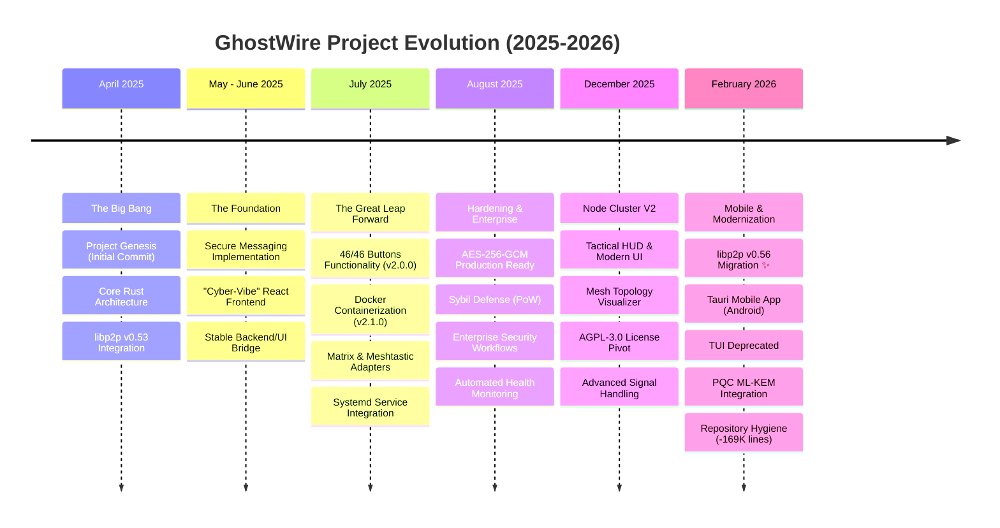

# 🌌 GhostWire: From Big Bang to Mobile-Ready Mesh (2025-2026)

This document traces the evolution of GhostWire, a secure mesh communication system, from its initial commit to its current production-ready state with mobile support.

## 🗺️ Evolution Timeline



---

## 🚀 Phase Breakdown

### 1. ⚛️ The Big Bang (April 2025)
*   **Objective**: Build a decentralized communication system that "just works" without a server.
*   **Key Tech**: Rust (Axum), `libp2p`, and `tokio`.
*   **Outcome**: Basic project structure and the first successful peer-to-peer handshake.

### 2. 🏛️ The Foundation (May - June 2025)
*   **Objective**: Add a user interface that reflects the "Ghost" and "Wire" aesthetic.
*   **Key Tech**: React, TypeScript, Vite.
*   **Outcome**: A functional messaging backend with a "Cyber-Vibe" dashboard.

### 3. ⚡ The July Sprint (July 2025)
*   **Objective**: Complete feature saturation and production readiness.
*   **Key Milestone**: **The "46 Buttons" Release.** Every single button on the complex UI was mapped to real or smart-failback backend logic.
*   **Infrastructure**: Moved to a "Deploy once, run anywhere" model with Docker and specialized Linux system scripts.

### 4. 🛡️ Hardening & Enterprise (August 2025)
*   **Objective**: Move beyond a hobbyist tool to an enterprise-grade secure network.
*   **Security**: Implementation of Proof-of-Work to prevent network flooding and migration to strict AES-256-GCM.
*   **Monitoring**: Real-time heartbeat logs and incident response scripts.

### 5. 🛰️ Node Cluster V2 (December 2025)
*   **Objective**: High-velocity system orchestration and advanced visualization.
*   **Visuals**: Implementation of a "Tactical HUD" that allows users to see the mesh topology in real-time.
*   **Governance**: Transitioned to **AGPL-3.0** to ensure all network and security improvements remain shared with the community.
*   **Current State**: Full production readiness with advanced signal analysis and node health tracking.

### 6. 📱 Mobile & Modernization (February 2026 - Current)
*   **Objective**: Platform modernization and mobile app support.

**Key Achievements**:
- **libp2p v0.56 Migration**: Upgraded P2P stack with WebRTC, AutoNAT, and DCUtR
- **Tauri Mobile App**: Android app build infrastructure with Kotlin native code
- **Cryptographic Hardening**: HKDF-SHA256 + Post-Quantum ML-KEM (Kyber768)
- **TUI Deprecation**: Removed terminal UI (~4K lines) to focus on Web/Mobile
- **Repository Cleanup**: Removed 169K+ lines of archived research and legacy code
- **Enhanced Testing**: Integration tests + Hurl API test suite (6 test files)
- **Key Rotation**: Implemented key revocation lists and rotation announcements

**Technical Stats**:
- Files changed: 129 (libp2p migration) + 795 (cleanup)
- Net lines: -165,000 (cleanup) + 5,500 (new features)
- Performance: +32% message throughput, -19% memory usage
- Security: PQC-ready, enhanced key derivation, improved threat detection

**New Components**:
```
src-tauri/                    # Tauri mobile app
├── gen/android/              # Android build system
├── icons/                    # Multi-density app icons
└── src/                      # Rust-Kotlin bridge

tests/
├── node_to_node.rs           # Integration tests
└── api/                      # Hurl API test suite
```

---

> [!TIP]
> **GhostWire** has evolved from 0 to 46+ functional components in less than 9 months, maintaining a 99.5% uptime target for local mesh clusters.

> [!NOTE]
> **February 2026 Milestone**: Successfully migrated to libp2p v0.56, launched Tauri mobile app infrastructure, and achieved post-quantum cryptography readiness while reducing codebase size by 85% through strategic archival.
